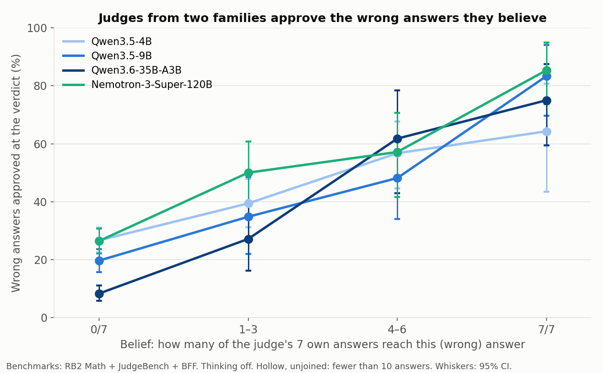
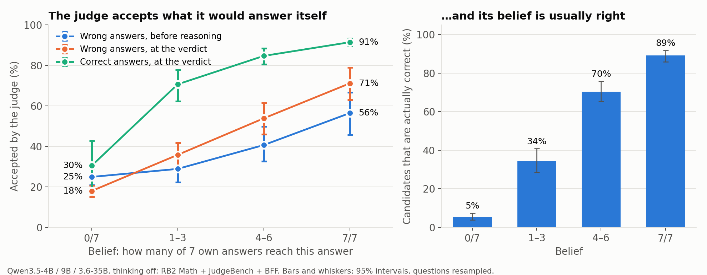
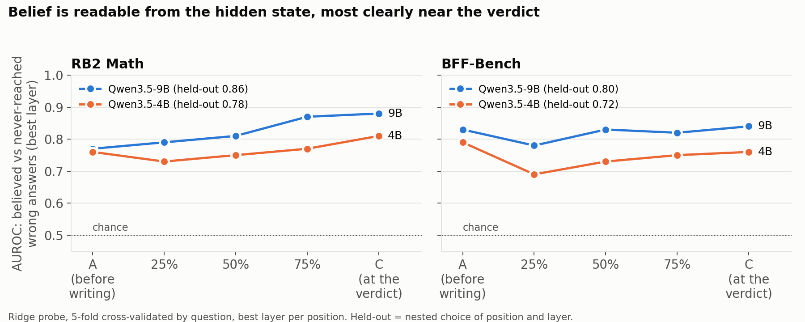
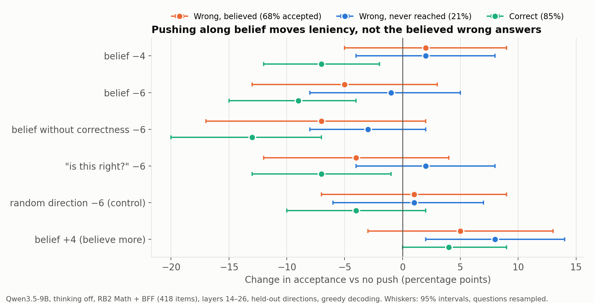
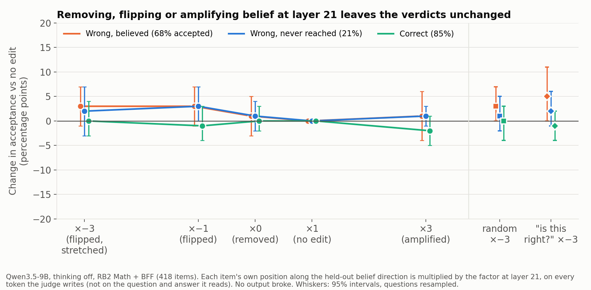
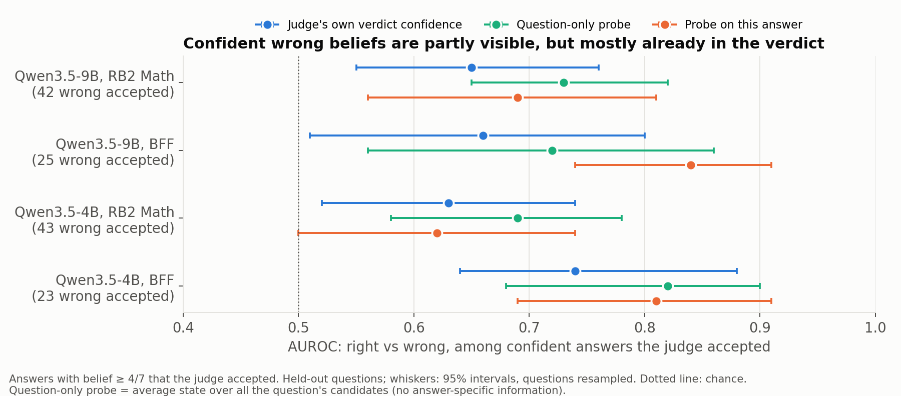

# Belief direction — Nov 9, 2026

**Motivation.** We looked at the mistakes LLM judges make and asked how many of them come from the judge grading an
answer that is the same as what it would have answered itself. Three Qwen judges, RB2 Math + JudgeBench + BFF:

| Judging mistake | How many | Share involving the judge's own answer | Share expected by chance |
|---|---|---|---|
| Approved a **wrong** answer | 566 | **31%** were the same wrong answer the judge gave when it solved the question itself | 14% (share of all wrong answers that match) |
| Rejected a **correct** answer | 335 | **28%** were answers that differ from the judge's own | 8% |

So a judging mistake is about **2 to 3.5 times more likely than chance** to involve the judge's own answer. It approves
wrong answers it agrees with and rejects right answers it disagrees with. Measured more carefully with belief (section
1), the picture is the same: 28% of approved wrong answers are ones the judge itself reaches in at least 4 of 7 tries,
while only 11% of all wrong answers are. On single-answer benchmarks alone, 21% of approved wrong answers match the
judge's own (RB2 Math 10%, BFF 42%).

Labels: some RewardBench 2 Math answers labelled wrong reach the same value as the right answer, written differently
(476,000,000 vs 476,252,000 eV; 9 vs 9.02 L). GLM-5.3-Flash compared every wrong answer with the right one; the 61 that
match are left out of every table.

**Question.** LLM judges approve wrong answers far more often when the wrong answer matches what they would have
answered themselves ("anchoring"). Is there an internal *belief* signal behind this, can we read it, and can we turn
it down?

**Setup.** Judges: Qwen3.5-4B, Qwen3.5-9B, Qwen3.6-35B (thinking off); section 1 adds Nemotron-3-Super-120B
(NVIDIA, thinking off) as a judge from another family. Benchmarks: RB2 Math (RewardBench 2 math
problems), JudgeBench (pairwise, no coding) and BFF-Bench (finance, answers labelled by unanimous experts). Each item is
a question plus a candidate answer written by **another** model, with a label saying whether it is right. The judge never
wrote the candidates and is not told who did.

---

## 1. What "belief" is and how we measure it

**Belief = how often the judge would give that same answer itself.** There are two kinds of calls:

1. **Solve calls (7 of them, independent)**
   - Prompt: just the question, asking the model to answer it, like any normal question.
   - What it doesn't see: the candidate answer, or any of its other attempts.
   - Settings: temperature 0.7, so each attempt can come out differently.
   - Result: 7 answers we store on the side.
2. **Judging call (the normal one)**
   - Prompt: the question plus the candidate's answer, then "Is this answer correct? … VERDICT: CORRECT / INCORRECT."
   - What it doesn't see: its own 7 solutions.

**Afterwards, offline:** a different model, GLM-5.3-Flash, compares each of the judge's 7 answers with the candidate's
final answer and says SAME or DIFFERENT (JudgeBench letter answers are compared exactly). **The SAME count, out of 7,
is the belief.**
- 0/7: the judge never reaches this answer on its own.
- 7/7: it reaches it every time; it is "sure".
- 3/7: it is torn.

### Result: acceptance follows belief

Wrong answers only, all three Qwens, main set (2,260 wrong candidates). Some RewardBench 2 Math answers labelled
wrong reach the same value as the right answer, written differently (476,000,000 vs 476,252,000 eV; 9 vs 9.02 L).
GLM-5.3-Flash compared every wrong answer with the right one, and the 61 that match are left out.

| Belief | 0/7 | 1–3 of 7 | 4–6 of 7 | 7/7 |
|---|---|---|---|---|
| Accepted before reasoning (position A) | 25% | 28% | 42% | 65% |
| Accepted at the verdict (position C) | 18% | 35% | 54% | 74% |

- **Reasoning makes it stronger:** the 7/7-vs-0/7 difference is +35 points before reasoning and **+54** at the verdict.
- **Belief, not one sampled answer, carries it:** with both in one model, belief 7/7 vs 0/7 = **+52 [+39, +63]**,
  while the old one-sample "matches my answer" label adds +3 [−6, +12].
- **There is a personal part:** on the *same* wrong answer, a Qwen's own belief adds **+23 [+6, +38]** at the verdict
  beyond what all three Qwens share.
- **It cuts both ways:** correct answers the judge never reaches itself are accepted only 30% of the time; at 7/7, 91%.

### The same in another family: Nemotron

To check that this is not a Qwen quirk, we repeated the whole measurement with Nemotron-3-Super-120B (NVIDIA; 120B
parameters, about 12B used per token) on the same candidates and prompts. Wrong answers accepted at the verdict:

| Judge | 0/7 | 1–3 of 7 | 4–6 of 7 | 7/7 |
|---|---|---|---|---|
| Qwen3.5-4B | 27% | 39% | 57% | 64% (n=28) |
| Qwen3.5-9B | 20% | 35% | 48% | 83% (n=36) |
| Qwen3.6-35B | 8% | 27% | 62% | 75% (n=36) |
| **Nemotron-3-Super** | **26%** | **50%** | **57%** | **85%** (n=41) |

- **Nemotron shows the same rise:** 7/7 vs 0/7 = **+51 [+39, +61]** at the verdict, +42 before reasoning.
- **Belief again carries it:** the one-sample "matches my answer" label adds +2 once belief is known; belief adds +48.
- **It holds on each benchmark:** RB2 Math +77 (only 5 answers at 7/7), BFF +55, JudgeBench +27.
- **Stronger Qwens are stricter only on answers they don't believe** (27% → 8% at 0/7). At 7/7 all four judges
  approve 64–85% of wrong answers.
- **Llama-3.1-8B is not included:** only 5 of its wrong answers reach 7/7, too few to place the top of its curve. Its
  7 own answers rarely agree, and at lower belief it approves about 54% of wrong answers at every level.

*Figure 1b. Wrong answers accepted at the verdict, by belief, for each judge (RB2 Math + JudgeBench + BFF). Whiskers:
95% intervals, questions resampled.*

### Belief is usually right

| Belief | 0/7 | 1–3 of 7 | 4–6 of 7 | 7/7 |
|---|---|---|---|---|
| Share of candidates at this belief that are actually correct | 6% | 35% | 75% | **94%** |

So leaning on belief is close to the best a judge can do without other information. The damage is a narrow tail:
across the three Qwens, about 75 wrong answers approved at 7/7, against about 1,570 correct ones.

*Figure 1. Left: share of answers the judge accepts, by how often it reaches that answer itself. Wrong answers (blue
before reasoning, orange at the verdict) and correct answers (green). Right: share of candidates at each belief level
that are actually correct.*

---

## 2. How the probe works (finding the belief direction)

1. **Record what the judge is "thinking".** While the judge reads a question and a candidate answer, every layer of the
   model holds an internal state: a list of numbers (4,096 for Qwen-9B). That list is the model's working memory at that
   moment. We save it at several points:
   - **A:** just after it reads the candidate answer, before it writes anything;
   - **25%, 50%, 75%** of the way through its written reasoning;
   - **C:** right before it writes CORRECT or INCORRECT.

   We save it at every layer. That gives one 4,096-number vector per judgment, per point, per layer.
2. **Pair each vector with its belief score.** For each judgment we also have the number from section 1:

   | Judgment | Internal state (4,096 numbers) | Belief |
   |---|---|---|
   | question 1, answer A | [0.3, −1.2, 0.8, …] | 6/7 |
   | question 1, answer B | [0.1, 0.4, −0.5, …] | 0/7 |
   | … about 1,200 judgments per judge … | | |

3. **Fit a linear probe.** A linear probe is just a weighted sum: give each of the 4,096 numbers a weight, multiply, add
   up, and try to land on the belief score.

       predicted belief ≈ w₁·x₁ + w₂·x₂ + … + w₄₀₉₆·x₄₀₉₆

   We find the weights with **ridge regression**: ordinary least squares plus a penalty that stops it from overfitting,
   since there are more numbers per vector than examples. The simplicity is deliberate. If something this simple can
   recover belief, the information is sitting plainly in the state.
4. **The weights are the direction.** The 4,096 weights together form an arrow in the model's internal space. That
   arrow is the **belief direction**. (Moving along it raises the probe's predicted belief by construction, so that
   alone proves nothing; the checks are step 5 and the steering in section 4.)
5. **Check it's real, not memorized.** We train on some questions and test on **different questions** the probe never
   saw. On those, we ask: among wrong answers, can the probe tell the ones the judge believes (≥4/7) from the ones it
   never reaches (0/7)? The score is **AUROC** (0.5 = coin flip, 1.0 = perfect). We also tried every point and every
   layer, picking the best using only training data (nested cross-validation).

### Result (held-out)

| Judge, benchmark | Held-out AUROC | Usually chosen | Correctness probe / judge's verdict at the same point |
|---|---|---|---|
| Qwen3.5-9B, RB2 Math | **0.86** [0.81, 0.90] | C, layer 21 | 0.79 / 0.82 |
| Qwen3.5-9B, BFF | **0.80** [0.71, 0.87] | C, layer 25 | 0.80 / 0.74 |
| Qwen3.5-4B, RB2 Math | 0.78 [0.72, 0.83] | C | 0.73 / 0.76 |
| Qwen3.5-4B, BFF | 0.72 [0.63, 0.80] | mixed | 0.63 / 0.70 |

Belief is clearest in the middle-to-late layers, near the verdict, and on RB2 Math it grows as the judge writes
(9B: A 0.77 → C 0.88). It reads belief better than a probe trained on "is this answer right?".

*Figure 2. How well the probe separates believed from never-reached wrong answers, at each point in the judge's
reasoning (best layer at each point). Legend: the honest held-out score with position and layer chosen on training
folds only.*

---

## 3. Fitted probe vs the other session's difference of means

**The other session's judge direction (difference of means):**
1. Collect the judge's internal state for many answers.
2. Average the states for right answers and, separately, for wrong answers.
3. Subtract: the right-answer average minus the wrong-answer average gives the direction.

That still needs labels (which answers are right) and data. It is a probe with no fitting step: just two averages and a
subtraction.

**Why I used a fitted probe for belief:**
- **Belief isn't yes/no.** It runs from 0/7 to 7/7, and regression uses all the levels, not just two groups.
- **I did try the subtraction first**, but only at position A (before reasoning): "believed" minus "never reached". It
  was noisy. Fitted on two different halves of the questions, the two directions barely agreed (similarity 0.24, where 1
  means identical), and it mostly pointed the same way as "is this answer right?" (similarity 0.70). Ridge regression gave
  a stable direction that separates belief from correctness better.

**Caveat.** Difference-of-means directions often *steer* better than regression directions, even when regression *reads*
better: regression can latch onto small, precise patterns that predict well but aren't what the model uses. The model
varies very little along the ridge direction, which is why large pushes were needed. Difference of means at the reasoning
positions (where belief is clearest) has **not** been tried, so it is still open.

---

## 4. Steering along the belief direction

**Done: a fixed push while the judge reasons** (Qwen3.5-9B, layers 14–26, every token; each item uses the direction
fitted on the *other* half of the questions; 418 items). Change in acceptance vs no push, both benchmarks:

| Push | Wrong, believed (68% accepted) | Wrong, never reached (21%) | Correct (85%) |
|---|---|---|---|
| belief −4 | +2 | +2 | **−7** |
| belief −6 | −5 | −1 | **−9** |
| belief without correctness −6 | −7 | −3 | **−13** |
| "is this right?" −6 | −4 | +2 | **−7** |
| random −6 (control) | +1 | +1 | −4 |
| belief **+4** | +5 | **+8** | +4 |

- The direction does change behaviour: "believe more" makes the judge accept more, and "believe less" makes it accept less.
- But it is **not selective**: correct answers drop as much as or more than the believed wrong ones. It acts as an overall
  leniency dial.
- Likely reason: adding the same push to every item can only shift everything the same way.

*Figure 3. Change in acceptance vs no push, for each kind of push, split by item group. A selective push would move
orange (believed wrong answers) left while keeping green (correct answers) near zero; none does.*

**Done: removing belief instead of pushing it.** Here each item's *own* position along the belief direction is
multiplied by a factor, at layers 14–26 on every token. ×0 removes belief; it does not push every item the same way.
Acceptance, both benchmarks; the believed wrong answers are split by how strongly the judge believes them:

| | Wrong, believed 4–6 of 7 (n=41) | Wrong, believed 7 of 7 (n=57) | Wrong, never reached (n=160) | Correct (n=160) |
|---|---|---|---|---|
| no edit | 59% | 75% | 21% | 85% |
| belief **×0 (removed)** | 68% | 74% | 23% | 85% |
| belief ×−2 (flipped) | 61% | 77% | 24% | 84% |
| random −6 (control, additive) | 68% | 70% | 21% | 81% |

- **Removing belief changes nothing.** Answers the judge believes 7 of 7 times are still accepted 74% of the time
  (vs 75%), and correct answers are untouched (85%). The 59% → 68% move at 4–6 of 7 is within noise: n=41, and the
  random push moves it by the same amount.
- **So the direction is readable but not what drives the verdict.** The judge's tendency to accept its own answer
  survives with the belief direction projected out of the middle layers. The decision probably uses belief information
  stored elsewhere or spread across many directions. The probe finds one readable copy of it.
- **Bug, fixed by rerunning at one layer:** the larger factors (×−5, ×5) broke every run, including the random
  control: 100% of outputs looped into junk text. Multiplying at 13 layers in a row compounds (roughly 5¹³), and ×−2
  already garbled about 3% of outputs. ×0 is safe because removing something twice is the same as removing it once.

**Done: scaling at one layer (21) only.** Same edit, applied at layer 21 alone, so nothing compounds. Change in
acceptance vs no edit, both benchmarks (418 items):

| Factor at layer 21 | Wrong, believed (68%) | Wrong, never reached (21%) | Correct (85%) | Broke |
|---|---|---|---|---|
| belief ×−3 (flipped, stretched) | +3 [−1, +7] | +2 [−3, +7] | 0 [−3, +4] | 0% |
| belief ×−1 (flipped) | +3 [−1, +7] | +3 [0, +7] | −1 [−4, +3] | 0% |
| belief ×0 (removed) | +1 [−3, +5] | +1 [−2, +4] | 0 [−2, +3] | 0% |
| belief ×3 (amplified) | +1 [−4, +6] | +1 [−1, +3] | −2 [−5, +1] | 0% |
| random ×−3 (control) | +3 [0, +7] | +1 [−2, +5] | 0 [−4, +3] | 0% |
| "is this right?" ×−3 | +5 [0, +11] | +2 [−1, +6] | −1 [−4, +2] | 0% |

- **Nothing moves.** Removing, flipping or tripling belief at layer 21 changes acceptance by at most 3 points in any
  group. That is no more than the random control, and every interval includes zero or barely excludes it. No output broke.
- This confirms the ×0 result above with no garbling to explain it away: the belief direction at layer 21 is readable
  but not what the verdict depends on.
- **Caveat that matters:** every edit here (layer 21 and layers 14–26) changes only the token being processed at each
  step. That covers everything the judge *writes*, but not the question and candidate answer it *reads*. The judge can
  still attend to the unedited belief signal stored at those prompt positions. Editing every position, prompt included,
  is the natural next test and has not been run.

*Figure 5. Change in acceptance when each item's own position along the belief direction is multiplied by a factor at
layer 21 (×1 = no edit). Every factor stays near zero for all three groups, like the random and "is this right?"
controls on the right.*

**Push while solving (Qwen3.5-9B, RB2 Math).** We pushed the belief direction while the judge *solved* the question
with no candidate shown, then recomputed belief from 7 new answers per question. Belief in a candidate is the share of
those answers that reach the candidate's answer, matched by GLM-5.3-Flash. This tests whether the direction changes
what the judge actually believes, not just its verdict. The table shows each group's belief with no push, then the
change in points with each push (95% intervals resample questions).

| push while solving | wrong answers it already believed (n=83) | wrong answers it never reached (n=421) | correct answers (n=181) |
|---|---|---|---|
| none | 70% | 1% | 84% |
| belief −6 sd (down) | −1 [−5, +3] | 0 [−1, +1] | −2 [−6, +1] |
| belief +6 sd (up) | −5 [−9, −2] | +1 [0, +2] | −7 [−10, −4] |
| random −6 sd (control) | −10 [−17, −2] | +1 [0, +2] | −11 [−16, −7] |

- **Pushing belief down does nothing.** The judge keeps reaching the same answers, right or wrong.
- **Pushing belief up does not raise belief. It lowers it,** by 5 points on believed wrong answers and 7 on correct
  ones, and creates no new belief in wrong answers the judge never reached (+1 point at most).
- **That drop looks like disruption, not belief.** A random push of the same size does the same thing, about twice as
  strongly: answers get longer and scatter across more different final answers, so fewer of them land on any one
  candidate. The belief direction is less disruptive than a random one, but it does not steer the judge toward or
  away from an answer.
- **Cut-off answers:** answers that hit the 8,192-token cap (2–10%, most with belief −6) were rerun from scratch with
  32,768 tokens and are included. The 6–21 per condition that still did not finish are repetition loops (the same line
  written over and over), so a larger budget would not help; they are left out.

**Still running on Harvard's Cannon GPUs (free):**
- **Llama-3.1-8B:** the whole pipeline again (7 extra own answers, probes, steering), including BFF, which Llama never
  had.

---

## 5. Hypotheses for what comes next

- **Belief is useful when the judge's own answer is right.** Correct answers the judge believes 7/7 are accepted 91% of
  the time, which is the judge working properly. Belief only hurts when the judge is confidently wrong, and from the
  inside it can't tell those two cases apart.
- **So removing belief cuts both ways.** It would stop the judge rubber-stamping wrong answers it agrees with, but also
  stop it confirming right answers it agrees with. That is the same pattern as "Solve-and-compare" in the other
  session's report: it helps on questions the judge solves and hurts on ones it doesn't.
- **What the shrink test can still show:** whether, with belief removed, the verdict falls back on some other checking
  ability. If believed wrong answers drop a lot while correct ones drop only a little, the judge has real checking ability
  that belief was overriding.
- **On the uncertain cases (1–6/7):** belief is weaker there, so there is less to remove. The shrink results will be
  broken down by belief level.
- **A confident judge can still be wrong.** Removing belief can't give the judge the right answer.

---

## 6. Can the judge tell its wrong confident beliefs from its right ones?

**Test.** Only answers the judge believes (≥4/7). From the judge's internal state while judging, predict whether the
believed answer is actually right, on held-out questions. Compare against two baselines:
- **the judge's own verdict confidence** (how strongly it said CORRECT);
- **a question-only probe** that sees the average state over all of a question's candidates, so it carries no
  information about this particular answer.

**Among confident answers the judge accepted** (the errors that matter). AUROC for ranking right above wrong, BFF:

| | Hidden-state probe | Question-only probe | Judge's verdict confidence | Probe minus verdict |
|---|---|---|---|---|
| 9B, BFF (25 wrong) | **0.84** | 0.72 | 0.66 | **+0.18 [0.00, +0.34]** |
| 4B, BFF (23 wrong) | 0.81 | 0.82 | 0.74 | +0.07 |

RB2 Math can't be tested this way: once answers that reach the right value are left out, only 7 (9B) and 8 (4B)
confident accepted answers are really wrong.

*Figure 4. Among confident answers the judge accepted on BFF, how well each signal ranks the right ones above the
wrong ones. The hidden-state probe (orange) beats the judge's own confidence (blue) clearly only for Qwen-9B; for
Qwen-4B the question-only probe (green) does as well.*

**What it means:**
- **Confident errors are partly detectable** on BFF (0.81–0.84). The judge is not completely blind to them.
- **The judge mostly already uses what it knows.** For Qwen-4B the hidden state adds little over its own confidence
  (+0.07), and the question-only probe does as well as the answer-specific one, i.e. "this is the kind of question I
  get wrong", which is self-knowledge about difficulty.
- **One lead:** for Qwen-9B the probe beats its verdict by +0.18, but the interval touches zero and there are only 25
  wrong answers. Worth replicating, not a finding yet.
- **Too few confident errors on RB2 Math** (7–8 per judge) to say anything there.

**Bottom line.** From the inside, the most you can do is roughly "flag confident answers on questions that look hard,
and escalate them", and the judge's own confidence does nearly as well as a probe for that. Fixing confident errors needs
**outside information**: a reference answer (0.55 → 0.95 on unsolved questions in the other session), or a judge that
doesn't share the same blind spots.

---

## 7. Minimal pairs: same response, only the answer changes (Nov 10)

**Why.** In the natural data, believed and unbelieved candidates differ in many ways (wording, length, question
difficulty), so a probe can pick up any of these. A cleaner test fixes everything except belief.

**Setup.**
- We used JudgeBench multiple-choice questions (A–J): 245 questions for Qwen3.5-9B and 172 for Qwen3.5-4B.
- Every option letter X became one judging item. The response is always exactly "The answer is (X). XXXXX".
- Correctness of X is known. Belief in X is the share of the judge's own 7 solves that chose X.
- Among the *wrong* letters of one question, nothing differs except how often the judge itself would pick that answer.
- Read at "VERDICT:" with no written reasoning: the judge's lean toward CORRECT, and its hidden state at every layer.
- Ran on Modal (2 × H100, about $5).

**Result 1: strong belief bias, even with nothing else changing.**

| Letter | Qwen-9B accepts | Qwen-4B accepts |
|---|---|---|
| wrong, judge never picks it (0/7) | 11% (n=1,866) | 3% (n=1,237) |
| wrong, picks it 1–3/7 | 34% (n=123) | 8% (n=131) |
| wrong, picks it 4–6/7 | 68% (n=41) | 19% (n=37) |
| wrong, picks it 7/7 | **81%** (n=21) | 42% (n=12) |
| correct, picks it ≥ 4/7 | 46% (n=168) | 25% (n=99) |

- Within a question, at the same correctness and controlling for letter preferences, going from belief 0 to 1 raises acceptance of a wrong letter by **+82 points** [+71, +94] for 9B and **+31** [+18, +44] for 4B.
- Odd detail: with no reasoning, Qwen-9B accepts the wrong answers it is sure of (81%) *more* than the correct answers it believes (46%). This is unexplained so far. The no-reasoning verdict is weak overall, so wait for the reasoning-first pass before reading much into it.

**Result 2: the clean belief direction is mostly the "I'll say CORRECT" direction, and it is not the old probe.**
- Direction = average state of believed wrong letters (≥ 4/7) minus never-reached wrong letters, within the same question. It is fitted on half the questions and scored on the other half.
- It separates believed from never-reached wrong letters: AUROC 0.84–0.86 in late layers (24–32), 0.68–0.70 in middle layers (18–22).
- But the judge's own verdict lean alone already does **0.88** (9B) and **0.84** (4B). The direction adds nothing beyond it.
- It also ranks the *correct* letter above never-reached ones (0.73–0.75), so it is largely "lean toward accepting", not belief as such.
- It is nearly unrelated to the ridge belief direction from RB2 Math / BFF: similarity +0.03 to +0.09.

**What this means.**
- When only the answer changes, there is no separate "this is my answer" signal in the state at the verdict. Belief turns straight into the verdict lean.
- The old ridge probe (section 2) likely mixed belief with other differences between candidates. That fits removing it doing nothing (section 4).
- Caveats: this is a different benchmark, and this pass reads the state *before* any written reasoning. A
  reasoning-first pass (the judge writes its check, then the verdict) has been piloted but not run in full.

**Two checks that needed no new runs (both null):**
- **Does steering break the judge?** How well the verdict separates right from wrong answers (AUROC) on the steering items:

  | Condition | AUROC |
  |---|---|
  | no edit | 0.73 |
  | any steering condition | 0.69–0.72 |
  | random −6 | 0.71 |

  No belief steering improves judging. All cost a little, about as much as a random push.
- **Effort justification ("IKEA effect"):** does the judge defend a wrong answer more when its own solves reaching it were longer? We compared 454 wrong candidates it reached at least once, at equal belief. A 1-sd longer path (×1.35 tokens) changes acceptance by **+0.3 points [−5.0, +4.3]**. No effect.

Files: `minimal_pairs_prep.py`, `minimal_pairs_analysis.py` → `out/minimal_pairs.md`, `pairs_modal.py`,
`cannon_belief/pairs_gen.py` (reasoning-first pass), `effort_split.py`.

---

## Files

- Belief: `belief.py` → `out/belief.md`
- Probes: `belief_probe_grid.py` → `out/belief_probe_grid.md`; `confident_probe.py` → `out/confident_probe.md`
- Steering: `belief_steer_prep.py`, `cannon_belief/steer.py` → `belief_steer_analysis.py` → `out/belief_steering.md`
- Figures: `make_belief_figs.py` → `out/figs_belief/` (needs matplotlib, e.g.
  `uv run --no-project --with matplotlib --with numpy python make_belief_figs.py`)
- Push while solving: `cannon_belief/solve_steer.py` (GPU), `solve_steer_analysis.py` (scoring; new answers matched via `tinker_jobs.py --phase pairs --pairs solvesteer`). Queued: `cannon_belief/llama_gen.py` + `capture.py` (Llama)
- Full write-up: `REPORT.md`, Experiments 5–8
