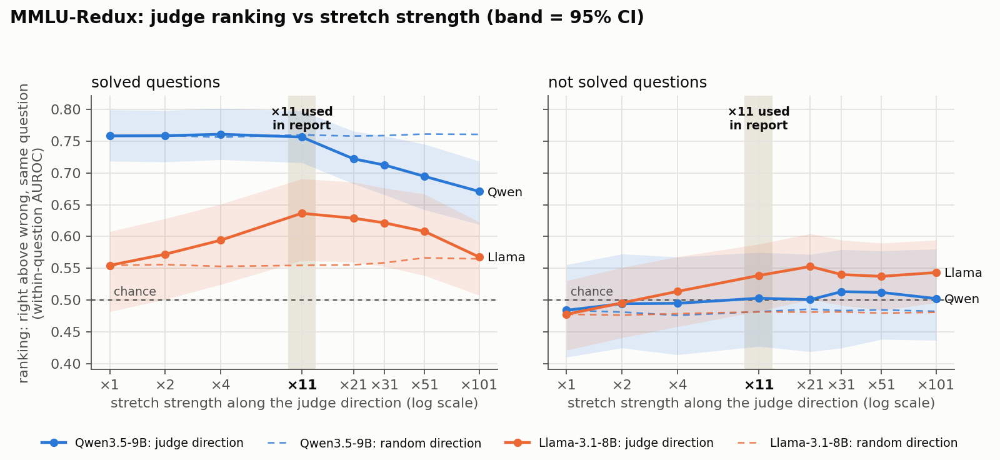
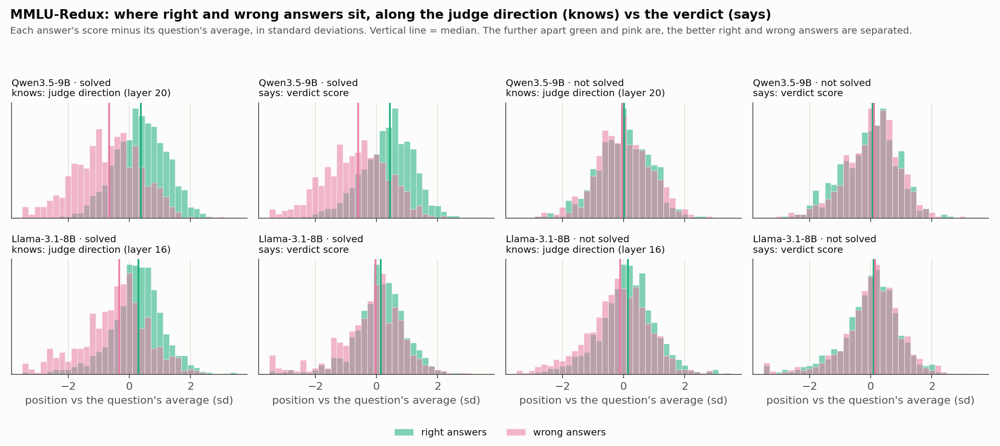

# Recovering What an LLM Judge Knows but Doesn't Say

*November 15, 2026*

::: summary
## Summary

- **Question.** Inside an LLM judge, is there a direction that tracks whether a candidate answer is actually right? Does stretching along it help the judge, especially on questions the judge cannot solve itself? Judges: Llama-3.1-8B and Qwen3.5-9B on MMLU-Redux.
- **Bottom line: stretching makes a judge better within its ability, not beyond it.**
- **Llama knows more than it says, on questions it can solve.** Its internal judge direction ranks right above wrong answers at 0.70, but its verdict only at 0.55.
- **Stretching recovers part of that gap.** Llama's ranking rises by +8 points [+4, +13]. The gain holds (+6 [+2, +10]) when we compare only answers written by the same model, so it is not explained by the judge recognising which model wrote the answer. A random direction does nothing.
- **No real gain on questions the judge can't solve.** An apparent +6 there disappears (+0.3 [−4, +5]) once we compare only answers from the same model. It came from the judge sensing which model wrote the answer, not whether the answer was right. Two other directions, one learned only on MATH and one learned only from same-model pairs, give the same pattern.
- **No gain for Qwen.** Its verdict already follows the direction (correlation 0.9), so stretching only makes it stricter. The gap between what the judge knows and what it says predicts the gain.
- **Preregistered tests on three new judges: two of three held.** Qwen3.5-4B (small gap) and Phi-4-mini gained nothing, as predicted. Llama-3.2-3B gained +4 where we predicted under 3: our check of whether the verdict responds to the direction was the wrong one.
:::

## 1. Motivation and setup

*Inside the Unfair Judge* ([Xu et al., 2026](https://arxiv.org/abs/2607.11871)) shows that an LLM judge's biases, such as favouring longer answers, live in a few directions of its hidden states, and that steering along them adds or removes the bias. Inspired by an insight from Phaedrus on that paper, we ask whether there is also a direction for whether an answer is *actually right*, and whether stretching it makes the judge better.

- **Benchmark:** MMLU-Redux, multiple choice with an expert-checked answer key.
- **Candidate answers:** for each question, three other models (Qwen3.5-4B, Qwen3.6-35B, Nemotron-3-Super) wrote answers. An answer is right if its final letter matches the key. We keep questions with at least one right and one wrong answer.
- **Judges:** Llama-3.1-8B and Qwen3.5-9B, thinking off. The judge sees the question and one answer and replies starting with `VERDICT:`.
- **Solved vs not solved:** whether the judge answers the question correctly itself.

| Judge | Questions not solved (answers) | Questions solved (answers) |
|---|---|---|
| Llama-8B | 512 (1,940) | 410 (1,556) |
| Qwen-9B | 287 (1,072) | 635 (2,424) |

## 2. The judge direction and the stretch

1. Record the judge's hidden state at `VERDICT:` for every answer.
2. Subtract each question's average state, so only differences between answers to the same question remain.
3. **Judge direction** = average state of right answers − average state of wrong answers. No classifier is trained.
4. Learn it on half the questions and test on the other half. Keep the layer that best separates right from wrong on held-out questions: layer 16 of 32 for Llama, layer 20 for Qwen.
5. **Stretch:** multiply how far each answer's state sits from the average along the direction (×11 in the main results), leaving everything else unchanged. Each answer is pushed further the way it already leans. Control: a random direction of the same size.

## 3. How we measure

- **Verdict score** = log P(CORRECT) − log P(INCORRECT) at the first word after `VERDICT:`. Above 0 means the judge says CORRECT.
- **Ranking:** each answer is judged in its own prompt. Afterwards, for every pair of one right and one wrong answer to the same question, we score 1 if the right one has the higher verdict score, ½ for a tie, 0 otherwise, and average. 0.50 is chance.
- **Why ranking and not balanced accuracy:** balanced accuracy can rise just because the judge becomes stricter. Stretching Qwen raises its balanced accuracy by +6 on solved questions while its ranking stays at 0.76. Ranking is unaffected by strictness, so we use it, and check strictness separately in section 5.
- **Same-model control:** the stronger answering models are right more often, so simple surface clues, chiefly *which model wrote the answer*, already rank right above wrong at 0.65–0.72 without looking inside the judge. To rule this out, we repeat the ranking using only pairs of answers to the same question written by the same model (mostly Qwen3.5-4B, the only model with several answers per question).
- **95% intervals** come from resampling questions.

## 4. Results: the gap between knowing and saying predicts the gain

*Knows* = ranking from the position along the judge direction alone. *Says* = ranking from the verdict score.

| Judge | Questions | Knows | Says | Says after ×11 | Gain [95% CI] | Gain, same-model pairs | Verdict–direction correlation |
|---|---|---|---|---|---|---|---|
| Qwen | solved | 0.75 | 0.76 | 0.76 | 0 [−3, +2] | −1 [−4, +2] | 0.90 |
| Qwen | not solved | 0.53 | 0.48 | 0.50 | +2 [−1, +6] | +3 [−1, +8] | 0.87 |
| Llama | solved | 0.70 | 0.55 | 0.64 | **+8 [+4, +13]** | **+6 [+2, +10]** | 0.40 |
| Llama | not solved | 0.58 | 0.48 | 0.54 | +6 [+2, +10] | +0.3 [−4, +5] | 0.28 |

- **Qwen:** its verdict already reflects what the direction knows, so there is nothing to recover.
- **Llama, solved questions:** the information is present in the middle of the model but mostly lost before the verdict. Stretching pushes more of it through, and the gain survives the same-model control.
- **Llama, questions it can't solve:** with the same-model control, the direction barely knows more than the verdict (0.56 vs 0.53) and stretching adds nothing. The earlier gain came from the answering model's identity.
- **Strength:** gains peak at ×11–×21 and never exceed what the direction knows. Much stronger stretches (×101) start to hurt. The random direction stays flat.

{width=80%}

**Where right and wrong answers sit.** For Llama on solved questions, right (green) and wrong (pink) answers are clearly apart along the direction but almost overlap along the verdict. For Qwen, both look alike:

{width=78%}

## 5. Better, or just stricter?

Stretching makes both judges reject more answers, right and wrong. To separate "better" from "stricter", we raise the unedited judge's cutoff until it accepts exactly as many wrong answers (same false positive rate, FPR) as the stretched judge, then compare how many right answers each accepts (true positive rate, TPR). Unlike ranking, this compares answers across questions, so we also repeat it on answers from a single model (Qwen3.5-4B).

| Judge | Questions | Stretched ×11 | Unedited, same FPR | Difference | Difference, one answering model [95% CI] |
|---|---|---|---|---|---|
| Llama | solved | TPR 89% at FPR 76% | TPR 82% | +7 | +2 [−2, +7] |
| Llama | not solved | TPR 84% at FPR 79% | TPR 76% | +8 | +7 [+1, +14] |
| Qwen | solved | TPR 72% at FPR 37% | TPR 73% | −1 | −1 [−5, +2] |
| Qwen | not solved | TPR 53% at FPR 52% | TPR 50% | +3 | +7 [−1, +17] |

- **Qwen:** stretching is equivalent to raising the cutoff.
- **Llama:** on all answers, stretched Llama accepts 7–8 points more right answers than an equally strict unedited judge. With one answering model, the solved-question advantage shrinks to +2 and is no longer clear.
- **Llama, questions it can't solve:** the advantage stays (+7) with one answering model, but the same-model ranking test above finds no gain within questions. The advantage therefore comes from treating whole questions differently, not from telling a right answer from a wrong one to the same question. We do not count it as better judging.

## 6. Preregistered tests on three new judges

The gap rule was found from the results above, so we tested it on unseen judges (same answers, thinking off), writing the predictions down before any stretch was run.

- **The rule:** if the verdict responds to pushes along the direction (its accept rate changes by at least 10 points between pushes of −8 and +8 standard deviations), the gain at ×11 is about half the gap between *knows* and *says* (±4 points). Otherwise it is under 3.
- **Predictions:** Qwen3.5-4B responds but has a small gap: no gain. Llama-3.2-3B and Phi-4-mini have large gaps but barely respond: under 3, where ignoring responsiveness would predict +6 and +4.

| Judge | Gap | Predicted | Gain at ×11, all [95% CI] | Not solved | Same-model pairs | Rule holds |
|---|---|---|---|---|---|---|
| Qwen3.5-4B | +1 | +0.6 | −0.4 [−1.5, +0.8] | −0.4 [−2.1, +1.2] | −1.3 [−3.1, +0.5] | yes (6 of 6 groups) |
| Phi-4-mini | +7 | < 3 | +1.2 [−0.2, +2.7] | +0.9 [−1.1, +3.0] | −1.0 [−3.7, +1.5] | yes |
| Llama-3.2-3B | +11 | < 3 | +4.1 [+2.4, +5.9] | +4.4 [+2.1, +6.6] | +3.0 [−0.5, +6.5] | **no** |

- **Why it failed on Llama-3.2-3B:** it accepts about 92% of all answers, so its accept rate has no room to move, yet its verdict scores still reorder under a push. How far the verdict *score* moves per push would have separated the two judges (0.068 for Llama-3.2-3B, 0.013 for Phi-4-mini), but we found that after scoring, so it needs a test of its own.
- **Most of the gap is the "which model wrote it" clue.** We also screened Mistral-7B and Granite-8B without stretching them. Measured only on pairs from the same answering model, the gap shrinks for every judge: Llama-3.1-8B +12 → +6, Llama-3.2-3B +11 → +3, Phi-4-mini +7 → +1, Mistral-7B +8 → +2, Granite-8B +6 → +2. Only Llama-3.1-8B keeps a sizeable gap.

## 7. Does the gain need MMLU's own direction?

MMLU's own direction could carry MMLU-specific clues. We stretched Llama-3.1-8B (layer 16, ×11) along two directions that cannot carry them: one learned only on MATH answers, and one learned on MMLU but only from answers to the same question by the same model, which cannot see who wrote an answer. Intervals here keep each question's before and after scores paired, so they are narrower than in section 4; the point estimates agree.

| Direction | Knows | Gain, solved | Gain, not solved | Same-model pairs, solved | Same-model pairs, not solved |
|---|---|---|---|---|---|
| MMLU's own | 0.64 | +8.3 [+5.6, +11.0] | +6.0 [+3.5, +8.6] | +5.9 [+1.6, +10.2] | +0.3 [−4.5, +5.0] |
| Borrowed from MATH | 0.57 | +3.8 [+1.4, +6.3] | +4.0 [+2.0, +6.1] | +5.2 [+1.1, +9.4] | −0.7 [−5.0, +3.5] |
| Same-model pairs only | 0.57 | +4.4 [+2.0, +6.9] | +4.1 [+1.9, +6.4] | +4.6 [+0.5, +8.5] | +1.2 [−3.3, +5.7] |
| Random | – | +0.1 | +0.3 | +0.2 | +0.3 |

- **All three directions help on questions the judge can solve, even within same-model pairs (+5 to +6).** None helps on questions it can't solve once the authorship clue is removed.
- **MMLU's own direction is strongest (+7 vs +4 overall).** The extra is most likely authorship, since the direction that can't see it gains no more than the MATH one.
- **Directions differ across benchmarks.** For Llama-3.1-8B, the directions learned on MMLU, MATH, BBEH and the two RewardBench 2 sets have cosine 0.2–0.6 with each other (1 = same direction), against 0.75–1.0 between the two halves of one benchmark. For Qwen3.5-9B, MMLU and MATH share nearly one direction (0.88–0.94).

## Limitations

- The gain does not carry over to other benchmarks. On MATH neither judge gains clearly (Llama's verdict barely responds at that layer). On RewardBench 2 Safety Qwen gains nothing, as preregistered, and ×11 makes Llama worse (−6 [−9.5, −3.5]) by overshooting.
- The gap rule failed one of three preregistered tests. The score-based check that fixes it has not been tested on fresh judges.
- The direction test in section 7 covers one judge on one benchmark. On questions the judge can't solve, the same-model intervals span about ±5 points, so they rule out a large gain there, not a small one.
