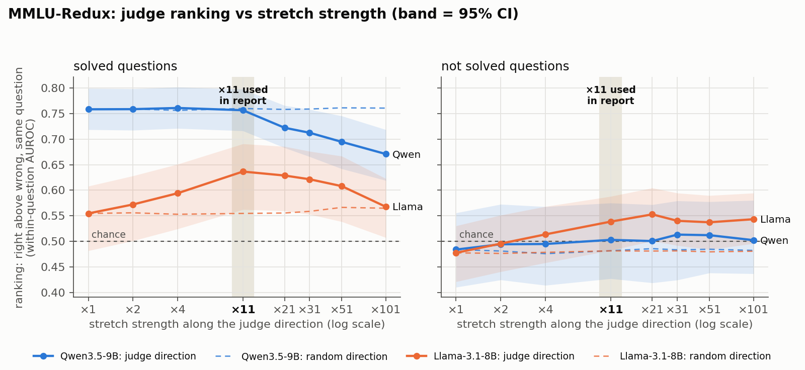
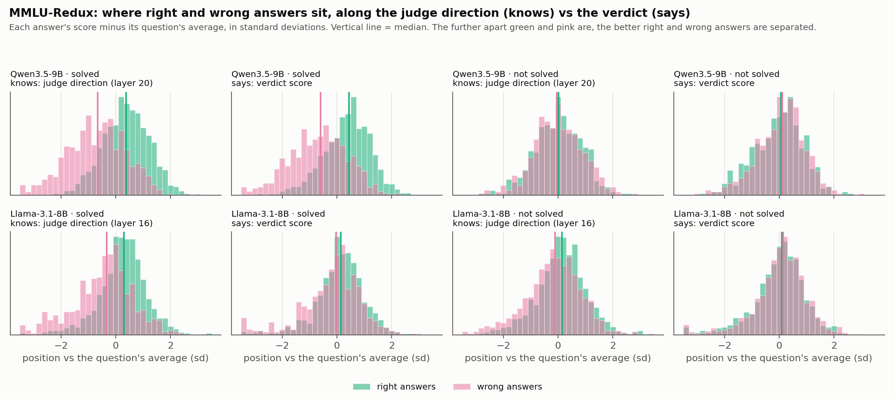
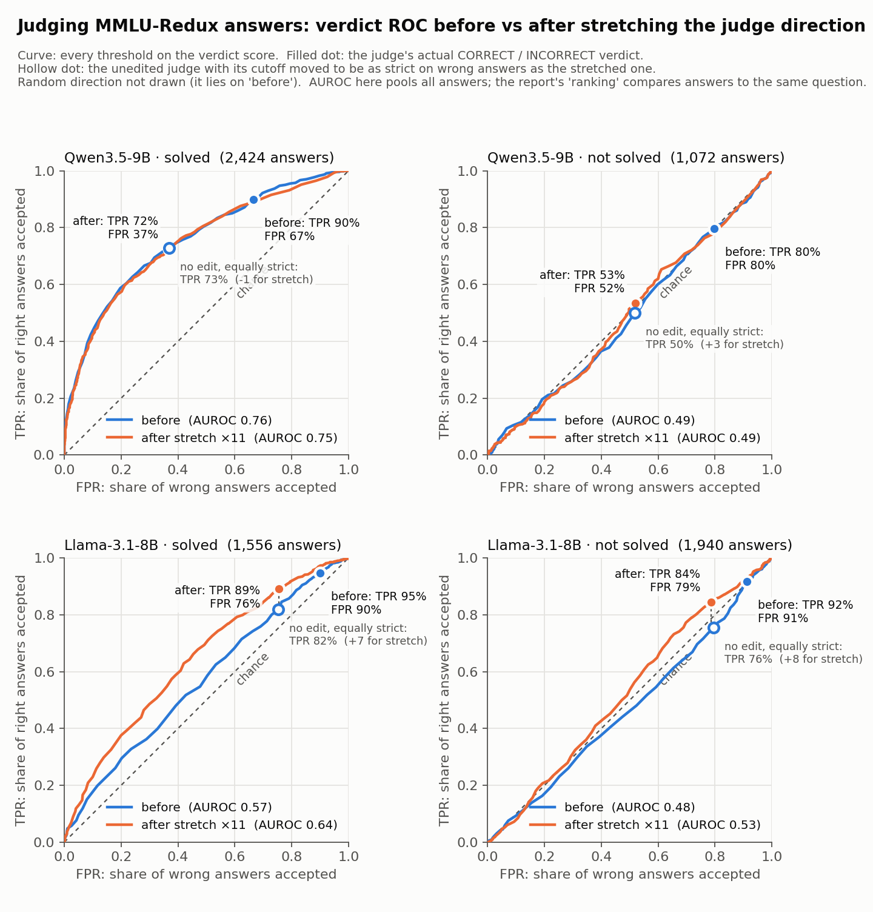

# Recovering What an LLM Judge Knows but Doesn't Say

*November 9, 2026*

::: summary
## Summary

- **Question.** Inside an LLM judge, is there a direction that tracks whether a candidate answer is actually right? Does stretching along it help the judge, especially on questions the judge cannot solve itself? Judges: Llama-3.1-8B and Qwen3.5-9B on MMLU-Redux.
- **Llama knows more than it says.** Its internal judge direction ranks right above wrong answers at 0.70 on questions it can solve, but its verdict only at 0.55. On questions it can't solve: 0.58 vs 0.48.
- **Stretching recovers part of that gap.** Llama's ranking rises to 0.64 on solved questions (+8 [+4, +13]) and 0.54 on unsolved ones (+6 [+2, +10]). A random direction does nothing.
- **Better, not just stricter.** At the same false positive rate, stretched Llama accepts 7–8 points more right answers than the unedited judge with a stricter cutoff.
- **No gain for Qwen.** Its verdict already follows the direction (correlation 0.9), so stretching only makes it stricter. The gap between what the judge knows and what it says predicts the gain.
:::

## 1. Motivation and setup

*Inside the Unfair Judge* ([Xu et al., 2026](https://arxiv.org/abs/2607.11871)) shows that an LLM judge's biases, such as favouring longer answers, live in a few directions of its hidden states, and that steering along them adds or removes the bias. Inspired by an insight from Phaedrus on that paper, we ask whether there is also a direction for whether an answer is *actually right*, and whether stretching it makes the judge better.

- **Benchmark:** MMLU-Redux, multiple choice with an expert-checked answer key.
- **Candidate answers:** for each question, three other models (Qwen3.5-4B, Qwen3.6-35B, Nemotron-3-Super) wrote answers. An answer is right if its final letter matches the key. We keep questions with at least one right and one wrong answer.
- **Judges:** Llama-3.1-8B and Qwen3.5-9B, thinking off. The judge sees the question and one answer and replies starting with `VERDICT:`.
- **Solved vs not solved:** whether the judge answers the question correctly itself.

| Judge | Questions not solved (answers) | Questions solved (answers) |
|---|---|---|
| Llama-8B | 512 (1,940) | 410 (1,556) |
| Qwen-9B | 287 (1,072) | 635 (2,424) |

## 2. The judge direction and the stretch

1. Record the judge's hidden state at `VERDICT:` for every answer.
2. Subtract each question's average state, so only differences between answers to the same question remain.
3. **Judge direction** = average state of right answers − average state of wrong answers. No classifier is trained.
4. Learn it on half the questions and test on the other half. Keep the layer that best separates right from wrong on held-out questions: layer 16 of 32 for Llama, layer 20 for Qwen.
5. **Stretch:** multiply how far each answer's state sits from the average along the direction (×11 in the main results), leaving everything else unchanged. Each answer is pushed further the way it already leans. Control: a random direction of the same size.

## 3. How we measure

- **Verdict score** = log P(CORRECT) − log P(INCORRECT) at the first word after `VERDICT:`. Above 0 means the judge says CORRECT.
- **Ranking:** each answer is judged in its own prompt. Afterwards, for every pair of one right and one wrong answer to the same question, we score 1 if the right one has the higher verdict score, ½ for a tie, 0 otherwise, and average. 0.50 is chance.
- **Why ranking and not balanced accuracy:** balanced accuracy can rise just because the judge becomes stricter. Stretching Qwen raises its balanced accuracy by +6 on solved questions while its ranking stays at 0.76. Ranking is unaffected by strictness, so we use it, and check strictness separately in section 5.
- **95% intervals** come from resampling questions.

## 4. Results: the gap between knowing and saying predicts the gain

*Knows* = ranking from the position along the judge direction alone. *Says* = ranking from the verdict score.

| Judge | Questions | Knows | Says | Says after ×11 | Gain [95% CI] | Verdict–direction correlation |
|---|---|---|---|---|---|---|
| Qwen | solved | 0.75 | 0.76 | 0.76 | 0 [−3, +2] | 0.90 |
| Qwen | not solved | 0.53 | 0.48 | 0.50 | +2 [−1, +6] | 0.87 |
| Llama | solved | 0.70 | 0.55 | 0.64 | **+8 [+4, +13]** | 0.40 |
| Llama | not solved | 0.58 | 0.48 | 0.54 | **+6 [+2, +10]** | 0.28 |

- **Qwen:** its verdict already reflects what the direction knows, so there is nothing to recover.
- **Llama:** the information is present in the middle of the model but mostly lost before the verdict. Stretching pushes more of it through, including on questions Llama cannot solve.
- **Strength:** gains peak at ×11–×21 and never exceed what the direction knows. Much stronger stretches (×101) start to hurt. The random direction stays flat.

{width=92%}

**Where right and wrong answers sit.** For Llama on solved questions, right (green) and wrong (pink) answers are clearly apart along the direction but almost overlap along the verdict. For Qwen, both look alike:

{width=100%}

## 5. Better, or just stricter?

Stretching makes both judges reject more answers, right and wrong. To separate "better" from "stricter", we raise the unedited judge's cutoff until it accepts exactly as many wrong answers (same false positive rate, FPR) as the stretched judge, then compare how many right answers each accepts (true positive rate, TPR).

| Judge | Questions | Stretched ×11 | Unedited, same FPR | Difference |
|---|---|---|---|---|
| Llama | solved | TPR 89% at FPR 76% | TPR 82% | **+7** |
| Llama | not solved | TPR 84% at FPR 79% | TPR 76% | **+8** |
| Qwen | solved | TPR 72% at FPR 37% | TPR 73% | −1 |
| Qwen | not solved | TPR 53% at FPR 52% | TPR 50% | +3 (noise) |

- **Llama:** stretching rejects wrong answers more selectively than any cutoff can.
- **Qwen:** stretching is equivalent to raising the cutoff.

{width=60%}

## Limitations

- Tested on one benchmark (MMLU-Redux) so far; other benchmarks are not yet tested.
