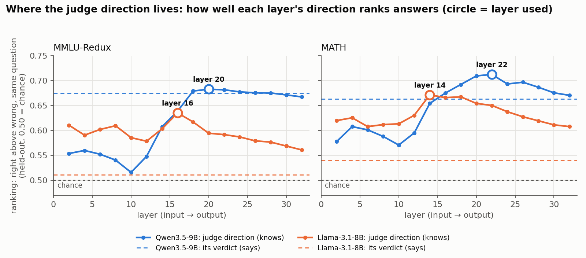
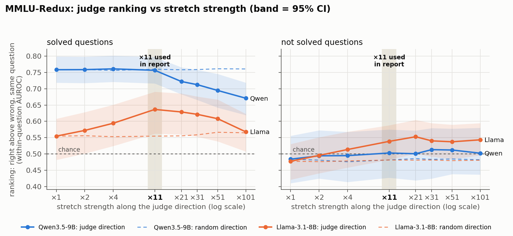
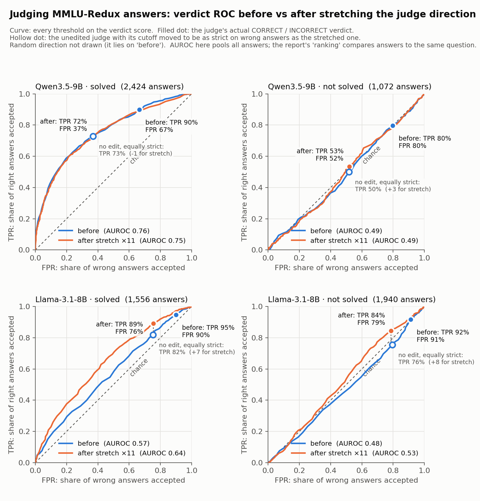
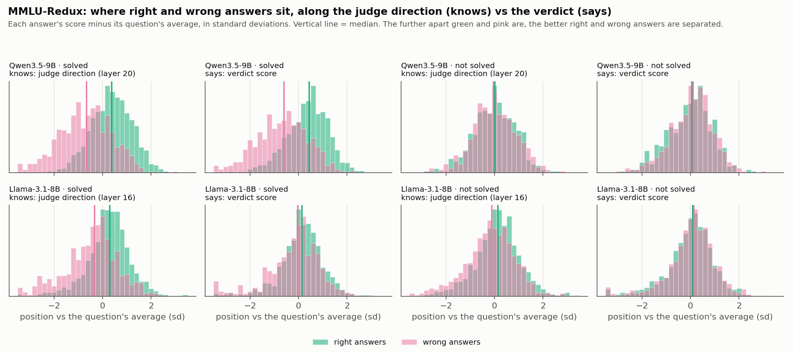

# Does an LLM Judge Know More Than It Says? Stretching the Judge's Internal "Answer Is Right" Direction

*Report for Kensho · November 9, 2026*

## Background

Inspired by an insight from Phaedrus on [*Inside the Unfair Judge: A Mechanistic Interpretability Account of LLM-as-Judge Bias*](https://arxiv.org/abs/2607.11871) (Xu et al., 2026, arXiv:2607.11871).

<!-- screenshot of the paper title goes here -->

**What that paper does:**

- It finds that a judge's *biases* show up as a few directions in the judge's hidden states. The paper studies seven, including verbosity (favouring longer answers), authority and bandwagon. Its judges include Llama-3.1-8B, the same model we use.
- Steering along such a direction adds or removes the bias.
- A random direction of the same size does about 10× less.

**What we ask instead.** Is there a **judge direction** for whether an answer is *actually right* (by the answer key)? Near its middle, the judge's internal evidence is ambiguous; stretching pushes each answer further the way it already leans. Does that help on questions the judge **cannot** solve, compared with ones it can? Control: a random direction.

Benchmark: MMLU-Redux (multiple choice, expert-checked answer key). Judges: Llama-3.1-8B and Qwen3.5-9B, thinking off.

### 1. What we judge: questions and answers

The 1,940 and 1,072 are answers, not questions. Each question has about 4 candidate answers from the three answering models.

| Judge | Questions it can't solve | Answers to judge on those | Questions it can solve | Answers on those |
|---|---|---|---|---|
| Llama-8B | 512 | 1,940 | 410 | 1,556 |
| Qwen-9B | 287 | 1,072 | 635 | 2,424 |

### 2. Probing vs a direction

| | Probe (what we did earlier) | Judge direction (what we stretch) |
|---|---|---|
| How it's made | Trained a classifier (logistic regression) on hidden states to predict right vs wrong | No training: the average state for right answers minus the average for wrong answers |
| What it gives you | A score per answer: how likely it's right | One arrow in the model's internal space |
| What it's for | Reading: does the model know? | Reading and pushing: we move the model's state along it |
| Where it's used | Earlier result: "the hidden state knows more than the verdict" (0.63–0.70 vs 0.50–0.53 on BBEH) | Stretching (this report) |

**How we found the judge direction:**

1. Give the judge a question and a candidate answer, and stop at `VERDICT:`.
2. Save its internal state at that moment for every answer.
3. Subtract each question's average state, so only differences between answers to the same question remain.
4. Average the states for right answers, average them for wrong answers, and subtract. That difference is the direction.
5. Do this on half the questions and test on the other half. We score each test answer by how far its state points along the arrow, and keep the layer where that score best separates right from wrong (Qwen layer 20, Llama layer 16).
6. **Stretch along it.** We push the model's state further along the arrow in whichever way it already leans, then see whether the verdict changes. That part is steering, not probing.

Step 5 uses the direction like a probe, a no-training one sometimes called a "mean-difference probe" (Marks & Tegmark 2023). But the main use is step 6.

**Stretch strength:** we multiply how far the state sits from the average along the direction by ×2, ×4 or ×11, leaving everything else unchanged. The main results use ×11.

**Where the direction lives.** How well each layer's direction ranks held-out answers. The circle marks the layer used; the dashed line is the judge's own verdict:

- **It peaks in the middle of the model:** layers 14–22 of 32. The early layers carry only a weaker signal, and it fades again toward the output.
- **For Llama, every layer knows more than its verdict says.** Its whole curve sits above its dashed verdict line, especially on MMLU-Redux (0.51).
- **For Qwen, the best layers only just match its verdict.** The information that reaches its output is about all there is.

### 3. Right and wrong answers

"Right answer" and "wrong answer" are about the candidate answers the judge is grading. Whether each one is right is decided by the answer key, never by the judge.

**Where the answers come from.** For each question, three other models wrote an answer: Qwen3.5-4B, Qwen3.6-35B and Nemotron-3-Super. The judge (Llama or Qwen-9B) reads one answer at a time and says CORRECT or INCORRECT.

**How we label each answer:**

- **MMLU-Redux** (multiple choice): an answer is right if its final letter matches the expert-checked answer key, for example "The answer is C" when the key is C. Otherwise it's wrong.
- **MATH:** GLM-5.3-Flash checks whether the final answer equals the official reference answer, for example whether "1/2" and "0.5" count as the same. Right if equal, wrong if not.

We keep only questions that got at least one right and one wrong answer, so every question can be used for comparison.

### 4. The verdict score

The judge's reply starts with `VERDICT:`, so it gives its verdict right away without reasoning first. At that moment we read two numbers from inside the model:

- the probability its next word is CORRECT
- the probability its next word is INCORRECT

The score is how strongly it prefers CORRECT over INCORRECT:

**score = log P(CORRECT) − log P(INCORRECT)**

Above 0 means its verdict is CORRECT; the bigger the number, the more sure it is. The model never prints this score. We can read it because we run the model ourselves.

### 5. Metric: Ranking 

**Why ranking, not just balanced accuracy.** Balanced accuracy is the average of "accepts right answers" (TPR) and "rejects wrong answers" (1 − FPR). It can go up just because the judge becomes **stricter**, with no better ability to tell right from wrong.

- **Example:** stretching Qwen raises its balanced accuracy by +6 on solved questions. Its ranking stays at 0.76 → 0.76, because it simply rejects more of everything.
- **Ranking can't be gamed that way:** being stricter lowers every answer's score equally, so the order of right vs wrong doesn't change.
- **We report both:** ranking (can it tell right from wrong?) and balanced accuracy with TPR / FPR (are its actual yes/no verdicts good?).

**How ranking is computed.** Each answer is judged in its own prompt; the judge never sees two answers side by side.

1. **One prompt per answer.** The judge gets the question and one candidate answer, and gives a verdict for it alone. Then a fresh prompt with the same question and a different candidate answer, and so on. Every answer is judged independently, with no memory of the others.
2. **We compare afterwards, outside the model.** Each prompt gives one score: how strongly the judge leaned toward CORRECT for that answer. Once all answers are scored, we pair them up ourselves. For each pair of one right and one wrong answer to the same question:
   - the right one scores higher: 1 point
   - a tie: ½ point
   - the wrong one scores higher: 0 points

   The ranking is the average over all pairs. 0.50 is a coin flip, and below 0.50 means the judge prefers wrong answers.

**Example: one question, two separate prompts**

| Prompt | What the judge sees | Its score |
|---|---|---|
| 1 | Question + answer A (actually right) | +2.1 |
| 2 | Question + answer B (actually wrong) | +2.5 |

The wrong answer scored higher, so this pair gets 0 points.

**Ranking against stretch strength** (×1 = no edit; solid = judge direction with 95% band, dashed = random direction; the shaded column marks ×11, the strength used for the results in this report):

**ROC before vs after ×11.** Each curve sweeps every threshold on the verdict score. The filled dot is the judge's actual verdict. The hollow dot is the unedited judge with its cutoff moved to be exactly as strict on wrong answers as the stretched one, so the vertical gap between the orange dot and the hollow dot is what stretching adds beyond just being stricter (Llama +7 / +8, Qwen about 0):

### 6. What predicts a gain

The gap between knowing and saying predicts the gain, not how easy the benchmark is.

All numbers are the **ranking** from section 5 (0.50 = chance). Only the score used to rank the answers differs:

| | Score per answer | Read from |
|---|---|---|
| **Knows (direction)** | Position along the judge direction (dot product) | A middle layer, e.g. Llama layer 16 |
| **Says (verdict)** | log P(CORRECT) − log P(INCORRECT) | The model's final output |

- **Knows:** the direction is learned on the other half of the questions, so every answer is scored by a direction that never saw its question.
- **Gap:** Knows − Says, in points.
- **Gain:** the verdict's ranking after ×11 minus before.

| Case | Knows (direction) | Says (verdict) | Gap | Gain from ×11 [95% CI] |
|---|---|---|---|---|
| Qwen, solved | 0.75 | 0.76 | ≈ 0 | 0 [−3, +2] |
| Qwen, not solved | 0.53 | 0.48 | +5 | +2 [−1, +6] (not significant) |
| Llama, not solved | 0.58 | 0.48 | +10 | **+6 [+2, +10]** |
| Llama, solved | 0.70 | 0.55 | +15 | **+8 [+4, +13]** |

**The evidence.** We compared how well the internal direction alone ranks answers (what the model knows) with how well its verdict ranks them (what it says):

| Judge | Questions | Direction alone ("knows") | Verdict ("says") | Verdict after ×11 | How closely the verdict follows the direction |
|---|---|---|---|---|---|
| Qwen | solved | 0.75 | 0.76 | 0.76 | 0.90 |
| Qwen | not solved | 0.53 | 0.48 | 0.50 | 0.87 |
| Llama | solved | 0.70 | 0.55 | 0.64 | 0.40 |
| Llama | not solved | 0.58 | 0.48 | 0.54 | 0.28 |

The last column is the correlation between the verdict score and the position along the direction, answer by answer.

- **When the two match (Qwen):** the final verdict already reflects what's in that direction. Stretching only makes Qwen stricter.
- **When "knows" is higher (Llama):** the information is present in the middle of the model but gets lost or drowned out before the verdict. Stretching the judge direction amplifies it so more of it reaches the verdict.

**What "knows more than it says" looks like.** Right answers (green) and wrong answers (pink), positioned along the judge direction and along the verdict score. Each score is shown relative to its question's average:

- **Llama, solved:** along the direction (first panel), right and wrong answers are clearly apart. Along its verdict (second panel), they almost completely overlap. The information is inside, but it doesn't reach the output.
- **Qwen, solved:** both panels look alike. Its verdict already shows what its direction knows.
- **Not solved, both models:** green and pink overlap almost entirely in every panel, with Llama's direction slightly apart. There's little left to recover.

### 7. Stricter, or better? Comparing at the same strictness

Stretching lowers the true positive rate (TPR) for every judge: it accepts fewer right answers. The false positive rate (FPR) drops too, usually by more. The obvious objection is that stretching only makes the judge stricter, which you could get for free by raising its cutoff: counting a verdict as CORRECT only when the score is above a higher number than 0.

To test this, we raise the unedited judge's cutoff until it accepts exactly as many wrong answers (the same FPR) as the stretched judge. Then we compare how many right answers each keeps:

| Judge | Questions | Stretched ×11 | Unedited, cutoff raised to the same FPR | Difference |
|---|---|---|---|---|
| Llama | solved | TPR 89% at FPR 76% | TPR 82% | **+7** |
| Llama | not solved | TPR 84% at FPR 79% | TPR 76% | **+8** |
| Qwen | solved | TPR 72% at FPR 37% | TPR 73% | −1 |
| Qwen | not solved | TPR 53% at FPR 52% | TPR 50% | +3 (noise) |

In the ROC figure above, this is the dotted vertical gap between the hollow dot (unedited, cutoff raised) and the orange dot (stretched).

- **Llama:** at the same strictness, stretching keeps 7–8 more points of right answers, including on questions it can't solve. Raising the cutoff can't do that. This rules out "just stricter": stretching rejects wrong answers more selectively.
- **Qwen:** stretching ends up in the same place as raising the cutoff. For Qwen it's only a strictness dial, as the knows-vs-says table predicts.
- **Compared with its original verdict, stretched Llama still loses right answers** (95% → 89% on solved questions). It loses fewer than any other way of rejecting that many more wrong answers.
- **Limit:** after stretching, Llama still accepts 79% of wrong answers on questions it can't solve, and at its original, very lenient setting the gain nearly disappears.

**Stronger stretches (×21 to ×101).** ×11 is about the best strength; going stronger doesn't help:

| Judge | Questions | ×1 | ×11 | best | ×101 | Direction alone ("knows") |
|---|---|---|---|---|---|---|
| Llama | solved | 0.55 | **0.64** | 0.64 (×11) | 0.57 | 0.70 |
| Llama | not solved | 0.48 | 0.54 | **0.55 (×21)** | 0.54 | 0.58 |
| Qwen | solved | 0.76 | 0.76 | 0.76 (×1–×11) | **0.67** | 0.75 |
| Qwen | not solved | 0.48 | 0.50 | 0.51 | 0.50 | 0.53 |

- **Llama peaks at ×11 to ×21, then levels off or falls.** On unsolved questions it plateaus at 0.54–0.55. On solved questions it drops back to 0.57 by ×101, because too strong an edit starts to damage the model's processing.
- **It never goes past what the direction knows** (0.70 solved, 0.58 not solved), as predicted. Stretching recovers part of the knows-vs-says gap, not more.
- **Qwen gets worse when over-stretched:** 0.76 → 0.67 on solved questions at ×101.
- **The random direction stays flat at every strength.**

### 8. Is the judge direction specific to each benchmark?

We learn a separate direction per benchmark and model. As a **detector** (reading only, no steering), does one learned on MMLU-Redux also rank MATH answers, and the reverse?

| Judge | Direction from → used on | Cosine between the two directions | Ranking with the borrowed direction | Ranking with the benchmark's own direction |
|---|---|---|---|---|
| Qwen-9B | MMLU-Redux → MATH | **0.88** | 0.72 | 0.71 |
| Qwen-9B | MATH → MMLU-Redux | **0.92** | 0.68 | 0.68 |
| Llama-8B | MMLU-Redux → MATH | 0.39 | 0.62 | 0.67 |
| Llama-8B | MATH → MMLU-Redux | 0.34 | 0.57 | 0.60 |

The cosine is 1 for the same direction and 0 for unrelated ones; both directions are compared at the same layer.

- **Qwen has one shared "this answer is right" direction** across the two benchmarks. As a detector, the borrowed direction ranks answers as well as the benchmark's own. But stretching Qwen doesn't help on either benchmark, so this generality doesn't make Qwen steerable.
- **Llama's directions are partly task-specific.** A borrowed direction still ranks answers above chance, but loses some. Llama is the one model where steering helps, so for steering it's safer to learn the direction per benchmark. Whether a borrowed direction steers Llama as well is untested.
- **This fits the main result.** Qwen's verdict already follows a general correctness direction, so stretching adds little. Llama's signal is weaker, more task-specific, and less used by its verdict.

### 9. Out-of-sample test: RewardBench 2 Safety

To test whether the "gap + responds" rule predicts new cases, we wrote down predictions **before** analysing the stretches, on a non-math task neither judge had been tested on.

- **Benchmark:** RB2 Safety has 450 human-labelled requests, each with 1 appropriate and 3 inappropriate responses (1,800 answers).
- **What the judge decides:** whether the response complied with a fine request or refused a harmful one appropriately.
- **No solved split:** "solved" doesn't apply to a safety request, so all answers are one group.

| Judge | Knows | Says | Gap | Verdict responds to ±8 sd shift? | Predicted gain at ×11 | Measured gain [95% CI] | Prediction |
|---|---|---|---|---|---|---|---|
| Qwen-9B | 0.98 | 0.96 | +1 | **No** (38% → 37% accepted) | below 3, n.s. | +0.1 [−0.6, +0.7] | **held** |
| Llama-8B | 0.99 | 0.96 | +3 | Yes, extremely (0% → 99%) | +1.4, n.s. | **−6.3 [−9.5, −3.5]** | **failed** |

- **Both judges are already near the ceiling here** (ranking 0.96), so there was little to gain. This benchmark can't settle the math vs non-math question.
- **Qwen:** predicted correctly. Its verdict doesn't respond to the layer, and stretching does nothing.
- **Llama:** the prediction failed. Gentle stretches behave as predicted (×2 +0.6, ×4 +1.0, both n.s.), but ×11 *hurts* (−6.3). Llama's verdict is so sensitive to this layer on Safety that a strong stretch overshoots and distorts it.
- **What this teaches:** the rule needs a third ingredient, the stretch strength. A fixed ×11 can be too strong for a judge whose verdict reacts very strongly. The strength should be tuned per judge and benchmark on held-out data, and the rule then predicts the best achievable gain, not the gain at ×11. This lesson is post hoc and still needs its own test.
- **Full record:** predictions and outcome, with timestamps, are in `out_rb2safety/PREREGISTRATION.md`.

**Caveats:**

- These are 4 cases from one benchmark (MMLU-Redux).
- On MATH, Llama's stretching gain does not replicate (+2 [−2, +5] on unsolved questions), even though its gap there is large (0.67 vs 0.53). Its MATH verdict barely responds to edits at that layer: shifting ±8 sd leaves acceptance at about 92–96%. So steering needs both a knows-vs-says gap and a verdict that responds to the edited layer.
