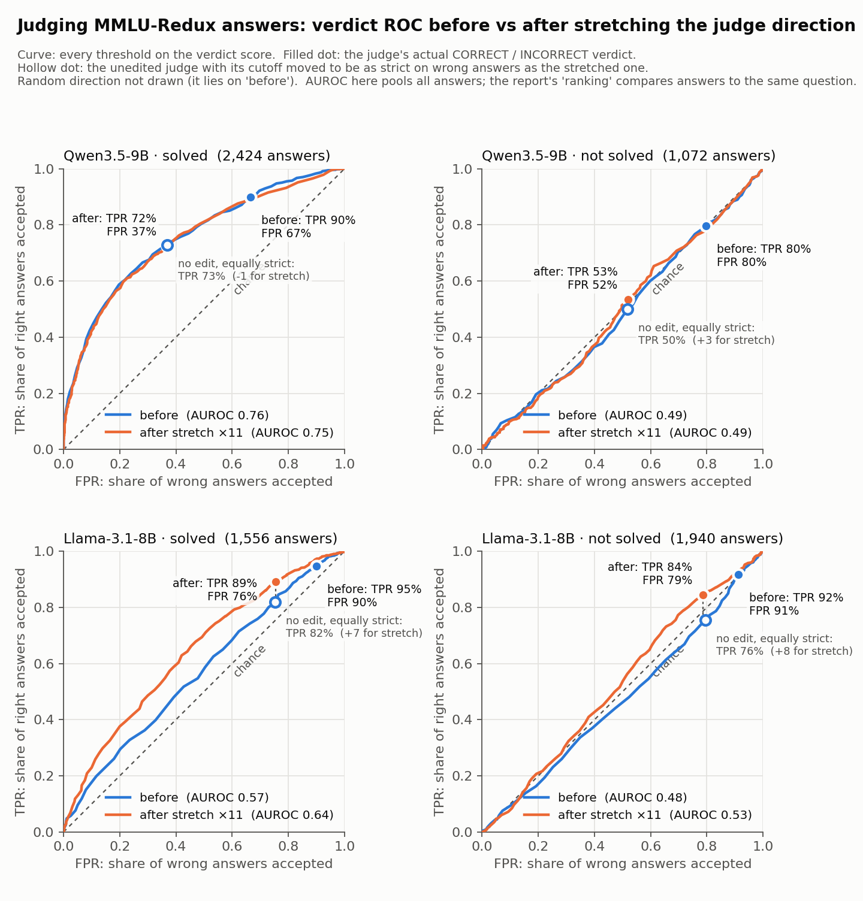
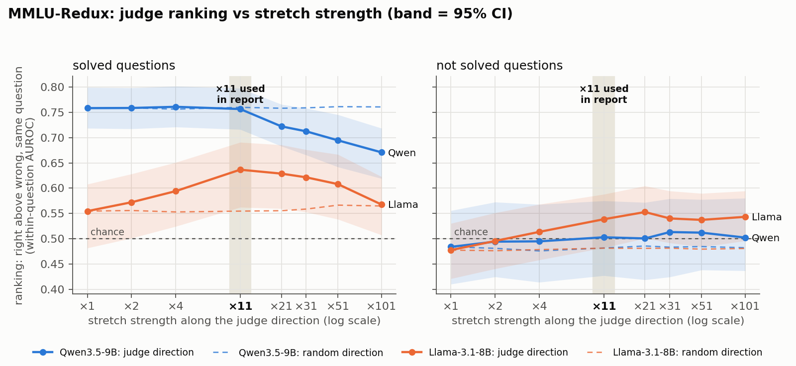
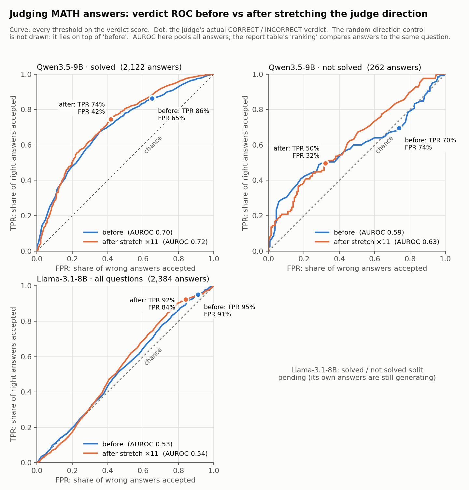

# Judging beyond capability — Nov 9, 2026

"New" means we don't know of published work reporting it. Checked with a targeted literature search on Nov 12 (about ten queries), not a systematic review.

## 1. Findings that support existing work

| Finding | Our evidence | Earlier work | Status |
|---|---|---|---|
| Judges are reliable mainly on questions they can solve | BBEH: Qwens 0.68–0.77 on questions they solve vs 0.49–0.55 on ones they don't | No Free Labels (Krumdick et al. 2025) | final |
| A reference answer fixes much of it | Official answer: 0.55 → 0.95 on unsolved; expert reference on BFF +15 | No Free Labels; reference-guided judging (Zheng et al. 2023) | final |
| Checking beats solving only where checking is easier | RB2 Math / finance stay 0.62–0.74 on unsolved; BBEH doesn't | generation–verification gap (e.g. Song et al. 2024) | final |
| Judges favour answers that match their own belief | Accept 68–90% of wrong answers equal to their own vs 44–54% of others | self-preference (Panickssery et al. 2024); judges favour text they find likely (Wataoka et al. 2024); judges favour models that make the same mistakes (Goel et al. 2025, *Great Models Think Alike*); judges favour claims matching their prior beliefs (Zahraei et al. 2026, *Prior Prejudice*, ACL Findings); anchoring study | final |
| The hidden state knows more than the verdict | Probe 0.63–0.70 vs verdict 0.50–0.53 on unsolved BBEH | Orgad et al. 2024; INSPECTOR | final |
| Correctness signals don't transfer across tasks | Probe trained in one role fails in another | Orgad et al. 2024 | final |
| A model can predict whether it will solve a question before answering | Pre-answer state predicts solving at 0.72–0.74 | Kadavath et al. 2022 | final |
| Escalating uncertain items to a stronger judge works | Routing ~45% of items recovers 55–80% of the gap | Trust or Escalate (Jung et al. 2024) | final |
| Shifting along a "correct" direction changes leniency, not discrimination | Accept rates of right and wrong answers move together | anchoring study; steering work | final |
| A follow-up "is your answer correct?" makes models back down | Small Qwens reject a third of right answers on BFF-Bench. The same happens when the answer is introduced as another AI's (50% vs 48% of right answers accepted), so it comes from the follow-up, not from ownership | "Are you sure?" sycophancy (Sharma et al. 2023; Laban et al. 2023) | final (control added Nov 10, section 8) |
| **Self-attribution:** an answer placed in the judge's own earlier turn is judged more leniently, although the judge didn't write it | BBEH: 18 points more wrong answers accepted [+15, +20] than the same answer introduced as another AI's in the same layout; all four judges. Saying "you gave this earlier" in a single prompt barely matters. BFF-Bench: no effect | Self-attribution bias (Khullar et al. 2026); label effects (Saraf et al. 2025; Chae et al. 2026) | final (section 8) |
| The judge's own answer as a reference helps when the judge is right and hurts when it is wrong | +16 on solved, **−17** on unsolved BBEH (section 3) | *Do Before You Judge* (Lin et al. 2025, EMNLP Findings): self-reference harms where the judge fails as a solver | final (moved from "new" Nov 12) |
| Agreement among candidate answers is a usable label-free signal | Accepting answers that match the most common candidate answer: +10 on unsolved | majority vote over sampled answers (self-consistency, Wang et al. 2023); cross-model consensus (arXiv 2607.10139) | final (moved from "new" Nov 12) |
| Letting the judge reason helps somewhat | Qwen-9B thinking on: +5 on unsolved BBEH | reasoning-judge work | final |

## 2. New effects or methods that worked

| Finding | Evidence | Status |
|---|---|---|
| **Stronger judges have bigger gaps, and on unsolved questions all judges look alike.** A judge's advantage is almost entirely its solving advantage. | Gap +13 (4B) → +28 (35B) → +30 (Kimi); unsolved all 0.49–0.65 | final |
| **The same answer is judged better by a judge that solved the question** (difficulty held fixed) | +6 points [+3, +10] | final |
| **A stronger model's reference only passes on that model's own solving.** The judge adds no checking of its own. | When Kimi is right: 0.88–0.94; when Kimi is wrong: no gain or worse | final |
| **Solving and judging use unrelated internal directions,** while any "give a verdict" task shares one direction regardless of whose answer it is | Cosine judge·generate ≈ 0 (ceiling 0.64–0.99); judge·self-check 0.64–0.93; both Qwen and Llama | final |
| **Stretching the judge's own direction gives real separation, not just leniency,** in Llama | Llama +7 [+1, +14] on unsolved; Qwen +1 | final |
| **The model's state after writing its own answer knows when it's right better than its spoken self-check** | 0.68 vs 0.61 | final |

## 3. Things that didn't work

| Tried | Result | Status |
|---|---|---|
| The judge's own earlier answer as a reference | **Flips sign:** +16 on solved, **−17** on unsolved. Already reported by Lin et al. 2025 (section 1) | final |
| "Verify the steps, don't re-solve" prompt | −2 on unsolved BBEH, +1 on BFF | final |
| Majority vote of four weak judges | +4: they fail on the same questions | final |
| Vote threshold adjusted by how sure the judge is | +1 to +5 | final |
| Solve-and-compare (accept only if it matches its own answer) | −22 on unsolved | final |
| Steering the judge along the *solving* direction | No effect, any strength, both models | final |
| Telling the judge the answer is its own, to use its self-check signal | No gain; −2 to −3, only shifts leniency | final |
| A hidden-state probe as the verdict | Mostly detects hard questions; small gain within a question | final |
| Steering *while it reasons* (thinking on) | Signal at the start of thinking is weak (0.52–0.60 on unsolved); first 25–35% of answers show no effect | running |

## 4. Going against what earlier work would suggest

| Expectation | What we found |
|---|---|
| Verification prompts help judges | Not on questions the judge can't solve |
| Juries of models beat single judges (e.g. Verga et al. 2024) | Barely, on unsolved questions: similar models share the same blind spots |
| A universal "truth direction" exists (Marks & Tegmark 2023; Bürger et al. 2024) | Not for answer correctness across solving vs judging |

## 5. The three most interesting findings

| Finding | Why it's interesting | Weak spot now | Cheap check (no fine-tuning) |
|---|---|---|---|
| **Solving and judging use unrelated directions** | No single "this is right" signal is shared between writing an answer and grading one | Two models, two benchmarks, thinking off | Add Qwen-4B, whose captures already exist (free, local), and the thinking-on capture of Qwen-9B we just made |
| **Stretching the judge's direction gives real separation (Llama)** | Shows "knows but doesn't say" can be fixed causally | One model (Llama). **Now replicated on MMLU-Redux:** +6 [+2, +10] ranking on unsolved (section 6); **not on MATH** (+1, n.s.) | Repeat at 2–3 other layers and on the second half of the questions (cluster); check it grows with stretch strength |
| **Self-attribution: an answer in the judge's own turn is judged more leniently** (moved to section 1: already reported by Khullar et al. 2026) | The answer text is held fixed, so judge quality can't explain it. Roytburg et al. (ICML 2026) argue that judge quality explains much of the self-preference reported elsewhere | Not new; BBEH only (BFF shows none); mostly more leniency on unsolved questions | Probe right vs wrong in the hidden state under both framings: does the judge still "know" an answer is wrong while approving it? |

## 6. Stretching the judge direction on a moderate benchmark (added Nov 9 morning)

**Setup.**
- **MMLU-Redux** is 5,330 multiple-choice questions on 57 school and university subjects, with answer keys rechecked by experts.
- **Answers to judge:** answers from Qwen3.5-4B, Qwen3.6-35B and Nemotron-3-Super. We kept only questions that got at least one right and one wrong answer: 3,496 answers on 922 questions.
- **The edit:** we amplify the judge's own "right vs wrong" internal direction ×11, at the point where it writes its verdict. The direction is learned on the other half of the questions.
- **Thinking:** off.

**Metrics.**
- **Right / wrong answer:** a candidate answer is right if its final answer matches the expert answer key (MMLU-Redux) or the official answer (MATH, checked by GLM-5.3-Flash). The judge never sees these labels.
- **Verdict score:** the judge's reply starts with "VERDICT:". At that moment we read, from inside the model, how likely its next word is CORRECT vs INCORRECT: score = log P(CORRECT) − log P(INCORRECT). Above 0 means its verdict is CORRECT; larger means more sure. The model never prints this; we can read it because we run the model ourselves.
- **Ranking (within-question AUROC):** take every pair of one right and one wrong answer to the *same* question; the judge gets 1 point if the right answer has the higher verdict score, ½ for a tie, 0 otherwise. Ranking is the average over all pairs. 0.50 is a coin flip; below 0.50 means it prefers wrong answers. Being stricter lowers every score equally, so it doesn't change the ranking.
- **TPR (true positive rate):** the share of actually-right answers the judge accepts. Higher is better.
- **FPR (false positive rate):** the share of actually-wrong answers the judge still accepts. Lower is better.
- **Balanced accuracy:** (TPR + (1 − FPR)) / 2. If TPR and FPR fall together, the judge only got stricter. If the gap between them widens, it got better at telling right from wrong.
- **Random direction:** the same edit along a random direction, as a control.

| Judge (solves) | Questions | Ranking: before → after | Balanced acc. change [95% CI] | TPR / FPR: before → after | Random direction |
|---|---|---|---|---|---|
| Qwen3.5-9B (91%) | solved | 0.76 → 0.76 | **+6 [+4, +8]** | 90% / 67% → 72% / 37% | 0 |
| Qwen3.5-9B | **not solved** | 0.48 → 0.50 | +1 [−2, +3] | 80% / 80% → 53% / 52% | 0 |
| Llama-3.1-8B (72%) | solved | 0.55 → 0.64 (+8 [+4, +13]) | **+4 [+3, +6]** | 95% / 90% → 89% / 76% | 0 |
| Llama-3.1-8B | **not solved** | **0.48 → 0.54 (+6 [+2, +10])** | **+3 [+1, +4]** | 92% / 91% → 84% / 79% | 0 |

*ROC curves: each curve sweeps every threshold on the judge's verdict score. The filled dot is the judge's actual verdict (the TPR / FPR in the table). The hollow dot is the unedited judge with its cutoff moved to be as strict as the stretched one; the gap up to the orange dot is what stretching adds beyond strictness (Llama +7 / +8, Qwen about 0). Higher and further left is better; the dashed diagonal is chance. Code: `plot_roc.py`.*

**In plain words.**
- **Qwen:** stretching only makes it **stricter**. It rejects more of everything, which helps balanced accuracy on questions it can solve. It does not rank right above wrong any better. On questions it can't solve, it is at chance before and after.
- **Llama:** it starts as a near rubber stamp, accepting about 93% of right answers and 91% of wrong ones. Stretching makes it **genuinely separate** right from wrong, **including on questions it cannot solve** (ranking 0.48 → 0.54). The random direction does nothing.
- **Replication:** this is the same split we saw on BBEH (Llama +7, Qwen +1). The "real separation" result in Llama now holds on a second, easier benchmark.
- **Why Qwen isn't helped:** see the table below. Qwen's verdict already *is* this direction, so stretching has nothing new to add.

**Why stretching helps Llama but not Qwen.** We compare how well the internal direction alone ranks answers ("what it knows") with how well the verdict ranks them ("what it says"). The correlation column shows how closely the verdict score follows the direction, answer by answer.

| Judge | Questions | Direction alone ("knows") | Verdict, no edit ("says") | Verdict after ×11 | Correlation of verdict with direction |
|---|---|---|---|---|---|
| Qwen3.5-9B | solved | 0.75 | 0.76 | 0.76 | **0.90** |
| Qwen3.5-9B | not solved | **0.53** | 0.48 | 0.50 | **0.87** |
| Llama-3.1-8B | solved | **0.70** | 0.55 | 0.64 | 0.40 |
| Llama-3.1-8B | not solved | **0.58** | 0.48 | 0.54 | 0.28 |

- **Qwen already uses everything the direction knows.** Its verdict follows the direction almost exactly (correlation 0.9), and they rank answers equally well.
- **Stretching only rescales.** It keeps the order of answers along the direction, so for Qwen it changes only where the yes/no cutoff falls. That makes Qwen stricter without changing its ranking.
- **On questions Qwen can't solve, the direction itself is near chance (0.53).** There is no hidden knowledge to recover there.
- **Llama has a gap between knowing and saying.** Its verdict barely follows the direction (correlation 0.3–0.4), and the direction ranks much better than the verdict (0.70 vs 0.55 solved, 0.58 vs 0.48 not solved).
- **Stretching makes Llama's verdict follow the direction more,** so its ranking moves toward the direction's: 0.55 → 0.64 toward 0.70, and 0.48 → 0.54 toward 0.58.
**The gap between knowing and saying predicts the gain** (MMLU-Redux; ranking × 100; gain = change in ranking after ×11 [95% CI]):

| Case | Knows (direction) | Says (verdict) | Gap | Gain from ×11 |
|---|---|---|---|---|
| Qwen, solved | 0.75 | 0.76 | ≈ 0 | 0 [−3, +2] |
| Qwen, not solved | 0.53 | 0.48 | +5 | +2 [−1, +6] (n.s.) |
| Llama, not solved | 0.58 | 0.48 | +10 | **+6 [+2, +10]** |
| Llama, solved | 0.70 | 0.55 | +15 | **+8 [+4, +13]** |

- **Takeaway:** stretching helps exactly where the judge knows more than it says, and the bigger the gap, the bigger the gain. How easy the benchmark is, or how good the judge already is, does not predict it.
- **Practical use:** measure the gap on a small set of labelled answers before steering. No gap means steering will only make the judge stricter.
- **Caveat:** these are only 4 cases from one benchmark. Checking it across BBEH, RB2 Math and MATH is the next step.

- **Stronger stretches, now done:** Llama peaks at ×11–×21 (0.64 solved, 0.55 not solved) and never passes what the direction knows (0.70 / 0.58). Beyond that it levels off or falls (0.57 solved at ×101). Qwen gets worse when over-stretched (0.76 → 0.67 solved at ×101). The random direction is flat throughout.

### 6b. Same test on MATH

**Setup.**
- **MATH** is 5,000 competition math problems (algebra to number theory, 5 difficulty levels).
- **Answers to judge:** from the same three models. We kept questions with at least one right and one wrong answer: 2,384 answers on 602 questions.
- **Grading:** GLM-5.3-Flash checks each answer against the reference.
- **Directions:** Qwen layer 22 (direction ranks at 0.71); Llama layer 14 (0.67).

| Judge (solves) | Questions | Ranking: before → after | Balanced acc. change [95% CI] | TPR / FPR: before → after | Random direction |
|---|---|---|---|---|---|
| Qwen3.5-9B (98%) | solved | 0.68 → 0.69 (+2 [−2, +5]) | **+6 [+4, +7]** | 86% / 65% → 74% / 42% | 0 |
| Qwen3.5-9B | **not solved** (64 questions) | 0.56 → 0.63 (+7 [−1, +15]) | **+11 [+5, +16]** | 70% / 74% → 50% / 32% | 0 |
| Llama-3.1-8B (44%) | solved | 0.65 → 0.66 (+1 [−5, +7]) | +3 [+0, +7] | 93% / 84% → 92% / 77% | 0 |
| Llama-3.1-8B | **not solved** | 0.53 → 0.54 (+2 [−2, +5]) | +2 [+1, +3] | 95% / 92% → 92% / 85% | 0 |

**In plain words.**
- **Llama does not replicate on MATH.** Ranking barely moves (+1, interval includes zero), and it still accepts about 9 in 10 of everything. Even pushing it hard along the direction (±8 sd) doesn't change how often it says "correct". On MATH, Llama's verdict hardly listens to this layer, even though the direction carries information (0.67).
- **Qwen shows a hint of real separation on the questions it can't solve.** Before the edit it accepts wrong answers *more* often than right ones (74% vs 70%). After, the gap reverses to 50% vs 32%. But that is only 64 questions, and the ranking interval just includes zero, so it's suggestive, not conclusive.
- **So stretching is not a general fix.** Whether it helps depends on the model and the benchmark. Llama gains on 2 of 3 benchmarks (BBEH, MMLU-Redux) and not on MATH. Qwen gains on 0 of 3 clearly, with a possible exception on unsolved MATH.

**Llama's own MATH answers** were capped at 32K tokens. 32 of 5,000 hit the cap and count as wrong.

**The knows-vs-says gap on MATH, and why Llama doesn't gain here:**

| Case | Knows (direction) | Says (verdict) | Gap | Gain from ×11 |
|---|---|---|---|---|
| Qwen, solved | 0.72 | 0.68 | +5 | +2 [−2, +5] |
| Qwen, not solved (64 q.) | 0.64 | 0.56 | +7 | +7 [−1, +15] |
| Llama, solved | 0.67 | 0.65 | +2 | +1 [−5, +7] |
| Llama, **not solved** | 0.67 | 0.53 | **+15** | **+2 [−2, +5]** |

- **Llama on unsolved MATH breaks the simple rule.** The gap is large (+15), yet the gain is small.
- **The reason:** on MATH, Llama's verdict barely responds to that layer at all. Shifting it ±8 sd leaves acceptance at about 92–96%, and the verdict's correlation with the direction is only 0.19. On MMLU-Redux the same shift moves acceptance from 80% to 97%.
- **So steering needs two things:** (1) a gap between knowing and saying, and (2) a verdict that actually responds to edits at that layer. Both are cheap to check before steering: the gap from a small labelled set, and the response with a quick ±shift.

## 7. Belief strength: how often the judge itself reaches the answer (anchoring study, added Nov 9)

Details: `experiments/anchoring_early_answer/REPORT.md`, Experiments 5–8.

**Setup.**
- **Belief:** out of **7 fresh answers** of its own (same prompt, temperature 0.7), how many times the judge reaches the candidate's final answer. 0/7 = never, 7/7 = always.
- **Comparison:** this replaces the single own answer behind "matches / differs" in section 1. The 7 samples are separate from that answer, so the two measures are independent.
- **Data:** three Qwens (4B, 9B, 35B), thinking off, on RB2 Math + JudgeBench + BFF-Bench (2,440 wrong candidates).
- **Matching:** GLM-5.3-Flash compares the answers.
- **Intervals:** 95%, resampling whole questions.

**Wrong answers accepted at the verdict, by belief** (clean labels, Nov 13: 61 of 549 RB2 Math answers labelled
wrong reach the same value as the right answer, e.g. 476,000,000 vs 476,252,000 eV, and are left out; that removes
180 rows, more than half of the 7/7 bin. Old-label values were 56% / 71% at 7/7):

| Belief | 0/7 | 1–3 of 7 | 4–6 of 7 | 7/7 |
|---|---|---|---|---|
| Accepted before reasoning | 25% | 28% | 42% | 65% |
| Accepted at the verdict | 18% | 35% | 54% | 74% (n=101) |

| Test | Result | Status |
|---|---|---|
| Belief vs the old one-sample label, both in one model | Belief 7/7 vs 0/7: **+52 [+39, +63]**; old label with belief held fixed: +3 [−6, +12] | final (clean labels) |
| Same wrong candidate, three Qwens (judge + candidate fixed effects): the judge's *own* belief beyond what every Qwen believes | +17 [+3, +31] before reasoning, **+23 [+6, +38]** at the verdict | final (clean labels) |
| Correct answers the judge never reaches itself | Accepted 30% at belief 0/7 vs 91% at 7/7 | final |
| Thinking on (gap between wrong answers that match vs differ from its own) | about +58 vs +37 with thinking off; fully in place by the end of thinking | preliminary: ~630 regenerated cut-off outputs not merged yet |
| **Belief probe** (hidden state → belief; nested choice of position × layer; AUROC on wrong answers, believed vs never) | Qwen-9B: RB2 Math 0.86, BFF 0.80; Qwen-4B: 0.78, 0.72. Beats a correctness probe and the verdict; best at middle-to-late layers near the verdict | final (old RB2 Math labels; not redone) |
| **Steering belief while the judge reasons** (Qwen-9B, layers 14–26, held-out direction, ±4/6; random, correctness and "belief minus correctness" controls) | "Believe more" raises acceptance and "believe less" lowers it, but correct answers drop as much as or more than believed wrong ones (−7 to −13 vs +2 to −7). **Leniency dial again, not a targeted fix.** | final |

**In plain words.**
- **Graded effect:** anchoring follows how strongly the judge holds an answer, not one sampled answer. The more reliably the judge reaches an answer itself, the more likely it is to approve that answer, right or wrong.
- **Reasoning makes it stronger:** the 7/7-vs-0/7 difference is +35 points before reasoning and +54 at the verdict.
- **A personal effect:** with this better measure there is a real part that is the judge's own belief, not only a belief every Qwen shares.
- **Readable but not steerable:** belief can be read out of the hidden state well, but pushing along it moves right and wrong answers together, like the correctness direction in section 1.
- **Link to section 3:** this fits "Solve-and-compare (−22 on unsolved)" and "The judge's own earlier answer as a reference" in section 3. The judge's verdict largely *is* its own solving, so where its solving is wrong, the verdict follows.
- **Likely cause:** the judge works the problem again in its reasoning and lands on the same wrong answer. That would also explain why a single direction can't undo it. Not yet checked in the transcripts.

## 8. "Your answer" vs "another AI's answer" in the same layout (added Nov 10)

Details: `REPORT.md` Step 4; tables from `analyze_framing.py` → `out/framing_tables.md`.

**Setup.**
- **Own-reply framing:** the question, then the candidate answer placed as the judge's *own* earlier reply, then "Is your final answer above correct?". The candidate was written by another model.
- **Control:** the same conversation, but the reply starts "Here is the answer another AI assistant gave to your question:", and the follow-up asks "Is that assistant's final answer above correct?".
- **Data:** BBEH and BFF-Bench, same answers, 4 judges (Qwen 4B, 9B, 35B, Nemotron), thinking off. The control was run on Nov 9 but not analysed until now.
- **Cells:** share of wrong (or right) answers the judge accepts, own minus another AI's, ×100. 95% intervals resample whole questions.

**BBEH: own minus another AI's**

| Judge | solved: wrong | solved: right | not solved: wrong | not solved: right |
|---|---|---|---|---|
| Qwen3.5-4B | +21 [+14, +29] | +10 [+5, +16] | +20 [+15, +24] | +17 [+11, +23] |
| Qwen3.5-9B | +19 [+12, +25] | +6 [+3, +9] | +18 [+14, +23] | +14 [+6, +22] |
| Qwen3.6-35B | +10 [+4, +17] | −2 [−5, 0] | +8 [+3, +13] | +3 [−7, +13] |
| Nemotron-3-Super | +26 [+19, +35] | +5 [−1, +10] | +23 [+19, +26] | +15 [+11, +19] |
| **4 judges pooled** | **+17 [+14, +21]** | +4 [+2, +6] | **+18 [+15, +20]** | +14 [+11, +17] |

**Against the no-framing baseline** (unsolved BBEH, pooled): wrong answers accepted 58% with no framing, **70%** as its own reply, **52%** as another AI's, 61% with "the answer you gave earlier" in one prompt.

**BFF-Bench, pooled:** own minus another AI's is +4 [0, +8] and +2 [−2, +6] on wrong answers (solved / not solved), and about 0 on right answers. Both framings make the judges stricter than no framing (right answers accepted on unsolved questions: 67% → 48% own, 50% another AI's).

**In plain words.**
- **On BBEH, "yours" matters on its own.** With the layout and follow-up held fixed, every judge accepts more wrong answers when told the answer is its own. The largest Qwen shows it least.
- **The position does the work, not the statement.** Saying "here is the answer you gave earlier" in a single prompt barely moves the judge (58% → 61%). This matches Khullar et al. (2026, "Self-Attribution Bias"): weak when authorship is stated, strong when the answer sits in the model's own turn. So this is a replication, not a new finding.
- **Mostly a leniency shift.** On unsolved questions right answers rise almost as much as wrong ones (+14 vs +18). On solved questions mostly wrong answers rise (+17 vs +4), so there the judge also gets worse at telling right from wrong.
- **BFF-Bench strictness is the follow-up question, not ownership.** The judges back down just as much with another AI's answer, so it's the "are you sure?" effect. Section 1 is updated.
- **Not confounded by judge quality.** Same judge and same answer in both framings. Roytburg et al. (ICML 2026) argue that judge quality explains much of the self-preference found when models judge their own real outputs; that can't apply here.
- **Caveat:** the control also says "another AI" explicitly. A human-expert or unlabelled version would show whether it's "mine" that raises acceptance or "someone else's" that lowers it. Relative to no framing, both happen (+12 and −6 on wrong answers).
