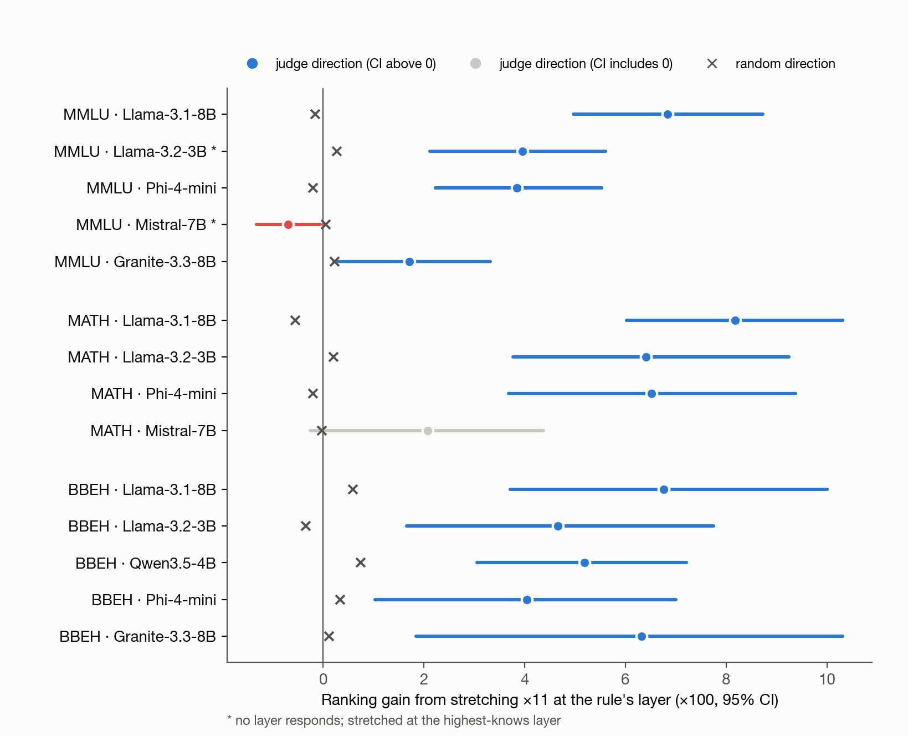

# Making Small LLM Judges Rank Better: Find the Correctness Direction, Pick the Layer the Verdict Reads, Stretch

*November 16, 2026*

::: summary
## Summary

- **Question.** Small open LLM judges often know more about whether an answer is right than their verdict shows. Can we turn that hidden knowledge into a better judge, reliably, across judges and benchmarks? And does it help on questions the judge cannot solve itself?
- **A recipe that works across judges and benchmarks.** (1) Check for a gap between what the judge's hidden state knows and what its verdict says. (2) Shortlist layers by how well the direction ranks answers. (3) Keep only layers where pushing along the direction actually moves the verdict. (4) Stretch there. With the layer rule fixed in advance, 14 of 21 judge–benchmark pairs have a gap; in **11 of the 12 where a layer responds, ranking improves by +2 to +8 points** (6 judges from 3 B to 8 B; MMLU-Redux, MATH, BBEH). A random direction does nothing.
- **Solved vs not solved.** Gains are largest where the judge can solve the question (Llama-3.1-8B on MMLU: +7.9, and +5.9 even within one answering model's answers). On questions it cannot solve the raw gains are also large (up to +9), but mostly come from recognising *which model wrote the answer*. Comparing only right vs wrong answers written by the **same** model, a smaller real gain remains on **reasoning benchmarks**: Llama-3.1-8B gains **+5.0 [+1.8, +8.5]** on 256 MATH questions it failed in all 9 of its own tries, Granite +3 on BBEH questions it can't solve, and small judges +2 to +3 with a gentle stretch; pooled over judges, +1 to +1.5 on MATH and BBEH. On **MMLU** (recalling facts) there is little or none. Checking a worked answer is easier than solving the problem; checking a recalled fact is not.
- **Why it fails when it fails, three causes:** (a) the layer is too early (the verdict rebuilds its decision from later layers and ignores an edit there); (b) the verdict reads the direction backwards (Llama-3.2-3B and, in the fresh test, Qwen2.5-7B distrust the most accurate answering model on MMLU); (c) the verdict is saturated (Mistral says CORRECT to 99% of answers, so pushes move its score but never its decision). The push test fixes (a); measuring the response on the verdict score instead of the accept rate fixes (c); (b) has no fix at those layers.
- **Most of the hidden gap is "which model wrote this answer"** (75–88% of the direction's spread within a question), which is why gains shrink on same-model pairs.
- **Strength:** ×11 is a safe default; judges whose verdict score responds strongly need a gentler stretch (×4), weakly responding ones a stronger one (×21).
- **Fresh preregistered test on two new judges: half held.** Llama-3.2-1B gains +5.4 (MMLU) and +7.9 (MATH), and on MATH questions it cannot solve (it solves 16 of 602) its same-model gain is +2 to +4 at every strength. Both misses are on BBEH (in both, the rule picked between layers whose *knows* differ by less than split noise, and a neighbouring layer the verdict reads more strongly gains +4.6 and +6.4).
:::

## 1. Setup

*Inside the Unfair Judge* ([Xu et al., 2026](https://arxiv.org/abs/2607.11871)) shows that an LLM judge's biases live in a few directions of its hidden states and can be steered. Building on an insight from Phaedrus on that paper, we look for a direction that tracks whether an answer is *actually right* and stretch it.

- **Judges** (thinking off): Llama-3.1-8B, Llama-3.2-3B, Qwen3.5-9B, Qwen3.5-4B, Phi-4-mini, Mistral-7B, Granite-3.3-8B.
- **Benchmarks:** MMLU-Redux (multiple choice, expert-checked key; 3,496 answers to 922 questions), MATH (competition math, graded by GLM-5.3-Flash; 2,384 answers to 602 questions), BBEH (hard reasoning; 2,244 answers to 447 questions). Answers come from other, mostly stronger models; the judge sees one question and one answer and replies starting with `VERDICT:`.
- **Solved / not solved:** whether the judge answers the question correctly itself (its own answer, thinking off).
- **Verdict score:** log P(CORRECT) − log P(INCORRECT) at the word after `VERDICT:`.
- **Ranking:** for every pair of one right and one wrong answer to the same question, 1 if the right one gets the higher verdict score, ½ for a tie, 0 otherwise; averaged. 0.50 is chance. Unlike accuracy, ranking cannot improve by the judge just becoming stricter.
- **Gain:** ranking after the stretch minus before, ×100, with 95% intervals from resampling questions.
- **Same-model pairs:** only pairs where the right and the wrong answer were written by the same model. This removes the clue "this answer came from the stronger model".

## 2. The recipe

1. **Capture.** One forward pass per answer; save the hidden state at `VERDICT:` at every other layer.
2. **Direction and gap.** At each layer, subtract each question's average state, then take (average state of right answers) − (average state of wrong answers), learned on half the questions and scored on the other half. *Knows* = ranking from the position along this direction. *Says* = ranking from the verdict score. **Gap** = best layer's *knows* − *says*. Stop if the gap is 5 points or less: there is nothing to recover.
3. **Push test (no labels).** On 400 answers, push each answer −8 and +8 standard deviations along the direction at each layer and record how often the judge then says CORRECT. A layer *responds* if the accept rate rises by at least 10 points.
4. **Pick the layer:** among responding layers, the one whose direction ranks best.
5. **Stretch:** at that layer, multiply each answer's distance from the average along the direction (×11 default), leaving everything else unchanged.

Steps 3–4 were fixed in a written rule before any of the 15 new pairs was run (`out_allpairs/RULE.md`). Only the chosen layer is stretched, so the layer cannot be picked by its gain. Cost: one capture pass plus a few edited re-reads of the last token per answer, under an H100-hour per pair.

## 3. Results across judges and benchmarks

| Bench | Judge | Gap | Layer | Accept −8 → +8 sd | Gain ×11, all | Solved | Not solved | Same-model, not solved |
|---|---|---|---|---|---|---|---|---|
| MMLU | Llama-3.1-8B | +12.6 | 16/32 | 79% → 97% | **+6.8** [+5.0, +8.7] | **+7.9** [+5.0, +10.8] | **+6.0** [+3.5, +8.7] | +0.4 [-4.4, +5.7] |
| MMLU | Llama-3.2-3B | +11.6 | 12/28* | 93% → 91% | **+4.0** [+2.1, +5.6] | **+3.9** [+0.8, +6.9] | **+4.0** [+1.9, +6.3] | +3.3 [-0.9, +7.7] |
| MMLU | Phi-4-mini | +7.2 | 16/32 | 69% → 96% | **+3.8** [+2.2, +5.5] | **+4.2** [+1.6, +6.9] | **+3.6** [+1.3, +6.1] | +0.3 [-3.6, +4.2] |
| MMLU | Mistral-7B | +7.6 | 4/32* | 99% → 99% | -0.7 [-1.3, -0.1] | -0.1 [-1.1, +0.8] | -1.0 [-1.9, -0.1] | -2.1 [-3.8, -0.5] |
| MMLU | Granite-3.3-8B | +6.4 | 20/40 | 81% → 94% | **+1.7** [+0.2, +3.3] | **+2.7** [+0.4, +4.9] | +1.0 [-1.1, +3.0] | +1.6 [-2.4, +5.6] |
| MATH | Llama-3.1-8B | +13.0 | 16/32 | 43% → 98% | **+8.2** [+6.0, +10.3] | +2.2 [-2.8, +7.5] | **+9.0** [+6.5, +11.6] | +2.7 [-2.0, +7.3] |
| MATH | Llama-3.2-3B | +11.8 | 14/28 | 43% → 100% | **+6.4** [+3.8, +9.2] | **+9.1** [+1.6, +16.6] | **+6.1** [+3.4, +9.0] | -3.6 [-9.0, +1.6] |
| MATH | Phi-4-mini | +12.9 | 14/32 | 50% → 93% | **+6.5** [+3.7, +9.4] | **+3.8** [+0.1, +7.3] | **+7.1** [+3.7, +10.7] | +1.7 [-4.6, +8.1] |
| MATH | Mistral-7B | +5.7 | 16/32 | 45% → 99% | +2.1 [-0.3, +4.4] | -7.3 [-17.3, +2.9] | +2.3 [-0.2, +4.9] | -0.7 [-4.7, +3.2] |
| BBEH | Llama-3.1-8B | +11.2 | 14/32 | 44% → 71% | **+6.8** [+3.7, +10.0] | +0.4 [-1.1, +2.1] | **+7.7** [+4.0, +11.9] | – |
| BBEH | Llama-3.2-3B | +10.3 | 14/28 | 25% → 38% | **+4.7** [+1.7, +7.7] | +0.0 [-11.9, +10.1] | **+5.2** [+2.0, +8.5] | – |
| BBEH | Qwen3.5-4B | +9.3 | 20/32 | 15% → 38% | **+5.2** [+3.1, +7.2] | **+6.4** [+3.4, +9.4] | **+3.9** [+1.1, +6.9] | – |
| BBEH | Phi-4-mini | +10.8 | 20/32 | 24% → 57% | **+4.0** [+1.0, +7.0] | +0.0 [-14.0, +13.3] | **+4.5** [+1.6, +7.4] | – |
| BBEH | Granite-3.3-8B | +7.4 | 22/40 | 0% → 65% | **+6.3** [+1.8, +10.3] | +6.5 [-5.0, +19.6] | **+6.3** [+1.9, +10.6] | – |

\* No layer responds; stretched at the layer whose direction ranks best. Not stretched (gap ≤ 5): Qwen3.5-9B on MMLU (+0.8); Qwen3.5-4B on MMLU (+1.2); Qwen3.5-9B on MATH (+4.9); Qwen3.5-4B on MATH (+2.0); Granite-3.3-8B on MATH (+4.4); Qwen3.5-9B on BBEH (-1.5); Mistral-7B on BBEH (+4.5).

- **Every judge with a gap gains somewhere.** The ×11 gain is significant in 11 of the 12 pairs where a layer responds (not Mistral on MATH, +2.1), and in one where none does (Llama-3.2-3B on MMLU, at the fallback layer). The random direction stays within ±1.
- **Small judges benefit too:** Llama-3.2-3B (+4 to +6), Phi-4-mini (+4 to +7), Qwen3.5-4B on BBEH (+5).
- **No gap, no gain:** Qwen3.5-9B has no gap on any benchmark; its verdict already uses what the direction knows.
- **The layer check matters.** Earlier we steered Llama-3.1-8B on MATH at layer 14 (chosen by *knows* alone) and Phi-4-mini on MMLU at layer 14: gains of +1.5 and +1.2. The rule moves both to layer 16, where the verdict listens: +8.2 and +3.8.

## 4. Beyond the judge's ability: the same-model test

The not-solved gains in section 3 mostly vanish on same-model pairs of the original answer pool, because most of what the direction knows is which model wrote the answer, and that pool has few same-model pairs. To test this with enough power we built answer sets with many right *and* wrong answers from the same model per question: on MMLU and MATH, Qwen3.5-4B answered each question Llama-3.1-8B cannot solve 12 more times; on BBEH, four answering models each contributed up to 2 right and 2 wrong of their existing 5 samples. That is 2,400–3,000 same-model pairs per benchmark. Each judge is stretched at the rule's layer, with the direction learned on the original answers to the other half of the questions. "Own unsolved" = questions the judge itself got wrong.

| Judge, benchmark (questions) | Questions | Ranking before | ×4 | ×11 | ×21 | Random ×11 |
|---|---|---|---|---|---|---|
| Granite-3.3-8B, BBEH (own unsolved) | 342 | 0.51 | **+3.1** [+1.7, +4.6] | **+3.3** [+0.7, +6.0] | +2.2 [-1.0, +5.8] | -0.0 |
| Llama-3.1-8B, BBEH (own unsolved) | 304 | 0.54 | +0.3 [-0.9, +1.5] | +1.1 [-1.5, +3.8] | -0.9 [-4.3, +2.8] | -0.2 |
| Llama-3.2-3B, BBEH (own unsolved) | 343 | 0.53 | **+2.2** [+1.0, +3.4] | +1.0 [-1.2, +3.1] | +1.3 [-1.4, +4.3] | -0.3 |
| Phi-4-mini, BBEH (own unsolved) | 345 | 0.56 | +0.2 [-0.7, +1.1] | +0.8 [-0.7, +2.6] | +0.8 [-1.7, +3.5] | +0.1 |
| Qwen3.5-4B, BBEH (own unsolved) | 213 | 0.54 | +0.4 [-1.0, +1.9] | +1.0 [-1.1, +2.9] | +2.3 [-0.6, +5.2] | -0.1 |
| Llama-3.1-8B, MATH (own unsolved) | 351 | 0.58 | **+3.6** [+1.8, +5.5] | **+3.9** [+1.3, +6.5] | **+4.8** [+2.0, +7.7] | -0.1 |
| Llama-3.1-8B, MATH (failed 9 of 9 own tries) | 256 | 0.57 | **+4.8** [+2.5, +7.5] | **+5.0** [+1.8, +8.5] | **+5.2** [+1.7, +8.8] | +0.4 |
| Llama-3.2-3B, MATH (own unsolved) | 332 | 0.63 | **+2.8** [+0.5, +5.0] | -3.4 [-7.1, +0.0] | -5.3 [-9.2, -1.1] | +0.2 |
| Mistral-7B, MATH (own unsolved) | 340 | 0.56 | +0.6 [-0.3, +1.5] | -0.6 [-2.9, +1.7] | -6.3 [-10.0, -2.9] | -0.1 |
| Phi-4-mini, MATH (own unsolved) | 312 | 0.59 | **+1.7** [+0.0, +3.4] | -2.1 [-6.1, +1.8] | -14.6 [-19.9, -10.1] | -0.2 |
| Granite-3.3-8B, MMLU (own unsolved) | 272 | 0.45 | -0.5 [-2.4, +1.4] | +0.3 [-2.8, +3.0] | +1.3 [-1.7, +4.4] | +0.0 |
| Llama-3.1-8B, MMLU (own unsolved) | 401 | 0.48 | +0.3 [-1.1, +1.6] | -0.0 [-2.6, +2.6] | -0.7 [-3.7, +2.3] | +0.1 |
| Phi-4-mini, MMLU (own unsolved) | 269 | 0.44 | **+1.6** [+0.3, +2.9] | +1.7 [-0.6, +3.8] | +2.6 [-0.5, +5.4] | -0.1 |
| **Pooled, MATH** (4 judges) | | | **+1.5** [+0.8, +2.2] | +0.1 [-1.4, +1.6] | -2.8 [-4.6, -1.0] | |
| **Pooled, BBEH** (5 judges) | | | **+1.0** [+0.5, +1.5] | **+1.3** [+0.3, +2.2] | +1.2 [-0.1, +2.6] | |
| **Pooled, MMLU** (3 judges) | | | +0.7 [-0.1, +1.5] | +0.8 [-0.6, +2.3] | +1.1 [-0.7, +2.8] | |

- **MATH: real checking beyond ability, strongest for Llama-3.1-8B.** It gains at every strength, including +5.0 [+1.8, +8.5] on the 256 questions it failed in all 9 of its own attempts. The smaller judges gain only with a gentle stretch (×4: Llama-3.2-3B +2.8, Phi-4-mini +1.7); ×11–×21 overshoots and hurts them.
- **BBEH: a smaller real gain, clearest for Granite** (+3.1 to +3.3 on its own unsolved questions) and Llama-3.2-3B (+2.2 at ×4); pooled over five judges +1.0 to +1.3.
- **MMLU: little or none.** Llama-3.1-8B and Granite gain nothing; Phi-4-mini +1.6 at ×4. Recognising a right multiple-choice answer needs the fact; a worked math or reasoning answer can be checked step by step.
- The random direction stays within ±0.4 everywhere.

## 5. Why it fails when it fails

Three checks on each failing case: (i) the within-question correlation between the direction and the unedited verdict score; (ii) the same push applied at every token instead of only the last; (iii) how much of the direction's spread within a question is explained by which model wrote the answer.

- **Layer too early** (Llama-3.1-8B on MATH, layers ≤ 14). The correlation is −0.5 to +0.3 at layers 2–14 and +0.67 to +0.90 from layer 16. At layers 10–14 a last-token push moves the accept rate by ≤ 2 points, but the same push at every token moves it by up to 16 (layer 14: 83% → 99%). The verdict rebuilds its decision from the answer tokens in later layers and overwrites a last-token edit. *Fix: the push test.*
- **Verdict reads the direction backwards** (Llama-3.2-3B on MMLU, layers ≥ 14). The correlation is negative at every layer (−0.2 to −0.65), and pushing toward "right" makes it reject (98% → 44%). Both Llamas accept only 79% of Nemotron's answers against 98–99% of the Qwens', although Nemotron is right 72% of the time and Qwen3.5-4B 43%. The direction says Nemotron-like answers tend to be right; the 3B's verdict says the opposite. On MATH and BBEH the same judge responds normally (+6.4, +4.7). *No fix at those layers; the rule falls back to layer 12 (+4.0).*
- **Saturated verdict** (Mistral-7B on MMLU). It accepts 99% of answers with an average verdict score of +16.5 (odds about 10⁷ to 1). From layer 18 the verdict follows the direction (correlation +0.54 to +0.85) and pushes move the score (sensitivity 0.05–0.31), but never across zero, so the accept-rate check sees nothing. Stretching at layers 16–30 gains +2.3 to +3.6. *Fix: measure the response on the verdict score.* A score-based rule (sensitivity ≥ 0.05, then best *knows*) picks layer 16 (+2.3 [+0.5, +3.7]), and picks the same layer as the original rule wherever that rule worked. It was found after seeing this failure, so it still needs a fresh test.
- **The gain is authorship, not checking** (most not-solved gains on MMLU). 75–88% of the direction's spread within a question is explained by the answering model, at every layer, for every judge checked. *This is what the same-model test (section 4) controls for.*

## 6. Choosing the strength

*Sensitivity* = how far the verdict score moves per 1 sd pushed along the direction, in units of the score's spread within a question (label-free, from the push test). Gains on all pairs; the less the verdict responds, the harder it needs to be stretched.

| Judge, benchmark | Sensitivity | ×4 | ×11 | ×21 |
|---|---|---|---|---|
| Llama-3.1-8B, MATH | 0.26 | – | +8.2 | +7.6 |
| Llama-3.2-3B, MATH | 0.26 | +6.7 | +6.4 | +4.3 |
| Mistral-7B, MATH | 0.20 | +1.2 | +2.1 | -1.1 |
| Granite-3.3-8B, BBEH | 0.19 | +5.6 | +6.3 | +1.9 |
| Llama-3.1-8B, MMLU | 0.13 | +3.7 | +6.8 | +7.4 |
| Phi-4-mini, MATH | 0.12 | +2.0 | +6.5 | -3.9 |
| Phi-4-mini, MMLU | 0.12 | +1.5 | +3.8 | +4.2 |
| Granite-3.3-8B, MMLU | 0.11 | +1.9 | +1.7 | +2.0 |
| Qwen3.5-4B, BBEH | 0.08 | +3.6 | +5.2 | +7.0 |
| Phi-4-mini, BBEH | 0.07 | -0.2 | +4.0 | +7.7 |
| Llama-3.2-3B, MMLU | 0.06 | – | +4.0 | +1.0 |
| Llama-3.1-8B, BBEH | 0.04 | +2.0 | +6.8 | +6.0 |
| Llama-3.2-3B, BBEH | 0.03 | +2.2 | +4.7 | +3.4 |

- High sensitivity (≥ 0.2): ×21 overshoots; use ×4–×11.
- Low sensitivity (< 0.08, mostly BBEH): ×11–×21.
- ×11 is within about 2 points of the best tested strength for most pairs, so it is a safe default. On same-model pairs, small judges need the gentler end (section 4).

## 7. A fresh test of the score-based rule

The score-based rule (section 5) was written down before running two judges new to this study, a deliberately weak one (Llama-3.2-1B) and a stronger one (Qwen2.5-7B), on all three benchmarks (`out_allpairs/RULE_v2.md`). Prediction: wherever there is a gap and a responding layer, the ×11 gain is above 0 and the random direction stays within ±1.

| Bench | Judge | Gap | Layer: score rule (accept rule) | Sensitivity | Gain ×11, all | Not solved | Same-model, own unsolved: ×4 / ×11 | Random |
|---|---|---|---|---|---|---|---|---|
| MMLU | Llama-3.2-1B | +12.1 | 10 (4) | 0.05 | **+5.4** [+2.8, +7.7] | **+4.7** [+2.0, +7.1] | -0.1 / -1.8 | -0.1 |
| MMLU | Qwen2.5-7B | +10.3 | 20* (20) | 0.04 | **+2.5** [+1.1, +4.0] | +1.3 [-0.4, +3.2] | – | -0.2 |
| MATH | Llama-3.2-1B | +12.8 | 14 (12) | 0.15 | **+7.9** [+5.4, +10.1] | **+8.2** [+5.7, +10.4] | +2.2 / +3.7 | -0.8 |
| MATH | Qwen2.5-7B | +5.0 | gap ≤ 5, not stretched | | | | | |
| BBEH | Llama-3.2-1B | +7.9 | 10 (10) | 0.20 | -1.5 [-5.1, +2.0] | -1.8 [-5.7, +1.8] | +0.4 / -4.0 | -0.8 |
| BBEH | Qwen2.5-7B | +10.1 | 20 (20) | 0.09 | +1.0 [-1.5, +3.4] | +1.1 [-1.6, +3.9] | – | +0.1 |

- **Held:** Llama-3.2-1B gains +5.4 on MMLU and +7.9 on MATH; the random direction stays within ±1.
- **Checking beyond ability replicates on MATH.** On same-model pairs from MATH questions the 1B cannot solve (it solves 16 of 602), the gain is +2.2 / +3.7 / +3.5 at ×4 / ×11 / ×21, all with intervals above 0. MMLU stays at about 0, as predicted.
- **Qwen2.5-7B on MMLU: no layer responds** (best sensitivity 0.047), with the same signature as Llama-3.2-3B: it accepts 63% of Nemotron's answers against 90–95% of the Qwens', and its verdict runs against the direction at layers 2–18 (correlation −0.4 to −0.5). Stretching at the fallback layer still gains +2.5. Its MATH gap is +5.0, so MATH was not stretched.
- **Both misses are on BBEH.** The 1B's gap is +7.9 on the rule's split but +5.9 averaged over 20 splits (*knows* 0.55): little to recover. Qwen2.5-7B has a real gap (+8.5 over 20 splits). In both, *knows* is flat across the responding layers to within split noise, and the rule took the layer where the verdict only starts to respond. A full sweep shows a neighbouring layer the verdict reads more strongly does gain: +6.4 [+3.3, +10.3] for the 1B (layer 14) and +4.6 [+1.2, +8.2] for Qwen2.5-7B (layer 22). *Lesson (not yet tested):* average *knows* over several splits and, among near-ties, prefer the layer with the stronger response.

## Limitations

- The layer rule's accept-rate check failed on one judge (Mistral); the score-based fix was found after that failure, and on two fresh judges it held in 2 of the 4 pairs with a responding layer (section 7).
- The beyond-ability gains are clear on MATH (Llama-3.1-8B, and the fresh Llama-3.2-1B) and small elsewhere; MMLU and MATH same-model answers come from one answering model (Qwen3.5-4B). The pooled rows treat judges as independent, which they are not (same questions and answers).
- The gap is measured on one split of the questions; on BBEH (about 230 usable questions) it varies by ±0.01–0.04 across splits, enough to push a borderline pair over the bar (Llama-3.2-1B: +7.9 on the rule's split, +5.9 averaged over 20).
- "Not solved" uses one sample of the judge's own answer, except the strict MATH test (9 samples); one sample overstates how often a judge truly cannot solve a question.
- Ranking measures whether right answers score above wrong ones to the same question; a deployed judge also needs a threshold, which stretching shifts.
