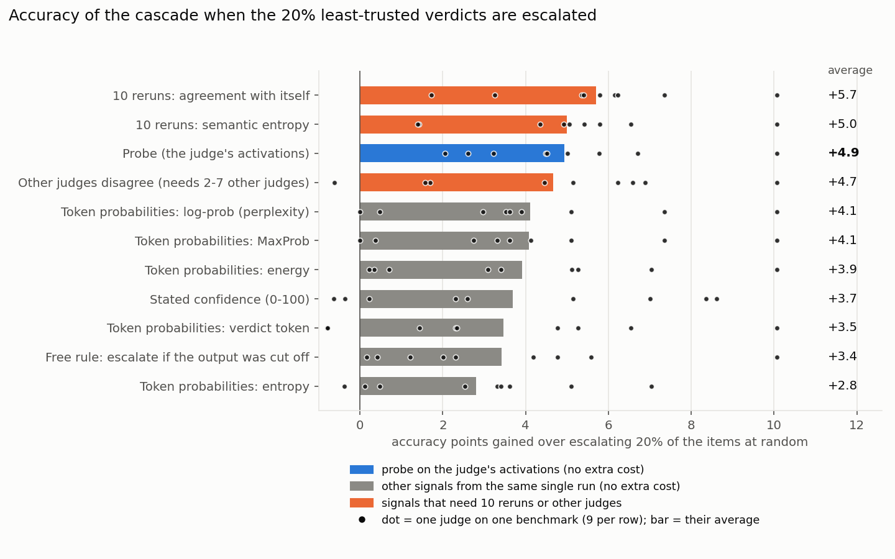
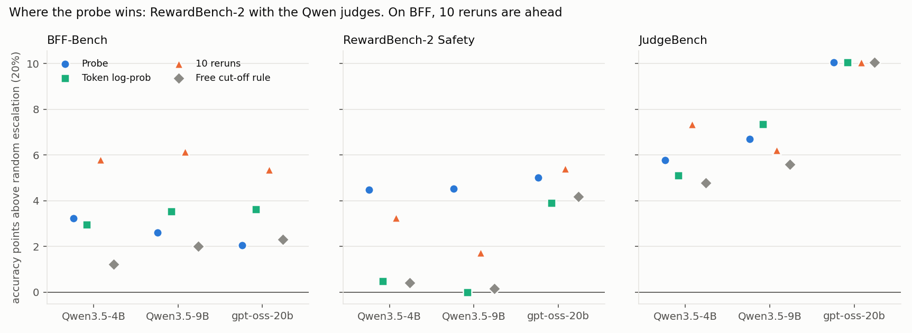
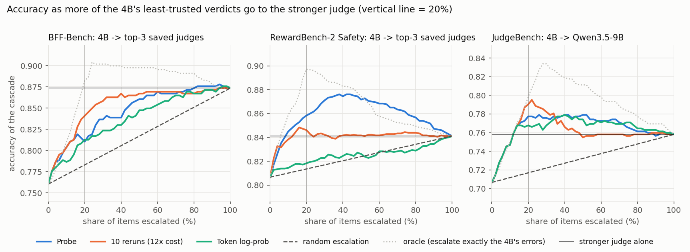

# Can a judge's internal numbers tell us when its verdict is wrong?

Replication of *Calibrating LLM Judges: Linear Probes for Fast and Reliable Uncertainty Estimation* (arXiv 2512.22245), applied to the question behind our dynamic jury.

## The problem

A dynamic jury should not call every judge on every item. The cheap way to run it: a small, cheap judge grades the item first, and only the items it is probably **wrong** about go to a stronger (more expensive) judge. This is called **escalation**.

That only works if we can tell, for each verdict, **how likely the cheap judge is to be wrong**. This README tests one way to do that and compares it with the alternatives.

## The idea we test

When a model reads an item and writes its answer, it builds long lists of numbers inside itself. These are its **activations**. The paper's claim: those numbers already contain a hint about whether the answer is right.

To read the hint, the paper trains a **probe**: a very small scorer (one weighted sum, no deep network).

1. The judge grades an item: it writes its reasoning, then its verdict.
2. We save the judge's activations at the **last token it wrote**. That is a list of about 2,500 numbers.
3. The probe multiplies each number by a learned weight and adds them up. The result is a score between 0 and 1: *how likely is this verdict to be right?*
4. The probe learns the weights from past verdicts where we know the true answer: it sees the activations and the label "right" or "wrong".

A low score means "doubt this verdict", so we escalate it. The probe costs nothing extra to compute: the judge has already run.

## What we did

**Judges and data.** Three open-weight judges that we run ourselves, because reading activations needs access to the model's inside: Qwen3.5-4B, Qwen3.5-9B and gpt-oss-20b. Three benchmarks, each with human labels:

| Benchmark | Items | What the judge decides |
|---|---|---|
| BFF-Bench | 459 (80 questions) | is the final answer in a finance conversation correct? |
| RewardBench-2, Safety subset | 1,800 (450 prompts) | is the response appropriate: helps with fine requests, refuses harmful ones? |
| JudgeBench | 620 pairs | which of two responses to a hard math, reasoning, code or knowledge question is correct? |

A verdict counts as **right** when it matches the human label. Qwen3.5-4B is right on 76% / 81% / 71% of these three benchmarks; the 9B on 78% / 84% / 76%; gpt-oss-20b on 79% / 84% / 59%.

**Step 1: get the verdicts and the activations.** Each judge writes its reasoning and verdict with the paper's prompt (reasoning inside `<think>`, then a verdict, up to 4,096 tokens; no randomness, always the most likely next word). We save its activations at the last token, at every second layer. One linear probe is trained **per judge**, on that judge's own activations. The main result uses the layer the paper uses (the middle layer: 16 for the 32-layer Qwen models, 8 for the 24-layer gpt-oss-20b).

**Step 2: train the probe without cheating.** The items of the three benchmarks are pooled and split by question into 5 folds. The probe scoring an item was trained only on other questions, so it never saw the item it scores. We repeat this with 5 random seeds and average, because one training run can be luckier than another. Training settings are the paper's: one linear layer, squared-error (Brier) loss, AdamW, learning rate 1e-4, 10 epochs.

**Step 3: compare with every other way of deciding "doubt this verdict".**

| Signal | How it works | Extra generation |
|---|---|---|
| **Probe** | reads the judge's activations | none |
| Stated confidence | the judge writes "confidence: 0 to 100" in its answer | none |
| Token probabilities | how confident the judge's own word choices were (perplexity, entropy, MaxProb, energy, and the probability of the verdict word) | none |
| Free cut-off rule | escalate only if the output was cut off and gave no verdict | none |
| 10 reruns | run the judge 10 more times at temperature 0.7; doubt it if its answers disagree (consistency, semantic entropy) | about 12x |
| Other judges disagree | doubt the verdict if other judges disagree with it | needs 2 to 7 other judges |

Stated confidence comes from a second run of the judge with the confidence request added to the prompt, and that run's own verdict is used for it.

**Step 4: the test that matters, the cascade.** For each signal: rank the cheap judge's verdicts from least to most trusted, send the least-trusted share to the stronger judge, and use the stronger judge's verdict for those. Then measure the accuracy of the whole system. Escalation targets: the saved top-3 vote of our 8-judge pool for BFF and RewardBench-2, and the other hosted judge for JudgeBench. Verdicts that never finished (no answer) are escalated first for every signal.

We compare the signals at one fixed point: **the accuracy of the whole cascade when the 20% of items a signal trusts least are escalated.** The reference is escalating 20% of the items **at random**. We report **accuracy points gained over random escalation**, so a signal that is no better than random scores 0.

This cascade comparison is our own experiment, not one from the paper. The paper's own metrics (AUROC and calibration error) are reported in the last results section.

## Results

### Which signal picks the right items to escalate?

Averaged over the 3 judges and 3 benchmarks, the cheap judge alone gets 0.764, escalating 20% at random gets 0.772, and the stronger judges alone get 0.806. Escalating the 20% each signal trusts least gives:

| Signal | Extra generation | Accuracy points over random |
|---|---|---|
| 10 reruns (agreement with itself) | about 12x | **+5.7** |
| 10 reruns (semantic entropy) | about 12x | +5.0 |
| **Probe** | none | **+4.9** |
| Other judges disagree | needs 2 to 7 other judges | +4.7 |
| Token probabilities (the five variants) | none | +2.8 to +4.1 |
| Stated confidence | none | +3.7 |
| Free cut-off rule | none | +3.4 |

- The probe is **about as good as 10 reruns** (+4.9 against +5.0 and +5.7, a gap of under one point), at one-twelfth of the generation cost.
- Its edge over the other signals from the same single run is small: about 1.5 points over the free cut-off rule and under 1 point over the best token-probability signal.
- The probe's numbers are means over 5 training seeds (spread at most 0.5 accuracy points per setting). The other signals involve no training. Differences of about a point between the probe and the next signals are small and should not be over-read.

### Where it works and where it doesn't

Accuracy of the cascade with 20% escalated (random escalation and the cheap judge alone in brackets):

| | Probe | 10 reruns | Token log-prob | Free cut-off rule |
|---|---|---|---|---|
| RewardBench-2, Qwen3.5-4B (0.814, 0.807) | **0.858** | 0.846 | 0.818 | 0.818 |
| RewardBench-2, Qwen3.5-9B (0.841, 0.841) | **0.886** | 0.858 | 0.841 | 0.843 |
| RewardBench-2, gpt-oss-20b (0.839, 0.839) | 0.889 | 0.893 | 0.878 | 0.881 |
| BFF, Qwen3.5-4B (0.783, 0.760) | 0.815 | **0.841** | 0.813 | 0.795 |
| BFF, Qwen3.5-9B (0.797, 0.778) | 0.823 | **0.858** | 0.832 | 0.817 |
| BFF, gpt-oss-20b (0.809, 0.793) | 0.830 | **0.863** | 0.845 | 0.832 |
| JudgeBench, Qwen3.5-4B (0.717, 0.706) | 0.775 | **0.790** | 0.768 | 0.765 |
| JudgeBench, Qwen3.5-9B (0.725, 0.758) | 0.792 | 0.787 | **0.798** | 0.781 |
| JudgeBench, gpt-oss-20b (0.625, 0.592) | 0.726 | 0.726 | 0.726 | 0.726 |

- **RewardBench-2 with the Qwen judges: the probe is ahead.** It beats 10 reruns by 1 to 3 points, and the simple signals barely beat random there.
- **BFF: 10 reruns are ahead for all three judges.**
- **JudgeBench: everything is close.** 13% to 26% of the answers there were cut off at 4,096 tokens, and the free cut-off rule alone already captures most of the gain. For gpt-oss the signals from the main run end up identical, because the cheap judge's cut-off answers are escalated first and nothing is left to rank.

### What it means for accuracy

Qwen3.5-4B as the cheap judge, sending its least-trusted verdicts to a stronger judge (one probe training run, as drawn). The dotted line is the best possible: escalating exactly the 4B's mistakes first.

| Benchmark | 4B alone | Stronger judge alone | Random 20% escalated | **Probe, 20% escalated** | 10 reruns, 20% escalated |
|---|---|---|---|---|---|
| RewardBench-2 | 0.807 | 0.841 | 0.814 | **0.858** | 0.846 |
| JudgeBench | 0.706 | 0.758 | 0.716 | **0.777** | 0.790 |
| BFF | 0.760 | 0.874 | 0.783 | 0.810 | 0.841 |

- On RewardBench-2 and JudgeBench, the cascade beats the stronger judge alone while the cheap judge handles 80% of the items.
- On BFF it does not: it needs about half the items escalated to approach the stronger judge.

**Cost of getting the signal** (generated tokens per item, Qwen3.5-4B): the probe needs one run (1,196 tokens on BFF, 425 on RewardBench-2, 1,860 on JudgeBench). 10 reruns need about 12 times that (14,441, 5,110 and 22,219).

### Is the probe's score a trustworthy probability? (4B only)

The paper's main claim is that the probe's number is well calibrated, meaning that "80%" really means right about 80% of the time. We did **not** reproduce that. The probe trained on BFF and RewardBench-2 and tested on held-out questions (JudgeBench as an unseen benchmark), on items where every method has a score:

| | Probe | Stated confidence | 10-rerun consistency | Always the training accuracy |
|---|---|---|---|---|
| RewardBench-2: ranks right above wrong (AUROC, 0.5 = guessing) | **0.89** | 0.55 | 0.79 | 0.50 |
| RewardBench-2: calibration error (lower is better) | 0.090 | 0.147 | 0.088 | 0.012 |
| BFF: AUROC | 0.67 | 0.68 | 0.85 | 0.50 |
| BFF: calibration error | 0.114 | 0.098 | 0.076 | 0.054 |
| JudgeBench, unseen benchmark: AUROC | 0.59 | 0.72 | n/a | 0.50 |
| JudgeBench: calibration error | 0.191 | 0.118 | n/a | 0.021 |

- The probe is good at **ranking** on RewardBench-2 but its numbers are not better calibrated than the baselines'; a constant guess has lower calibration error than every method.
- Normalizing the activations before the probe made calibration much worse (error 0.58 to 0.73).
- Trained on single-response grading, the probe did not carry over to the pairwise JudgeBench. When JudgeBench pairs were in its training data, it reached AUROC 0.73 on held-out JudgeBench questions (only 54 test items, so noisy).

## Conclusion

For a judge we can run ourselves, a probe on its activations is a **cheap trigger for escalation that is about as good as rerunning the judge 10 times** (+4.9 against +5.7 accuracy points over random escalation), at one-twelfth of the generation cost. Its edge over the other cheap signals is small, about one point. The clear win is RewardBench-2 with the Qwen judges. On BFF the reruns are better, and on JudgeBench everything is close. The overall gain is a few accuracy points.

## Limits

- **Only for judges we can run.** The probe needs the judge's activations, so it cannot be used on API-only judges. The paper states the same limit. We did not test a small hosted model reading an API judge's answers.
- **It needs labelled data** from each kind of task, and it did not transfer across task formats.
- **Three judges from two families.** We could not read the activations of Nemotron or Qwen3.6-35B, and the largest judges (gpt-oss-120b, DeepSeek) are too big for our setup.
- **The escalation targets for BFF and RewardBench-2 are saved verdicts** from our earlier 8-judge pool, which used short answers through an API, not the reasoning runs used here.
- **Cut-off answers on JudgeBench** count as wrong, and make up 13% to 26% of the verdicts there.
- **Choices the paper does not specify:** which token is "the last token" (we use the last token the judge writes), the prompt for single-response grading (the paper only has a pairwise prompt), the 4,096-token cap, and the training set (the paper uses its own PPE data; we use our three benchmarks).
- **Not done:** temperature-scaled MaxProb, Chain-of-Embedding and CoT-kinetics baselines, the loss ablation (BCE and focal), and the rerun-count ablation. The loader for the paper's own training data (PPE) is written but unused.

## How the results were checked

- **Faster generation changes nothing.** Text is generated with vLLM and the activations are read by a separate full pass through the model. We checked this against the standard Hugging Face generation on 48 items: the two models agree on 98.9% of tokens, and where they differ the choice was an exact tie in the model's rounded numbers (median gap 0.000). On the items where the two texts were identical (6 of 48), the activations match to cosine similarity 0.9993 or better at every layer.
- **Cut-off answers cannot inflate the probe.** A probe can easily spot "this judge never finished". So every signal escalates unfinished answers first, and we report the free cut-off rule as its own baseline.

## Files

| File | What it does |
|---|---|
| `modal_generate.py` | runs everything on Modal GPUs (generation, activations, token statistics) |
| `vllm_generate.py`, `acts_from_gen.py`, `token_stats.py` | fast generation; reading the judge's activations; token-probability signals |
| `generate_judge.py` | the single-script Hugging Face version (used as the reference for the check above) |
| `judge_data.py`, `prompts.py` | the benchmarks and the paper's prompts |
| `evaluate.py`, `metrics.py` | probe training and the calibration table |
| `cascade_eval.py`, `summarize_cascade.py` | the escalation experiment and its cross-judge summary |
| `make_figures.py`, `figures/` | the plots above |
| `check_equivalence.py`, `check_greedy.py` | the equivalence checks |

Generated outputs (verdicts, activations) are not in the repo. `modal_generate.py` reads the saved 8-judge verdict files and the cached VERDICTS / RewardBench-2 tables from paths set at the top of the file; adjust them to where those files live. `cascade_eval.py` imports `data.py` and `audit.py` from `../role_conditioned_panels`.

Run order: `modal_generate.py::sweep` (per judge), then `modal_generate.py::tokstats`, download the outputs with `modal volume get`, then `cascade_eval.py`, `summarize_cascade.py` and `make_figures.py`.
