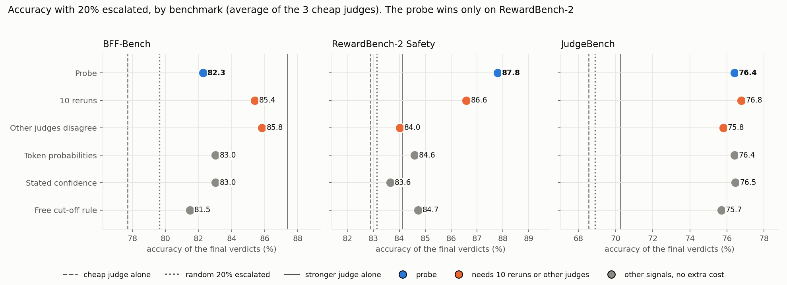

# Can a judge's internal numbers tell us when to escalate its verdict?

Replication of *Calibrating LLM Judges: Linear Probes for Fast and Reliable Uncertainty Estimation* (arXiv 2512.22245), applied to our dynamic jury: a cheap judge grades first, and only the verdicts it is probably wrong about go to a stronger judge.

## Setup

- **The test:** a cheap judge grades every item. A **signal** gives each verdict a trust score. The 20% with the lowest trust go to a stronger judge, whose verdict replaces the cheap one. Verdicts that never finished go first.
- **The metric:** the accuracy of the final verdicts against the human labels, compared with the accuracy we would get by escalating a random 20% instead. Example: Qwen3.5-4B on RewardBench-2 gets 81.4% with random escalation and 85.8% when the probe chooses.
- **The probe:** a tiny trained scorer on the judge's activations (its internal numbers) at the last token it writes. One probe per judge, trained on questions it never scores.
- **Judges and data:** cheap judges Qwen3.5-4B, Qwen3.5-9B, gpt-oss-20b, on BFF-Bench (finance), RewardBench-2 Safety and JudgeBench. Three judges times three benchmarks gives 9 settings. The stronger judge is the saved top-3 vote of our 8-judge pool (BFF, RewardBench-2) or another hosted judge (JudgeBench).
- **Compared with:** the judge's stated confidence, token probabilities, a free rule (escalate only answers that were cut off), 10 reruns (about 12x the generation) and other judges' disagreement (needs those judges).

## 1. Which signal chooses best overall?

Each dot is the accuracy of the final verdicts when the 20% each signal trusts least are escalated, averaged over the 9 settings. The vertical lines are the reference points: the cheap judge alone (76.4%), escalating 20% at random (77.2%) and the stronger judges alone (80.6%).

- Every signal beats random escalation (77.2%). They land between 80.0% and 82.9%.
- The top two are the **10 reruns** (82.9%, 82.2%), at about 12x the generation cost.
- The **probe** gets 82.2% with no extra cost. The other signals that cost nothing extra get 80.0% to 81.3%.
- Read the order with care: neighbouring dots differ by under a point.

## 2. Where it works and where it does not

Accuracy of the final verdicts, average of the 3 cheap judges (dashed line: the cheap judge alone, dotted: random 20% escalation, solid: the stronger judge alone):

- **RewardBench-2: the probe wins** (87.8%), above 10 reruns (86.6%) and above the stronger judge alone (84.1%). The other free signals reach only 83.6% to 84.7%.
- **BFF: the probe is weak** (82.3%). 10 reruns (85.4%) and other judges' disagreement (85.8%) are much better.
- **JudgeBench: everything is close** (75.7% to 76.8%). Most of that gain comes from escalating the answers that were cut off (the free rule alone gets 75.7%).

Full table of accuracies and gaps

Accuracy (%) with 20% escalated; average of the 3 cheap judges per benchmark.

| | BFF | RewardBench-2 | JudgeBench |
|---|---|---|---|
| Cheap judge alone | 77.7 | 82.9 | 68.5 |
| Random 20% escalated | 79.6 | 83.1 | 68.9 |
| **Probe** | 82.3 | **87.8** | 76.4 |
| 10 reruns | 85.4 | 86.6 | **76.8** |
| Other judges disagree | **85.8** | 84.0 | 75.8 |
| Token probabilities (log-prob) | 83.0 | 84.6 | 76.4 |
| Stated confidence | 83.0 | 83.6 | 76.5 |
| Free cut-off rule | 81.5 | 84.7 | 75.7 |
| Stronger judge alone | 87.4 | 84.1 | 70.3 |

Points above random (the gap to the "Random 20% escalated" row): probe 2.6 / 4.7 / 7.5; 10 reruns 5.8 / 3.5 / 7.9; other judges 6.2 / 0.9 / 6.9; token log-prob 3.4 / 1.5 / 7.5; stated confidence 2.6 / 0.5 / 8.0; free rule 1.8 / 1.6 / 6.8. Stated confidence comes from its own second run, so its gaps use that run's own baseline. The JudgeBench stronger-judge number averages different targets (for the 9B the target is weaker than the 9B itself).

Setting by setting, the probe beats 10 reruns in 3 of 9, loses in 5, ties in 1. It beats the free cut-off rule in 7 of 9 and token log-prob in 5 of 9.

## 3. What it means for accuracy

Qwen3.5-4B as the cheap judge. x-axis: the share of items sent to the stronger judge (0% = the 4B alone, 100% = the stronger judge alone). Dashed: random escalation. Dotted: the best possible.

| Accuracy | 4B alone | Stronger judge alone | Random 20% | **Probe, 20%** | 10 reruns, 20% |
|---|---|---|---|---|---|
| RewardBench-2 | 0.807 | 0.841 | 0.814 | **0.858** | 0.846 |
| JudgeBench | 0.706 | 0.758 | 0.716 | **0.777** | 0.790 |
| BFF | 0.760 | 0.874 | 0.783 | 0.810 | 0.841 |

- On RewardBench-2 and JudgeBench, escalating only 20% beats the stronger judge alone: the cheap judge keeps the items it is sure about, and the stronger judge handles the doubtful ones.
- On BFF it does not: the stronger judge is much better there, so about half the items must go up.

## 4. Does it carry over to a benchmark it was not trained on?

Accuracy (%) of the final verdicts with 20% escalated, mean of the 3 judges. In the "unseen" column the probe was trained on the other two benchmarks only:

| | Random 20% | Probe, same benchmark (one training run) | **Probe, unseen benchmark** | 10 reruns | Free rule |
|---|---|---|---|---|---|
| BFF | 79.6 | 82.1 | 82.1 | 85.4 | 81.5 |
| RewardBench-2 | 83.1 | 87.8 | **83.7** | 86.6 | 84.7 |
| JudgeBench | 68.9 | 76.6 | 76.2 | 76.8 | 75.7 |
| **Mean of the 9** | 77.2 | 82.1 | **80.7** | 82.9 | 80.6 |

On an unseen benchmark the probe falls to the free rule's level (80.7% against 80.6% on average). On RewardBench-2, its one win, it drops from 87.8% to 83.7%: about random escalation (83.1%) and below the free rule (84.7%). For the Qwen3.5-9B it is below random there. So the probe needs labelled data from each new kind of task.

## 5. Which layer to read the probe from?

Top: how well the probe separates right from wrong verdicts at each layer. Bottom: the validation error the layer-picking rule minimizes, and the layers it picks. Dotted line: the paper's fixed layer.

- **Qwen3.5-9B:** the ranking peaks at the paper's layer 16, and the rule picks it.
- **Qwen3.5-4B:** flat from layer 8 to 30; the rule picks 28 to 30.
- **gpt-oss-20b:** best in the earliest layers, near chance in deep layers; the rule picks 0 to 4.
- For the cascade the layer barely matters for the Qwen judges (under 1 point).

## Limits

- Only for judges we run ourselves (it needs their activations), and it needs labelled data per kind of task.
- Three judges from two families. Nemotron and Qwen3.6-35B could not be read.
- The stronger judges on BFF and RewardBench-2 are saved verdicts from our earlier 8-judge pool (short API answers, not reasoning runs).
- 13% to 26% of JudgeBench answers were cut off at 4,096 tokens and count as wrong.
- We did not reproduce the paper's calibration claim (below).

Details: signals, probe setup, calibration, checks, not done, files

**Signals**

| Signal | What gives the trust score | Extra cost |
|---|---|---|
| Probe | the judge's activations | none |
| Stated confidence | the judge writes "confidence 0 to 100" (a second run) | none |
| Token probabilities | how confident the judge's own word choices were (log-prob, entropy, MaxProb, energy, verdict token) | none |
| Free cut-off rule | the answer was finished or cut off | none |
| 10 reruns | share of 10 new runs that agree with the verdict (also semantic entropy) | about 7 to 12x |
| Other judges disagree | share of other judges whose verdict differs | needs 2 to 7 other judges |

**The probe.** One linear layer on the residual stream at the last token the judge generates, at the paper's fixed layer (16 for the 32-layer Qwen models, 8 for gpt-oss). Brier loss, AdamW, learning rate 1e-4, 10 epochs, batch 4. One probe per judge, trained on the three benchmarks pooled, 5 folds by question, 5 seeds (probe numbers are seed means). The paper does not say which token is "the last token"; this is our reading.

**Calibration (Qwen3.5-4B only).** The paper claims the probe's number is well calibrated. We did not reproduce this. On RewardBench-2 the probe ranks right above wrong verdicts well (AUROC 0.89, against 0.55 for stated confidence and 0.79 for 10 reruns), but its calibration error is 0.090 while a constant guess scores 0.012.

**Checks.** Generation uses vLLM and the activations come from a separate full pass. Against Hugging Face's own decoding on 48 items they agree on 98.9% of tokens, and every difference was an exact tie; on identical text the activations match to cosine similarity 0.9993 or better. Every signal escalates unfinished answers first, so cut-off answers cannot inflate the probe, and the free rule is reported as its own baseline.

**Not done:** the paper's broader training data (PPE), temperature-scaled MaxProb, Chain-of-Embedding, CoT-kinetics, and the loss and rerun-count ablations.

**Files**

| File | What it does |
|---|---|
| `modal_generate.py` | runs generation, activations and token statistics on Modal GPUs |
| `vllm_generate.py`, `acts_from_gen.py`, `token_stats.py` | fast generation; the judge's activations; token-probability signals |
| `generate_judge.py` | single-script Hugging Face version (reference for the check) |
| `judge_data.py`, `prompts.py` | the benchmarks and the paper's prompts |
| `evaluate.py`, `metrics.py` | probe training and the calibration table |
| `cascade_eval.py`, `summarize_cascade.py` | the escalation experiment, including the unseen-benchmark test |
| `layer_sweep.py` | trains the probe at every layer |
| `make_figures.py`, `figures/` | the plots |
| `check_equivalence.py`, `check_greedy.py` | the equivalence checks |

Generated outputs (verdicts, activations) are not in the repo. `modal_generate.py` reads the saved 8-judge verdict files and the cached VERDICTS and RewardBench-2 tables from paths set at the top of the file. `cascade_eval.py` imports `data.py` and `audit.py` from `../role_conditioned_panels`.

