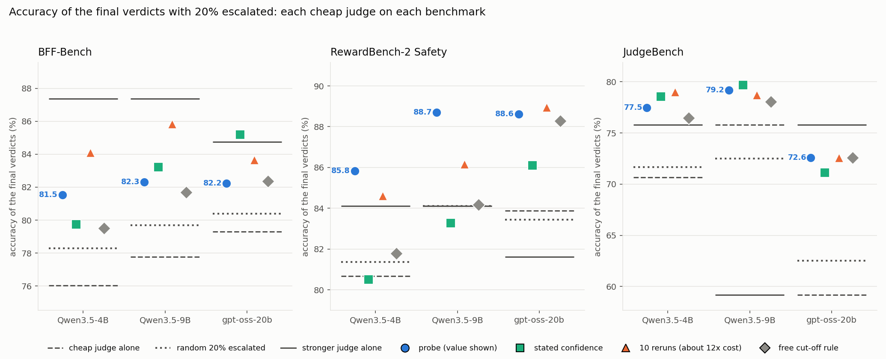
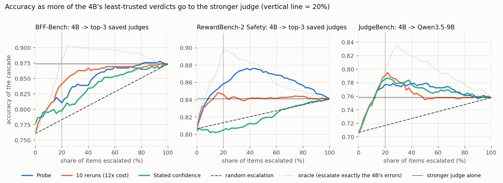
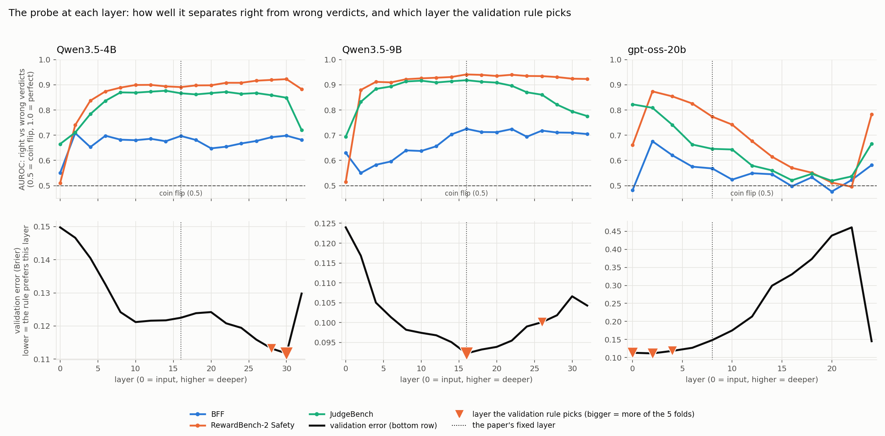

# Can a judge's internal numbers tell us when to escalate its verdict?

Replication of *Calibrating LLM Judges: Linear Probes for Fast and Reliable Uncertainty Estimation* (arXiv 2512.22245), applied to our dynamic jury: a cheap judge grades first, and only the verdicts it is probably wrong about go to a stronger judge.

## Setup

- **The test:** a cheap judge grades every item. A **signal** gives each verdict a trust score. The 20% with the lowest trust go to a stronger judge, whose verdict replaces the cheap one. Verdicts that never finished go first.
- **The metric:** the accuracy of the final verdicts against the human labels, compared with the accuracy we would get by escalating a random 20% instead. Example: Qwen3.5-4B on RewardBench-2 gets 81.4% with random escalation and 85.8% when the probe chooses.
- **The probe:** a tiny trained scorer on the judge's activations (its internal numbers) at the last token it writes. One probe per judge, trained on questions it never scores.
- **Judges and data:** cheap judges Qwen3.5-4B, Qwen3.5-9B and gpt-oss-20b, each on BFF-Bench (finance, 459 items), RewardBench-2 Safety (1,800 items) and JudgeBench (620 pairs). The stronger judge is the saved top-3 vote of the other judges in our 8-judge pool (BFF, RewardBench-2; the cheap judge's own model is never in its panel) or another hosted judge (JudgeBench).
- **Compared with:** the judge's stated confidence, token probabilities, a free rule (escalate only answers that were cut off), 10 reruns (about 12x the generation) and other judges' disagreement (needs those judges).
- **No averaging:** every number below is for one cheap judge on one benchmark.

## 1. Where it works and where it does not

Each panel is a benchmark and each group of dots is one cheap judge. Dashed line: the cheap judge alone. Dotted: random 20% escalation. Solid: the stronger judge alone.

- **RewardBench-2:** for the two Qwen judges the probe is the best signal: 85.8% (4B) and 88.7% (9B), above 10 reruns (84.6%, 86.2%), above the stronger judge alone (84.1% for both) and well above random (81.4%, 84.1%). For gpt-oss-20b the probe (88.6%) is level with 10 reruns (88.9%) and the free cut-off rule (88.3%); there the stronger panel (81.6%) is below the cheap judge itself (83.9%).
- **BFF:** the probe (81.5%, 82.3%, 82.2% for the 4B, 9B and gpt-oss) is behind 10 reruns (84.1%, 85.8%, 83.7%) and behind other judges' disagreement (85.2%, 86.3%, 84.3%) for all three judges. For gpt-oss, stated confidence (85.2%) is also above it.
- **JudgeBench:** the probe (77.5%, 79.2%, 72.6%) is within 1.5 points of the best signal for every judge. For gpt-oss every signal except stated confidence ends at exactly 72.6%: 26% of its answers were cut off, and escalating those first leaves little to rank. For the 9B the stronger judge (gpt-oss) is weaker than the 9B itself (59.2% against 75.8%).

Setting by setting, the probe beats 10 reruns in 3 of 9, loses in 5 and ties in 1. It beats the free cut-off rule in 7 of 9.

Full table: every judge on every benchmark (accuracy %, 20% escalated)

The best of the six signals in each row is in bold. Stated confidence comes from its own second run of the cheap judge.

| Benchmark | Cheap judge | Cheap alone | Random 20% | Probe | 10 reruns | Other judges | Token prob. | Stated conf. | Free rule | Stronger alone |
|---|---|---|---|---|---|---|---|---|---|---|
| BFF | Qwen3.5-4B | 76.0 | 78.3 | 81.5 | 84.1 | **85.2** | 81.3 | 79.7 | 79.5 | 87.4 |
| BFF | Qwen3.5-9B | 77.8 | 79.7 | 82.3 | 85.8 | **86.3** | 83.2 | 83.2 | 81.7 | 87.4 |
| BFF | gpt-oss-20b | 79.3 | 80.4 | 82.2 | 83.7 | 84.3 | 84.3 | **85.2** | 82.4 | 84.7 |
| RewardBench-2 | Qwen3.5-4B | 80.7 | 81.4 | **85.8** | 84.6 | 83.1 | 81.8 | 80.5 | 81.8 | 84.1 |
| RewardBench-2 | Qwen3.5-9B | 84.1 | 84.1 | **88.7** | 86.2 | 83.2 | 84.3 | 83.3 | 84.2 | 84.1 |
| RewardBench-2 | gpt-oss-20b | 83.9 | 83.4 | 88.6 | **88.9** | 83.4 | 87.1 | 86.1 | 88.3 | 81.6 |
| JudgeBench | Qwen3.5-4B | 70.6 | 71.7 | 77.5 | **79.0** | 77.9 | 76.8 | 78.5 | 76.5 | 75.8 |
| JudgeBench | Qwen3.5-9B | 75.8 | 72.5 | 79.2 | 78.7 | 76.9 | **79.8** | 79.7 | 78.1 | 59.2 |
| JudgeBench | gpt-oss-20b | 59.2 | 62.5 | **72.6** | **72.6** | **72.6** | **72.6** | 71.1 | **72.6** | 75.8 |

## 2. What it means for accuracy

Qwen3.5-4B as the cheap judge. x-axis: the share of items sent to the stronger judge (0% = the 4B alone, 100% = the stronger judge alone). Dashed: random escalation. Dotted: the best possible.

Accuracy (%) of the final verdicts with 20% escalated:

| | 4B alone | Stronger judge alone | Random 20% | **Probe, 20%** | Stated confidence, 20% | 10 reruns, 20% |
|---|---|---|---|---|---|---|
| RewardBench-2 | 80.7 | 84.1 | 81.4 | **85.8** | 80.5 | 84.6 |
| JudgeBench | 70.6 | 75.8 | 71.7 | 77.5 | 78.5 | **79.0** |
| BFF | 76.0 | 87.4 | 78.3 | 81.5 | 79.7 | **84.1** |

The probe's numbers are means over 5 training seeds; the curves show one training run, so they can differ by up to about half a point. The stated-confidence curve starts at a different height at 0% because it comes from its own second run of the 4B, whose verdicts differ slightly.

- On RewardBench-2 and JudgeBench, escalating only 20% with the probe beats the stronger judge alone: the cheap judge keeps the items it is sure about, and the stronger judge handles the doubtful ones.
- On BFF it does not: the stronger judge is much better there, so about half the items must go up.
- On RewardBench-2 the 4B's stated confidence does no better than random escalation (80.5% against 81.4%).

## 3. Does it carry over to a benchmark it was not trained on?

Accuracy (%) with 20% escalated. In the "unseen" column the probe was trained on the other two benchmarks only. "Same benchmark" is one training run.

| Benchmark | Cheap judge | Random 20% | Probe, same benchmark | **Probe, unseen benchmark** | 10 reruns | Free rule |
|---|---|---|---|---|---|---|
| BFF | Qwen3.5-4B | 78.3 | 81.0 | **81.5** | 84.1 | 79.5 |
| BFF | Qwen3.5-9B | 79.7 | 82.8 | **81.7** | 85.8 | 81.7 |
| BFF | gpt-oss-20b | 80.4 | 81.9 | **81.9** | 83.7 | 82.4 |
| RewardBench-2 | Qwen3.5-4B | 81.4 | 85.8 | **81.8** | 84.6 | 81.8 |
| RewardBench-2 | Qwen3.5-9B | 84.1 | 88.8 | **81.9** | 86.2 | 84.2 |
| RewardBench-2 | gpt-oss-20b | 83.4 | 88.6 | **87.1** | 88.9 | 88.3 |
| JudgeBench | Qwen3.5-4B | 71.7 | 77.7 | **77.4** | 79.0 | 76.5 |
| JudgeBench | Qwen3.5-9B | 72.5 | 79.4 | **78.5** | 78.7 | 78.1 |
| JudgeBench | gpt-oss-20b | 62.5 | 72.6 | **72.6** | 72.6 | 72.6 |

- On an unseen benchmark the probe is within about 2 points of the free cut-off rule in every one of the 9 settings (from -2.3 to +2.0).
- On RewardBench-2, where the probe won, it falls to about random escalation for the 4B (81.8% against 81.4%) and below it for the 9B (81.9% against 84.1%).
- So the probe needs labelled data from each new kind of task.

## 4. Which layer to read the probe from?

Top: how well the probe separates right from wrong verdicts at each layer. Bottom: the validation error that an automatic layer-picking rule minimizes, and the layers it picks. Dotted line: the paper's fixed layer.

- **Qwen3.5-9B:** the ranking peaks at the paper's layer 16, and the rule picks it.
- **Qwen3.5-4B:** flat from layer 8 to 30 on RewardBench-2 and JudgeBench; the rule picks 28 to 30.
- **gpt-oss-20b:** best in the earliest layers, near chance in deep layers; the rule picks 0 to 4.

## Limits

- Only for judges we run ourselves (it needs their activations), and it needs labelled data per kind of task.
- Three judges from two families. Nemotron and Qwen3.6-35B could not be read.
- The stronger judges on BFF and RewardBench-2 are saved verdicts from our earlier 8-judge pool (short API answers, not reasoning runs).
- 13% to 26% of JudgeBench answers were cut off at 4,096 tokens and count as wrong.
- We did not reproduce the paper's calibration claim (below).

Details: signals, probe setup, calibration, checks, not done, files

**Signals**

| Signal | What gives the trust score | Extra cost |
|---|---|---|
| Probe | the judge's activations | none |
| Stated confidence | the judge writes "confidence 0 to 100" (a second run) | none |
| Token probabilities | how confident the judge's own word choices were (log-prob, entropy, MaxProb, energy, verdict token) | none |
| Free cut-off rule | the answer was finished or cut off | none |
| 10 reruns | share of 10 new runs that agree with the verdict (also semantic entropy) | about 7 to 12x |
| Other judges disagree | share of other judges whose verdict differs | needs 2 to 7 other judges |

**The probe.** One linear layer on the residual stream at the last token the judge generates, at the paper's fixed layer (16 for the 32-layer Qwen models, 8 for gpt-oss). Brier loss, AdamW, learning rate 1e-4, 10 epochs, batch 4. One probe per judge, trained on the three benchmarks pooled, 5 folds by question, 5 seeds (probe accuracies are means over the 5 seeds of the same setting). The paper does not say which token is "the last token"; this is our reading.

**Calibration (Qwen3.5-4B only).** The paper claims the probe's number is well calibrated. We did not reproduce this. On RewardBench-2 the probe ranks right above wrong verdicts well (AUROC 0.89, against 0.55 for stated confidence and 0.79 for 10 reruns), but its calibration error is 0.090 while a constant guess scores 0.012.

**Checks.** Generation uses vLLM and the activations come from a separate full pass. Against Hugging Face's own decoding on 48 items they agree on 98.9% of tokens, and every difference was an exact tie; on identical text the activations match to cosine similarity 0.9993 or better. Every signal escalates unfinished answers first, so cut-off answers cannot inflate the probe, and the free rule is reported as its own baseline.

**Not done:** the paper's broader training data (PPE), temperature-scaled MaxProb, Chain-of-Embedding, CoT-kinetics, and the loss and rerun-count ablations.

**Files**

| File | What it does |
|---|---|
| `modal_generate.py` | runs generation, activations and token statistics on Modal GPUs |
| `vllm_generate.py`, `acts_from_gen.py`, `token_stats.py` | fast generation; the judge's activations; token-probability signals |
| `generate_judge.py` | single-script Hugging Face version (reference for the check) |
| `judge_data.py`, `prompts.py` | the benchmarks and the paper's prompts |
| `evaluate.py`, `metrics.py` | probe training and the calibration table |
| `cascade_eval.py`, `summarize_cascade.py` | the escalation experiment, including the unseen-benchmark test |
| `layer_sweep.py` | trains the probe at every layer |
| `make_figures.py`, `figures/` | the plots |
| `check_equivalence.py`, `check_greedy.py` | the equivalence checks |

Generated outputs (verdicts, activations) are not in the repo. `modal_generate.py` reads the saved 8-judge verdict files and the cached VERDICTS and RewardBench-2 tables from paths set at the top of the file. `cascade_eval.py` imports `data.py` and `audit.py` from `../role_conditioned_panels`.

