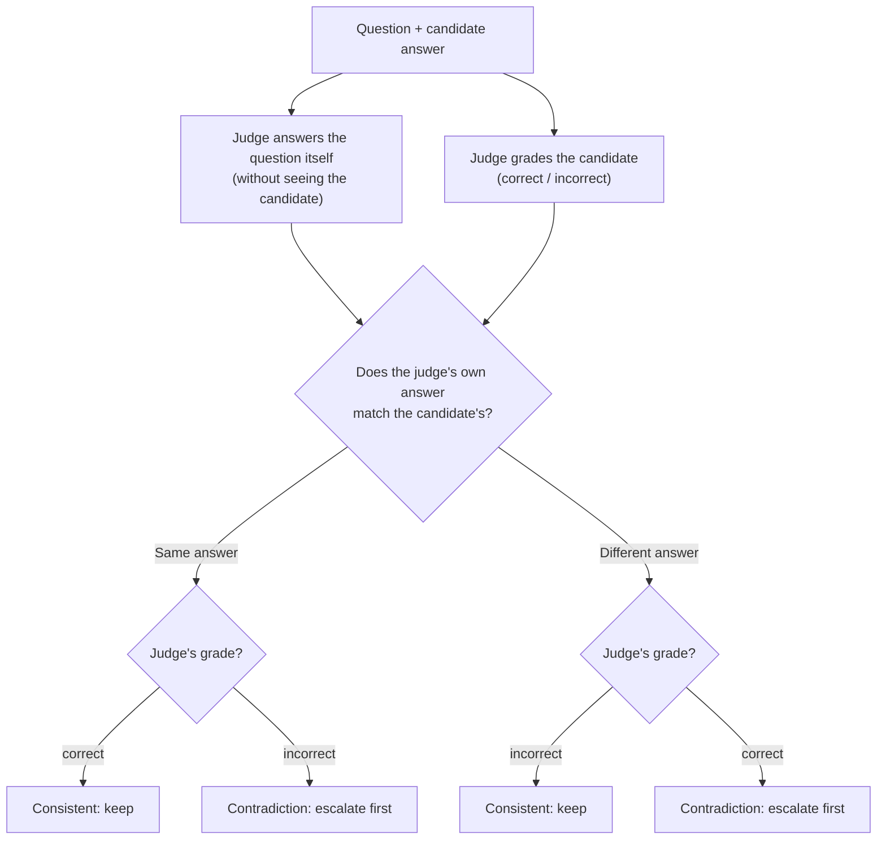
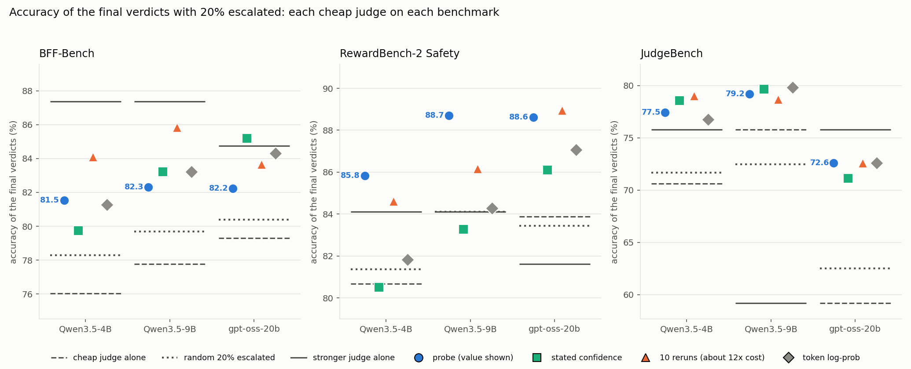
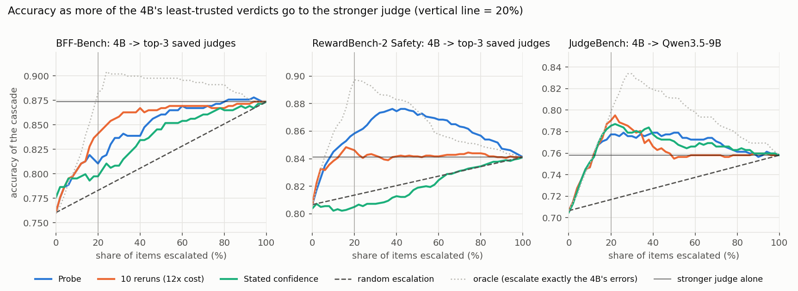
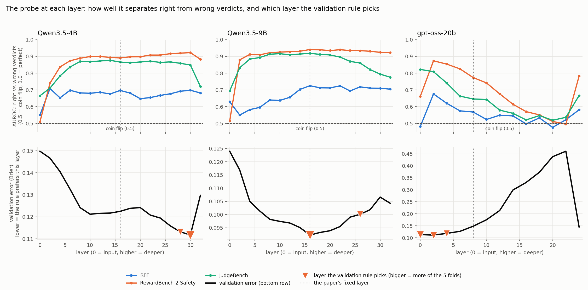

# Escalation signals for a cheap LLM judge

A cheap judge grades every answer. A **signal** gives each grade a trust score, and the 20% least-trusted grades are sent to a stronger judge, whose grade replaces the cheap one. The question: which signal picks the right 20%?

This folder starts as a replication of *Calibrating LLM Judges: Linear Probes for Fast and Reliable Uncertainty Estimation* (arXiv 2512.22245) and then adds two signals that work better: an **all-layer probe** and the **belief rule**.

The full report with plots is `escalation_signals.html` (download it and open in a browser; GitHub shows HTML as code).

## Summary

- **All-layer probe:** logistic regression on the judge's activations at every saved layer, guesses averaged. It beats the "correct"-first rule (defined below) in 5 of 6 BFF/Safety settings and the paper's probe in 4 of 6 (significant). It costs nothing extra. On Safety it beats 10 reruns for both Qwen judges; on BFF it is 1–2 points behind them.
- **Belief rule:** the judge answers the question itself; a grade that contradicts the judge's own answer is escalated first. No training, no labels, no activations. On RB2 Math it beats the judge's own confidence by 8.3 and 10.6 points (significant), and Qwen 9B with the rule (escalating 20%) beats the 35B judge grading everything (92.3 vs 90.9). On BFF it scores above every cheap signal, including the all-layer probe.
- **Works on a new benchmark without its labels:** the belief rule needs no human marks, and a trained belief model moved from one benchmark to the other loses nothing (3 of 4 settings significant). The probe trained on other benchmarks gets worse, and on Safety falls below the "correct"-first rule.
- **Flip on math:** reversing the grades that contradict the judge's own answer reaches 92.5 and 93.9 on RB2 Math with no stronger judge. It does not work on BFF.
- **Limits:** the belief rule only helps when the question has a checkable answer (finance, math). No gain on JudgeBench or Safety.

## Terms

- **Accuracy at 20%:** share of final grades that match the human label after the 20% least-trusted grades are escalated. Unfinished answers are always escalated first.
- **Significant:** the 95% interval of the difference, resampling whole questions, lies above zero. Each test's pass rule was fixed before running it.
- **"Correct"-first rule:** uses nothing but the grade. Every answer the judge called "correct" is escalated before any it called "incorrect" (random order inside each group). The judge is wrong more often when it says "correct", so this already beats random; a signal must beat it to be worth anything.
- **Judge's own confidence:** the probability the judge itself puts on its verdict word ("correct" / "incorrect") when it writes it. Read from the same run, no extra cost.
- **Stated confidence:** the judge writes a confidence number 0–100 in a second prompt.
- **10 reruns:** the judge grades the same answer 10 more times with randomness on (temperature 0.7); grades it keeps changing are escalated first. About 10× the cost.
- **Labels:** the human right/wrong mark for each answer.

## Setup

- **Cheap judges:** Qwen3.5-4B, Qwen3.5-9B, gpt-oss-20b (belief tests use the two Qwen judges).
- **Stronger judge:** BFF and Safety: majority vote of the 3 best other judges in the 8-judge pool (never the cheap judge's own model). RB2 Math: Qwen3.6-35B. JudgeBench: another judge run here.
- **Benchmarks:** BFF (459 finance answers), RewardBench 2 Safety (1,800), RB2 Math (about 630 answers, cleaned labels), JudgeBench (620 pairs).

## 1. All-layer probe

- Input: the cheap judge's activations at the last token, right after it writes its verdict, at every second layer.
- Probe: logistic regression on standardised activations at each layer (regularisation C = 0.01), probabilities averaged over layers. No layer is chosen.
- Trained on the three benchmarks pooled; 5-fold splits by question (a question is never scored by a probe that saw it); 5 seeds.
- Compared with the paper's probe (linear, one fixed middle layer: 16 for Qwen, 8 for gpt-oss, the paper's training settings).
- Found by testing the probe types from the literature on the same data (`probe_zoo.py`): MLP, difference of means, best layer picked on a validation split, PCA over all layers, and others. Averaging logistic regressions over layers was best and was then re-run with 5 new seeds (`confirm_probe.py`).
- Caveat: C = 0.01 was picked by comparing variants on the same benchmarks, so the gain over the paper's probe may be slightly overstated.

Accuracy at 20% (mean of 5 seeds):

| Setting | "Correct"-first | Paper's probe | **All-layer probe** | 10 reruns |
|---|---|---|---|---|
| Qwen 4B, BFF | 79.7 | 81.5 | **82.0** | 84.1 |
| Qwen 9B, BFF | 82.2 | 82.3 | **84.1** | 85.4 |
| gpt-oss-20b, BFF | 82.6 | 82.2 | **84.6** | 83.9 |
| Qwen 4B, Safety | 84.7 | 85.8 | **87.7** | 84.6 |
| Qwen 9B, Safety | 86.9 | 88.7 | **89.0** | 86.1 |
| gpt-oss-20b, Safety | 89.4 | 88.6 | **89.7** | 88.8 |

Differences (points, 95% interval; bold = significant):

| Setting | − "correct"-first | − paper's probe | − 10 reruns |
|---|---|---|---|
| Qwen 4B, BFF | **+2.4 [+0.3, +4.6]** | +0.5 [−1.7, +2.4] | −2.0 [−3.8, +0.1] |
| Qwen 9B, BFF | **+2.0 [+0.5, +3.9]** | **+1.8 [+0.2, +3.6]** | −1.3 [−3.5, +0.7] |
| gpt-oss-20b, BFF | **+2.0 [+0.6, +3.7]** | **+2.4 [+1.0, +3.9]** | +0.7 [−1.2, +2.8] |
| Qwen 4B, Safety | **+3.0 [+2.2, +3.6]** | **+1.9 [+1.1, +2.6]** | **+3.1 [+2.0, +4.1]** |
| Qwen 9B, Safety | **+2.1 [+1.4, +2.9]** | +0.3 [+0.0, +0.7] | **+2.9 [+1.9, +4.0]** |
| gpt-oss-20b, Safety | +0.3 [−0.5, +1.0] | **+1.1 [+0.5, +1.6]** | +0.9 [−0.2, +2.2] |

JudgeBench: all signals tie, because 13–26% of answers are cut off and escalated first.

## 2. Belief rule

Based on the team's anchoring finding: judges approve answers that match their own answer, even when the answer is wrong.

1. Separately, the cheap judge answers the question itself, without seeing the candidate answer.
2. Another model (GLM-5.3-Flash) checks whether the judge's answer matches the candidate's.
3. If the grade contradicts the judge's own answer (it says "correct" but its answer differs, or "incorrect" but its answer matches), that grade is escalated first; the rest follow in random order.

Example: the judge's own answer is 12, the candidate says 15, and the judge still grades it "correct". That grade is escalated first.

When is it a contradiction? Only when the grade goes against the judge's own answer:

| | Judge grades "correct" | Judge grades "incorrect" |
|---|---|---|
| **Judge's own answer = candidate's** (e.g. both 12) | consistent → keep | **contradiction → escalate** |
| **Judge's own answer ≠ candidate's** (judge 12, candidate 15) | **contradiction → escalate** | consistent → keep |

If fewer contradictions than 20% exist, the rest of the 20% is filled at random.

Data: the judge's own answers (7 per question) and the matching come from the team's anchoring experiments (`experiments/anchoring_early_answer`). The rule uses 1 of the 7. A second version uses all 7: belief is then the share of the 7 that match the candidate, and a small logistic regression on 4 inputs (the share, its distance from 0.5, whether the grade agrees with it, the grade) turns that into a trust score.

Accuracy at 20%:

| Signal | Extra cost | BFF 4B | BFF 9B | RB2 Math 4B | RB2 Math 9B |
|---|---|---|---|---|---|
| Random | none | 78.3 | 79.7 | 78.7 | 82.8 |
| "Correct"-first rule | none | 79.7 | 82.2 | — | — |
| Stated confidence | second prompt | 79.7 | 83.2 | — | — |
| Token log-prob | none | 81.3 | 83.2 | — | — |
| Judge's own confidence | none | 79.7 | 85.0 | 82.3 | 81.7 |
| All-layer probe | none (needs activations) | 82.0 | 84.1 | — | — |
| **Belief rule, 1 own answer, no training** | 1 generation per question | **83.3** | **86.5** | **88.1** | **92.3** |
| Belief, 7 own answers, small trained model | 7 generations per question | 84.8 | 87.1 | 90.6 | 92.3 |
| 10 reruns | 10 generations per item | 84.1 | 85.8 | — | — |
| Other judges' disagreement | 7 other judges per item | 85.2 | 86.3 | — | — |
| Stronger judge grading everything | — | 87.4 | 87.4 | 90.9 | 90.9 |

- **Significant:** RB2 Math, belief rule over the judge's own confidence: +8.3 [+5.9, +10.2] (4B), +10.6 [+7.7, +13.2] (9B).
- **Significant:** BFF, 7-answer belief over the all-layer probe: +3.0 [+0.0, +5.6] (4B), +3.1 [+1.0, +4.9] (9B). The 1-answer rule also scores above the probe, but that gap was not tested for significance.
- Cost on BFF: about 160 extra generations (one per question, shared by all answers to it), against about 4,590 for 10 reruns.
- It beats the judge's own confidence and random at every budget tested (10%, 20%, 30%, 50%).
- On RB2 Math only random and the judge's own confidence exist as baselines (no reruns, activations or other-judge grades were run there).

## 3. Works on a new benchmark without its labels

- The probe learns from labels, so every new benchmark needs human marks. The belief rule learns nothing, so it needs none.
- Test: the 7-answer belief model learned on RB2 Math and used on BFF, and the reverse. It scores about the same as when learned on the same benchmark.

| Accuracy at 20% | Judge's own confidence | Belief, learned on same benchmark | **Belief, learned on other benchmark** | Belief rule, no training |
|---|---|---|---|---|
| BFF 4B | 79.7 | 82.9 | **83.9** | 83.3 |
| BFF 9B | 85.0 | 86.3 | **86.3** | 86.5 |
| RB2 Math 4B | 82.3 | 89.2 | **87.1** | 88.1 |
| RB2 Math 9B | 81.7 | 92.3 | **92.2** | 92.3 |

Learned on the other benchmark vs baselines (bold = significant):

| Setting | − confidence | − "correct"-first |
|---|---|---|
| BFF 4B (learned on RB2 Math) | **+4.1 [+1.7, +6.1]** | **+4.2 [+2.1, +6.3]** |
| BFF 9B (learned on RB2 Math) | +1.3 [−1.1, +3.5] | **+4.1 [+2.0, +5.9]** |
| RB2 Math 4B (learned on BFF) | **+4.8 [+2.4, +7.4]** | **+5.1 [+3.4, +7.3]** |
| RB2 Math 9B (learned on BFF) | **+10.5 [+7.7, +12.1]** | **+6.3 [+4.2, +7.4]** |

Probe vs belief on BFF without BFF labels:

| Accuracy at 20%, BFF | Qwen 4B | Qwen 9B |
|---|---|---|
| "Correct"-first rule | 79.7 | 82.2 |
| Probe trained on the other two benchmarks | 81.1 | 81.7 |
| Same, with the verdict direction removed | 81.7 | 83.2 |
| Probe trained on BFF itself (needs BFF labels) | 82.4 | 85.4 |
| Belief model learned on RB2 Math | **83.9** | 86.3 |
| Belief rule, no training | 83.3 | **86.5** |

On Safety, the probe trained on other benchmarks falls below the "correct"-first rule (81.9 vs 84.7 for 4B, 84.2 vs 86.9 for 9B).

## 4. Flip on math

Instead of escalating, a grade whose belief says it is more likely wrong is reversed, with no stronger judge.

| Accuracy | Cheap judge alone | Escalate 20% (belief) | **Flip, no stronger judge** | Qwen3.6-35B on everything |
|---|---|---|---|---|
| RB2 Math 4B | 75.6 | 89.2 | **92.5** | 90.9 |
| RB2 Math 9B | 80.7 | 92.3 | **93.9** | 90.9 |

On BFF flipping gives 79.6 (4B, from 76.0) and 78.4 (9B, from 77.8), so escalation is still needed there. The pre-set test (escalate and flip vs escalate only) passed in 1 of 4 settings, so this is a math-only result.

## 5. Where the belief rule does not work

Own answers for these were generated here (`belief_solve.py`). No gain in 0 of 4 settings.

| Accuracy at 20% | Belief rule | Confidence | "Correct"-first | 10 reruns | All-layer probe |
|---|---|---|---|---|---|
| JudgeBench 4B | 76.6 | 76.6 | 76.4 | 79.2 | 77.2 |
| JudgeBench 9B | 79.8 | 79.5 | 78.6 | 78.7 | 79.2 |
| Safety 4B | 80.6 | 80.6 | 84.7 | 84.8 | 87.7 |
| Safety 9B | 83.2 | 83.1 | 86.9 | 86.2 | 89.0 |

- JudgeBench: the judge produced a final answer for only 66–69% of questions (long coding and reasoning items), so the rule applied to about 60% of pairs.
- Safety: there is no single right answer. The judge's own "comply or refuse" decision disagreed with the candidate on about half of all items, but only 8–11% of those were real mistakes.

## 6. Tried, no significant gain

| Tried | Result |
|---|---|
| Probing bigger judges (gpt-oss-120b, Qwen3.8-27B) | No better: BFF AUROC 0.68 (120b) vs 0.67 (20b); 0.78 (27B) vs 0.83 (9B) |
| Reading the probe partway through the reasoning | Weaker; the signal becomes strong only once the verdict is written |
| Escalating where the stronger judge would fix the grade | Activations predict the stronger judge at chance (AUROC 0.46–0.54) |
| Probe + token probabilities + question wording | No gain over the probe alone (1 of 6 settings) |
| Probe trained on correctness and belief together | −0.4 / −0.5 vs the probe |
| Belief read from the activations instead of solved | +0.7 / +1.4 over the probe, not significant (about 350 training examples) |
| One-pass belief (how likely the judge finds the candidate's text) | Worse than the probe; correlation with solved belief about 0 |
| Juries of judges with different mistakes; other systems' answers as references | No gain; judges share blind spots (error correlation 0.36–0.46) |
| Stricter grading on hard questions (Project 6) | 0 of 9 settings |

---

# Replication of the paper's probe

The sections below are the original replication. "Probe" here means the paper's probe (one fixed middle layer), not the all-layer probe above.

## Replication: short answer

Every number is for one cheap judge on one benchmark; nothing is averaged.

- **It works in one place:** RewardBench-2 (safety) with the Qwen judges. The probe gets 85.8% (Qwen3.5-4B) and 88.7% (Qwen3.5-9B), ahead of 10 reruns (84.6%, 86.2%) and of the other signals that cost nothing extra (80.5% to 84.3%).
- **It does not help on BFF** (finance): for all three judges, rerunning the judge 10 times or checking whether other judges disagree chooses better. The gap is large for the 4B and 9B (for the 9B: 85.8% and 86.3%, against 82.3% for the probe) and 1.5 to 2 points for gpt-oss.
- **On JudgeBench** every signal is about equally good. 13% to 26% of the answers were cut off, and every signal escalates those first, so the signals differ only on the rest.
- **It does not carry over where it matters.** Trained on two benchmarks and scored on the third, the probe loses 1.5 to 6.9 points on RewardBench-2, its one win, and ends at about random escalation (4B) or below it (9B). On BFF and JudgeBench it loses about a point or less, but it was not better than the alternatives there either.
- The probe needs labelled data and a judge we run ourselves, and the gains are a few accuracy points.

## How we tested it

1. **A cheap judge grades every item.** It writes its reasoning and its verdict. A verdict is right if it matches the human label.
2. **A signal gives each verdict a trust score.** The probe is one signal. We compare it with the others below.
3. **The 20% of items with the lowest trust go to a stronger judge,** whose verdict replaces the cheap one. Verdicts that never finished are escalated first.
4. **We measure the accuracy of the final verdicts** against the human labels, and compare it with the accuracy we would get if the same 20% were escalated **at random**.

Real example: Qwen3.5-4B on RewardBench-2 gets 81.4% with random escalation and 85.8% when the probe chooses. 20% is our choice. At 10%, 20% and 30% the probe beats 10 reruns in 2, 3 and 3 of the 9 settings.

**Judges and data.** Three cheap judges that we run ourselves (we need their activations): Qwen3.5-4B, Qwen3.5-9B and gpt-oss-20b. Three benchmarks with human labels: BFF-Bench (459 items), RewardBench-2 Safety (1,800 items) and JudgeBench (620 pairs). Each judge on each benchmark is one **setting**, so there are 9.

**The stronger judge.** On BFF and RewardBench-2 it is the majority vote of the three best *other* judges in our 8-judge pool; the cheap judge's own model is never in it. On JudgeBench it is one other judge we ran ourselves.

| Cheap judge | BFF: stronger panel | RewardBench-2: stronger panel | JudgeBench: stronger judge |
|---|---|---|---|
| Qwen3.5-4B | gpt-oss-120b, gpt-oss-20b, DeepSeek-V3.1 | gpt-oss-20b, Nemotron-3-Nano, Qwen3.5-9B | Qwen3.5-9B |
| Qwen3.5-9B | gpt-oss-120b, gpt-oss-20b, DeepSeek-V3.1 | gpt-oss-20b, Nemotron-3-Nano, gpt-oss-120b | gpt-oss-20b |
| gpt-oss-20b | gpt-oss-120b, DeepSeek-V3.1, Qwen3.6-35B | Nemotron-3-Nano, Qwen3.5-9B, gpt-oss-120b | Qwen3.5-9B |

**The probe.** One linear layer on the judge's activations at the last token it wrote, at the paper's fixed middle layer (16 for the 32-layer Qwen models, 8 for gpt-oss). One probe per judge, trained on the three benchmarks pooled and scoring only questions it was not trained on. Training settings are the paper's. The probe's accuracies are means over 5 training seeds of the same setting.

**What we compare it with**

| Signal | What gives the trust score | Extra cost |
|---|---|---|
| **Probe** | the judge's activations | none |
| Stated confidence | the judge writes "confidence 0 to 100" (a second run) | none |
| Token log-prob | how confident the judge's own word choices were (the average log-probability of the words it wrote) | none |
| 10 reruns | the share of 10 new runs that agree with the verdict (also scored by semantic entropy) | about 7 to 12x the generation |
| Other judges disagree | the share of other judges whose verdict differs | needs 2 to 7 other judges |

## Where it works and where it does not

Each panel is a benchmark and each group of dots is one cheap judge. Dashed line: the cheap judge alone. Dotted: random 20% escalation. Solid: the stronger judge alone.

- **RewardBench-2:** for the two Qwen judges the probe is the best signal: 85.8% (4B) and 88.7% (9B), above 10 reruns (84.6%, 86.2%), above the stronger judge alone (84.1% for both) and well above random (81.4%, 84.1%). For gpt-oss-20b the probe (88.6%) is level with 10 reruns (88.9%) and ahead of token log-prob (87.1%); there the stronger panel (81.6%) is below the cheap judge itself (83.9%).
- **BFF:** the probe (81.5%, 82.3%, 82.2% for the 4B, 9B and gpt-oss) is behind 10 reruns (84.1%, 85.8%, 83.7%) and behind other judges' disagreement (85.2%, 86.3%, 84.3%) for all three judges. For gpt-oss, stated confidence (85.2%) is also above it.
- **JudgeBench:** the probe (77.5%, 79.2%, 72.6%) is within 1.5 points of the best signal for every judge. For gpt-oss every signal except stated confidence ends at exactly 72.6%: 26% of its answers were cut off, and escalating those first leaves little to rank. For the 9B the stronger judge (gpt-oss) is weaker than the 9B itself (59.2% against 75.8%).

Setting by setting, the probe beats 10 reruns in 3 of 9, loses in 5 and ties in 1. It beats token log-prob in 5 of 9 (loses 3, ties 1) and stated confidence in 5 of 9 (loses 4).

Full table: every judge on every benchmark (accuracy %, 20% escalated)

The best of the five signals in each row is in bold. Stated confidence comes from its own second run of the cheap judge.

| Benchmark | Cheap judge | Cheap alone | Random 20% | Probe | 10 reruns | Other judges | Token log-prob | Stated conf. | Stronger alone |
|---|---|---|---|---|---|---|---|---|---|
| BFF | Qwen3.5-4B | 76.0 | 78.3 | 81.5 | 84.1 | **85.2** | 81.3 | 79.7 | 87.4 |
| BFF | Qwen3.5-9B | 77.8 | 79.7 | 82.3 | 85.8 | **86.3** | 83.2 | 83.2 | 87.4 |
| BFF | gpt-oss-20b | 79.3 | 80.4 | 82.2 | 83.7 | 84.3 | 84.3 | **85.2** | 84.7 |
| RewardBench-2 | Qwen3.5-4B | 80.7 | 81.4 | **85.8** | 84.6 | 83.1 | 81.8 | 80.5 | 84.1 |
| RewardBench-2 | Qwen3.5-9B | 84.1 | 84.1 | **88.7** | 86.2 | 83.2 | 84.3 | 83.3 | 84.1 |
| RewardBench-2 | gpt-oss-20b | 83.9 | 83.4 | 88.6 | **88.9** | 83.4 | 87.1 | 86.1 | 81.6 |
| JudgeBench | Qwen3.5-4B | 70.6 | 71.7 | 77.5 | **79.0** | 77.9 | 76.8 | 78.5 | 75.8 |
| JudgeBench | Qwen3.5-9B | 75.8 | 72.5 | 79.2 | 78.7 | 76.9 | **79.8** | 79.7 | 59.2 |
| JudgeBench | gpt-oss-20b | 59.2 | 62.5 | **72.6** | **72.6** | **72.6** | **72.6** | 71.1 | 75.8 |

## What it means for accuracy

Qwen3.5-4B as the cheap judge. x-axis: the share of items sent to the stronger judge (0% = the 4B alone, 100% = the stronger judge alone). Dashed: random escalation. Dotted: the best possible.

Accuracy (%) of the final verdicts with 20% escalated:

| | 4B alone | Stronger judge alone | Random 20% | **Probe, 20%** | Stated confidence, 20% | 10 reruns, 20% |
|---|---|---|---|---|---|---|
| RewardBench-2 | 80.7 | 84.1 | 81.4 | **85.8** | 80.5 | 84.6 |
| JudgeBench | 70.6 | 75.8 | 71.7 | 77.5 | 78.5 | **79.0** |
| BFF | 76.0 | 87.4 | 78.3 | 81.5 | 79.7 | **84.1** |

The probe's numbers are means over 5 training seeds; the curves show one training run, so they can differ by up to about half a point. The stated-confidence curve starts at a different height at 0% because it comes from its own second run of the 4B, whose verdicts differ slightly.

- On RewardBench-2 and JudgeBench, escalating only 20% with the probe beats the stronger judge alone: the cheap judge keeps the items it is sure about, and the stronger judge handles the doubtful ones.
- On BFF it does not: the stronger judge is much better there (87.4% against 76.0%), and the probe's cascade only reaches it when about 80% of the items go up (10 reruns: about 94%).
- On RewardBench-2 the 4B's stated confidence does no better than random escalation (80.5% against 81.4%).

## Does it carry over to a benchmark it was not trained on?

Accuracy (%) with 20% escalated. In the "unseen" column the probe was trained on the other two benchmarks only. "Same benchmark" is one training run.

| Benchmark | Cheap judge | Random 20% | Probe, same benchmark | **Probe, unseen benchmark** | 10 reruns |
|---|---|---|---|---|---|
| BFF | Qwen3.5-4B | 78.3 | 81.0 | **81.5** | 84.1 |
| BFF | Qwen3.5-9B | 79.7 | 82.8 | **81.7** | 85.8 |
| BFF | gpt-oss-20b | 80.4 | 81.9 | **81.9** | 83.7 |
| RewardBench-2 | Qwen3.5-4B | 81.4 | 85.8 | **81.8** | 84.6 |
| RewardBench-2 | Qwen3.5-9B | 84.1 | 88.8 | **81.9** | 86.2 |
| RewardBench-2 | gpt-oss-20b | 83.4 | 88.6 | **87.1** | 88.9 |
| JudgeBench | Qwen3.5-4B | 71.7 | 77.7 | **77.4** | 79.0 |
| JudgeBench | Qwen3.5-9B | 72.5 | 79.4 | **78.5** | 78.7 |
| JudgeBench | gpt-oss-20b | 62.5 | 72.6 | **72.6** | 72.6 |

- **RewardBench-2, the probe's one win, does not carry over:** unseen, it drops by 4.0 points (4B), 6.9 (9B) and 1.5 (gpt-oss) compared with being trained on RewardBench-2's own questions. For the 4B it ends at about random escalation (81.8% against 81.4%) and for the 9B below it (81.9% against 84.1%).
- **BFF and JudgeBench:** the unseen-benchmark probe is within 1.1 points of the same-benchmark probe in all six settings.
- So the probe needs labelled data from each new kind of task.

## Which layer to read the probe from?

Top: how well the probe separates right from wrong verdicts at each layer. Bottom: the validation error that an automatic layer-picking rule minimizes, and the layers it picks. Dotted line: the paper's fixed layer.

- **Qwen3.5-9B:** the ranking peaks at the paper's layer 16, and the rule picks it.
- **Qwen3.5-4B:** flat from layer 8 to 30 on RewardBench-2 and JudgeBench; the rule picks 28 to 30.
- **gpt-oss-20b:** best in the earliest layers, near chance in deep layers; the rule picks 0 to 4.

## Is the probe's number a good probability?

The paper's main claim is that the probe's number is well calibrated: "80%" means about 80% are right. **We did not reproduce this** (Qwen3.5-4B only). On RewardBench-2 the probe ranks right above wrong verdicts well (AUROC 0.89, against 0.55 for the judge's stated confidence and 0.79 for 10 reruns), but its calibration error is 0.090 while a constant guess scores 0.012.

## Limits

- Only for judges we run ourselves (it needs their activations), and it needs labelled data per kind of task.
- Three judges from two families. Nemotron and Qwen3.6-35B could not be read.
- The stronger judges on BFF and RewardBench-2 are saved verdicts from our earlier 8-judge pool (short API answers, not reasoning runs).
- 13% to 26% of JudgeBench answers were cut off at 4,096 tokens and count as wrong.
- Choices the paper leaves open: which token is "the last token" (we use the last token the judge writes), the prompt for single-response grading, the 4,096-token cap, and the training set (the paper uses its own PPE data; we use our three benchmarks).
- Not done: the paper's broader training data (PPE), temperature-scaled MaxProb, Chain-of-Embedding, CoT-kinetics, and the loss and rerun-count ablations.

## How the results were checked

Generation uses vLLM and the activations come from a separate full pass. Against Hugging Face's own decoding on 48 items they agree on 98.9% of tokens, and every difference was an exact tie; on identical text the activations match to cosine similarity 0.9993 or better. Every signal escalates unfinished answers first, so cut-off answers cannot inflate the probe.

## Files

| File | What it does |
|---|---|
| `escalation_signals.html` | full report with plots (current results) |
| `nov13_probe_results.html` | earlier report (replication and first checks) |
| `modal_generate.py` | all Modal entrypoints: generation, activations, own-answer solves, and CPU analysis (`script`) |
| `vllm_generate.py`, `acts_from_gen.py`, `token_stats.py`, `cand_logprob.py` | fast generation; activations; token-probability signals; candidate log-prob |
| `generate_judge.py` | single-script Hugging Face version (reference for the check) |
| `judge_data.py`, `prompts.py` | the benchmarks and the prompts |
| `evaluate.py`, `metrics.py` | the paper's probe training and the calibration table |
| `cascade_eval.py`, `summarize_cascade.py` | the escalation experiment, including the unseen-benchmark test |
| `layer_sweep.py`, `multilayer_probe.py` | probe at every layer; multi-layer probes |
| `probe_zoo.py`, `confirm_probe.py` | probe types from the literature; 5-seed confirmation of the all-layer probe |
| `combo_probe.py`, `transfer_probe.py`, `multitask_probe.py` | probe plus other signals; probe on unseen benchmarks; two-target probe |
| `belief_combo.py`, `belief_variants.py`, `belief_transfer.py`, `belief_more.py` | belief rule: main test, budgets and flip, transfer, extra baselines |
| `belief_solve.py`, `belief_jb_safety_eval.py` | own-answer solves on JudgeBench and Safety, and their evaluation |
| `belief_probe_esc.py` | belief read from activations |
| `flip_check.py`, `flip_rule.py`, `verdict_confound.py` | flip tests; verdict-confound check |
| `strong_probe.py`, `gain_probe.py`, `early_probe.py`, `dayone_check.py` | bigger judges; predicting where the stronger judge helps; early reads |
| `peers_eval.py`, `err_eval.py`, `err_control.py`, `project6_bar.py` | other systems' answers as references; error-question wording; Project 6 |
| `make_figures.py`, `figures/` | the replication plots |
| `check_equivalence.py`, `check_greedy.py` | the equivalence checks |

Generated outputs (grades, activations, results) are not in the repo. `modal_generate.py` reads the saved 8-judge verdict files and the cached VERDICTS and RewardBench-2 tables from paths set at the top of the file. `cascade_eval.py` imports `data.py` and `audit.py` from `../role_conditioned_panels`. The belief scripts read `targets/belief_rows_clean.json` (from `experiments/anchoring_early_answer/out/`) and `targets/strong_judge_correct.json` (stronger-judge grades exported from the 8-judge pool).
