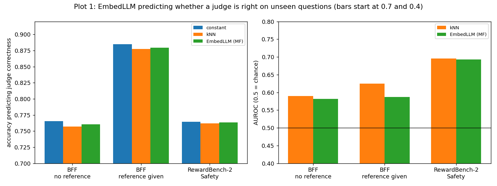
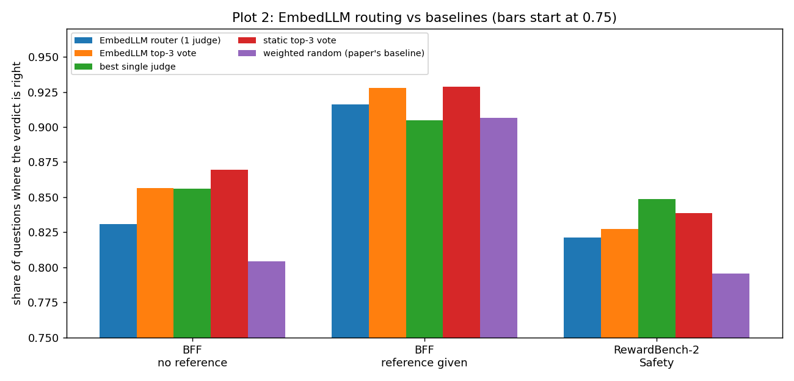

# EmbedLLM on our judges (arXiv 2410.02223)

Learn an embedding for each judge from its right and wrong history, embed each question, predict whether the judge will be right, and route each question to the judge most likely to be right. The model and training settings follow the authors' released code. The only big difference is our data, which is much smaller (8 judges, about 460 items).

**Result:** it predicts judge correctness no better than a constant baseline, and the router is about as good as the best single judge.

## How the model works

- **Training data:** the table of right and wrong. Each example is one cell: one judge and one question, labelled 1 if the judge's verdict matched the human label and 0 if not (about 3,700 examples for BFF).
- **Input:** a judge (its row number) and a question's text. **Output:** the predicted chance (0 to 1) that this judge is right on that question.
- **Model:** a small neural network (`TextMF` in the authors' code). It learns one vector per judge and two linear layers. The sentence encoder (all-mpnet-base-v2) is pretrained and frozen.

```
judge id ------> its learned vector -------------------------------+
                                                                   x (element-wise) --> linear layer --> chance the judge is right
question text -> frozen sentence encoder -> linear layer (trained) -+
```

- **Training:** compare the predicted chance with the true 0 or 1 (cross-entropy loss) and update the judge vectors and the two layers (Adam).
- **Routing:** for a new question, predict the chance for all 8 judges and use the highest-scoring judge.

| Setting | Predict judge right: constant / kNN / EmbedLLM (accuracy) | Router: EmbedLLM / best single / top-3 |
|---|---|---|
| BFF, no reference | 0.765 / 0.757 / 0.761 | 0.831 / 0.856 / 0.869 |
| BFF, reference given | 0.885 / 0.877 / 0.879 | 0.916 / 0.905 / 0.929 |
| RewardBench-2 | 0.764 / 0.762 / 0.764 | 0.821 / 0.849 / 0.839 |

Mean over 20 random 80/10/10 splits by question, prompt-only question text.

**Plot 1: predicting whether a judge is right on unseen questions.** Accuracy is no better than the constant baseline.



**Plot 2: routing accuracy of the EmbedLLM router against the baselines.** It beats the paper's weighted-random baseline everywhere, and is about the same as the best single judge at best.



## Run it

```bash
python embed_mpnet.py --bff <bff_judgments.jsonl> --rb2 <rb2_judgments.jsonl>
python embedllm.py --bff <bff_judgments.jsonl> --rb2 <rb2_judgments.jsonl> --variant q
```

The scripts reuse the data loading and splits in `../role_conditioned_panels/`. With so little data the paper's literal setting (embedding dimension 232, 50 epochs) only trains for about 100 steps and predicts each judge's majority label, so the output also reports the same recipe with the embedding dimension and number of epochs chosen on validation. Not yet replicated: the paper's probing and training-size experiments.
