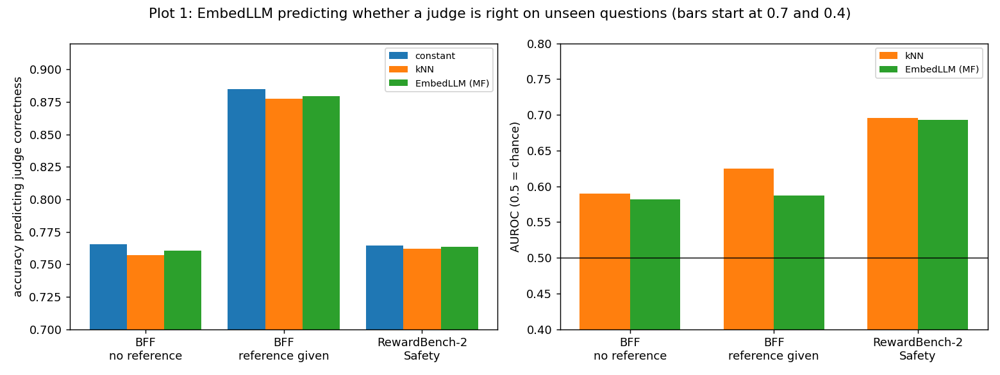
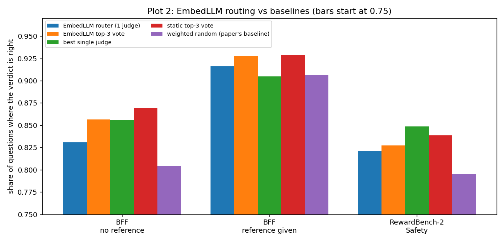
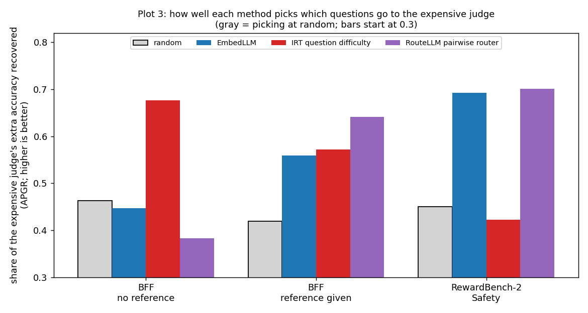

# EmbedLLM on our judges (arXiv 2410.02223)

Learn an embedding for each judge from its right and wrong history, embed each question, predict whether the judge will be right, and route each question to the judge most likely to be right. The model and training settings follow the authors' released code. The only big difference is our data, which is much smaller (8 judges, about 460 items).

**Result:** it predicts judge correctness no better than a constant baseline, and the router is about as good as the best single judge.

## How the model works

- **Training data:** the table of right and wrong. Each example is one cell: one judge and one question, labelled 1 if the judge's verdict matched the human label and 0 if not (about 3,700 examples for BFF).
- **Input:** a judge (its row number) and a question's text. **Output:** the predicted chance (0 to 1) that this judge is right on that question.
- **Model:** a small neural network (`TextMF` in the authors' code). It learns one vector per judge and two linear layers. The sentence encoder (all-mpnet-base-v2) is pretrained and frozen.

```
judge id ------> its learned vector -------------------------------+
                                                                   x (element-wise) --> linear layer --> chance the judge is right
question text -> frozen sentence encoder -> linear layer (trained) -+
```

- **Training:** compare the predicted chance with the true 0 or 1 (cross-entropy loss) and update the judge vectors and the two layers (Adam).
- **Routing:** for a new question, predict the chance for all 8 judges and use the highest-scoring judge.

| Setting | Predict judge right: constant / kNN / EmbedLLM (accuracy) | Verdict accuracy: EmbedLLM router (1 judge) / EmbedLLM top-3 vote / best single / static top-3 |
|---|---|---|
| BFF, no reference | 0.765 / 0.757 / 0.761 | 0.831 / 0.856 / 0.856 / 0.869 |
| BFF, reference given | 0.885 / 0.877 / 0.879 | 0.916 / 0.928 / 0.905 / 0.929 |
| RewardBench-2 | 0.764 / 0.762 / 0.764 | 0.821 / 0.828 / 0.849 / 0.839 |

Mean over 20 random 80/10/10 splits by question, prompt-only question text.

**Plot 1: predicting whether a judge is right on unseen questions.** Accuracy is no better than the constant baseline.



**Plot 2: how often the final verdict is right under each way of picking judges.** "EmbedLLM router" uses only the judge with the highest predicted chance. "EmbedLLM top-3 vote" takes the three judges with the highest predicted chance for each question and uses their majority vote. "Best single judge" always uses the same judge. "Static top-3" always uses the same three judges voting. "Weighted random" is the paper's baseline. The router beats the random baseline everywhere, and is about the same as the best single judge at best.



## Extension: ideas from IRT-Router and RouteLLM

The goal: a cheap judge is less accurate and an expensive judge is more accurate. Can a model tell which questions need the expensive judge? Same data, splits and question embeddings as above (`embedllm_ext.py`).

- **IRT-Router (ACL 2025):** predict whether a judge is right from a **judge ability** and a **question difficulty** (`sigmoid(a . ability - difficulty)`), either with ability learned freely or computed from a short text profile of the judge. The routing score trades the predicted chance of being right against price.
- **RouteLLM (ICLR 2025):** decide which questions go to the strong judge (the most accurate one) and which stay with the weak one (the cheapest, nemotron-nano). Quality is how much of the weak-to-strong accuracy gap is recovered compared with sending questions at random (APGR; random should be 0.5).

**Plot 3: APGR for each way of deciding which questions go to the expensive judge (10 splits).**



- Predicting whether a judge is right is no better than the constant baseline. The IRT version with the text profile has the best AUROC in all three settings, but only slightly (0.64, 0.66, 0.71).
- Learned ability follows real judge accuracy (rank correlation +0.38, +0.46, +0.77); learned difficulty follows how often judges fail only weakly (+0.17, +0.12) on BFF and moderately (+0.39) on RewardBench-2.
- The learned scores usually beat random, but no single one wins everywhere. Question difficulty is best on BFF without the reference and no better than random on RewardBench-2.
- Cost-aware routing, with the reference answer on BFF: within about 1 point of the best single judge at about 40% of its price. On RewardBench-2 the best single judge is already the cheapest, so nothing is saved.

Caveats: random scores 0.42 to 0.46 here instead of 0.5, so gaps under about 0.1 are noise; no confidence intervals yet. Differences from the papers: mpnet embeddings instead of BERT or OpenAI embeddings, one-line judge profiles written from the model names, training length chosen on validation, and no NIRT variant or query warm-up.

## Run it

```bash
python embed_mpnet.py --bff <bff_judgments.jsonl> --rb2 <rb2_judgments.jsonl>
python embedllm.py --bff <bff_judgments.jsonl> --rb2 <rb2_judgments.jsonl> --variant q
python embed_profiles.py            # judge profile embeddings (extension)
python embedllm_ext.py --bff <bff_judgments.jsonl> --rb2 <rb2_judgments.jsonl>   # extension
```

The scripts reuse the data loading and splits in `../role_conditioned_panels/`. With so little data the paper's literal setting (embedding dimension 232, 50 epochs) only trains for about 100 steps and predicts each judge's majority label, so the output also reports the same recipe with the embedding dimension and number of epochs chosen on validation. Not yet replicated: the paper's probing and training-size experiments.
