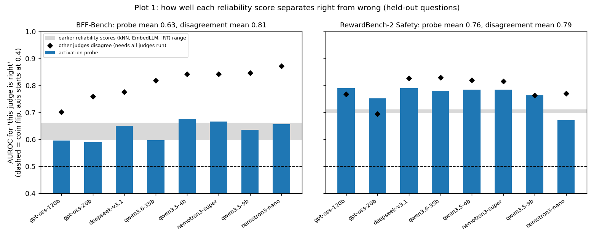
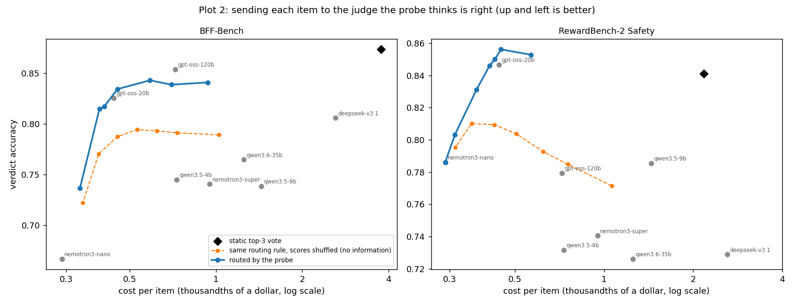
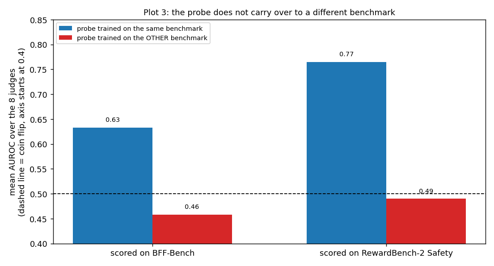

# Predicting whether a judge is right from its activations (No Answer Needed, arXiv 2509.10625)

## Goal, metric, comparison

- **Goal:** for each item, know in advance how likely each LLM judge is to be right, so we can pick a judge or escalate. This needs a per-item **reliability score** for each judge.
- **Idea tested:** the paper says a simple probe on a model's internal activations, read before it answers, gives such a score.
- **Metric:** AUROC of the score for "this judge is right" against "this judge is wrong" (0.5 is a coin flip, 1.0 is perfect). All scores come from questions the probe never saw. For routing, we also use verdict accuracy and cost per item.
- **Compared against:**
  1. **Our earlier reliability scores** (kNN, EmbedLLM, IRT-Router): about 0.60 to 0.66 AUROC on BFF and 0.70 to 0.71 on RewardBench-2. These came from different splits, so the match is approximate.
  2. **Other judges' disagreement:** the share of the other 7 judges that disagree with this judge. It is strong but needs every judge to be run first (about $0.008 per item at list price, against one small-model pass for the probe).
  3. **For routing:** the best single judge, the static top-3 vote, and the same routing rule with the scores shuffled (no item information).

## What a probe is

Run a small model on an item and save its internal numbers (activations) before it generates anything. Average them over items a judge got right, and over items it got wrong. The difference is a single direction, the probe. An item's score is how far it points along that direction; higher means more likely right. Nothing is trained beyond those two averages. The layer is chosen by cross-validation.

## Setup

BFF-Bench (459 items) and RewardBench-2 Safety (1,800 items), with the saved verdicts of our 8 judges. A judge is "right" when its verdict matches the human label. Activations come from Qwen3.5-4B run on each judge prompt (no-thinking mode), at the last prompt token, every second layer.

## Results

### Plot 1: how well each reliability score separates right from wrong

| | Probe (mean AUROC) | Earlier scores | Other judges disagree |
|---|---|---|---|
| BFF-Bench | **0.63** | 0.60 to 0.66 | 0.81 |
| RewardBench-2 | **0.77** | 0.70 to 0.71 | 0.79 |

- Against the earlier scores: **on par on BFF, about 0.06 better on RewardBench-2.**
- Against disagreement: **weaker.** It loses for all 8 judges on BFF and for 4 of 8 on RewardBench-2 (3 wins, 1 tie), but costs far less to compute.

### Plot 2: routing each item to one judge by the probe's score

The blue curve moves left as the cost penalty grows. The orange curve is the same rule with shuffled scores.

- Beats the shuffled control by +0.05 (BFF) and +0.07 to +0.08 (RewardBench-2), with 95% intervals that exclude zero.
- At about one-fifth of the cost of the static top-3 vote: RewardBench-2 is on par (0.856 vs 0.841); BFF is 3 points lower (0.839 vs 0.874).
- **Does not clearly beat the best single judge** (RewardBench-2 +0.010, interval [0.000, +0.019]; BFF -0.015, interval [-0.038, +0.007]).

### Plot 3: a probe trained on one benchmark, scored on the other

At or below a coin flip (0.46 and 0.49). The paper also reports that transfer falters across very different domains. The probe needs correctness labels from each new domain.

## Verdict

Roughly on par with our earlier reliability scores, a bit better on RewardBench-2. Weaker than judge disagreement, no better than the best single judge for routing, and it does not transfer. Not a breakthrough.

## Limits

- All activations come from **Qwen3.5-4B**. For the other 7 judges the probe measures how a small model reads the item, not that judge's own internals.
- The judge prompt includes the response being graded, so this is "before generation" as in the paper, but not question-only.
- BFF has only 80 questions, so its results are noisy. The best-single and top-3 baselines were chosen on all items, which slightly favours them.

## Files

| File | What it does |
|---|---|
| `extract_activations.py` | runs a model on the saved judge prompts and saves activations (GPU) |
| `probe_analysis.py` | the probe; `--save-scores` writes held-out scores |
| `compare_signals.py` | probe vs other judges' disagreement (Plot 1) |
| `routing_eval.py` | routing with the held-out scores (Plot 2) |
| `transfer_probe.py` | train on one benchmark, test on the other (Plot 3) |
| `make_plots.py` | draws the plots from the numbers above |
