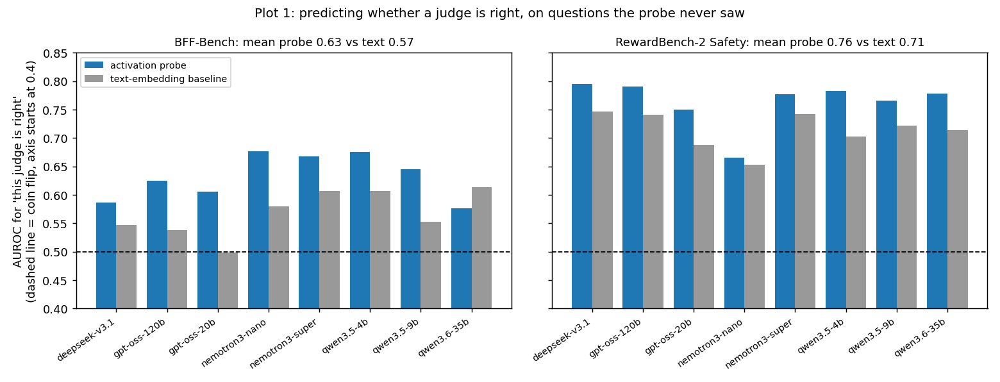
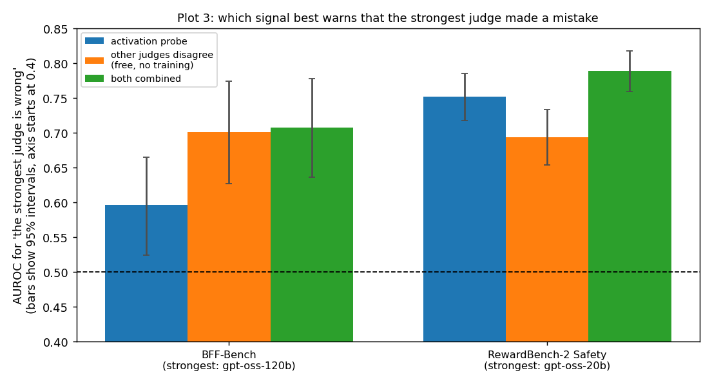
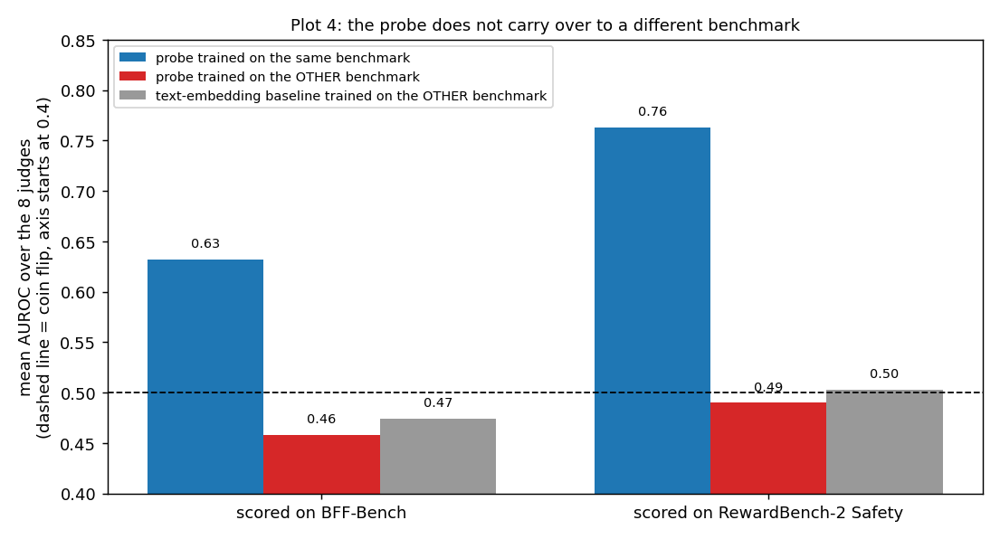

# Predicting whether a judge is right from its internal activations (No Answer Needed, arXiv 2509.10625)

## The idea

The paper shows that a language model's internal activations, read **before it generates anything**, contain a simple direction that predicts whether its answer will turn out right. We test this on our LLM judges: can a cheap probe on activations tell us **whether a judge will agree with the human label on an item**, and is that useful for choosing judges?

## What we did

- **Data:** BFF-Bench (459 items) and RewardBench-2 Safety (1,800 items), with the saved verdicts of our 8 judges. A judge counts as "right" on an item when its verdict matches the human label.
- **Activations:** We ran Qwen3.5-4B on each judge prompt (no-thinking mode) and saved its residual-stream activations at the last prompt token, before any generation, at every second layer.
- **Probe (as in the paper):** the average activation on items the judge got right minus the average on items it got wrong. An item's score is its projection on that direction. The layer is chosen by cross-validation. Quality is measured by AUROC (0.5 is a coin flip, 1.0 is perfect).
- **Fair test:** every score comes from a probe that never saw that item's question (all items of a question stay on the same side of each split).
- **Baseline (the paper's "assessor"):** logistic regression on sentence-embedding (all-mpnet-base-v2) vectors of the same prompt and response.

## Results

### Plot 1: the probe predicts whether a judge is right, better than text alone

Mean AUROC over the 8 judges: **0.63 vs 0.57 on BFF** and **0.76 vs 0.71 on RewardBench-2**. The probe wins for 7 of 8 judges on BFF and all 8 on RewardBench-2. On RewardBench-2 the signal appears suddenly at layer 18 (about 0.65 before, about 0.77 after).

### Plot 2: using it to route each item to one judge

Each item goes to the judge with the highest predicted chance of being right, minus a cost penalty. The blue curve moves left as the penalty grows. The orange curve is the same rule with the scores shuffled across items, which is what routing without any information about the item gives.

- Probe routing beats the shuffled control by **+0.05 (BFF)** and **+0.07 to +0.08 (RewardBench-2)** accuracy; the 95% intervals exclude zero.
- At a mild cost penalty it matches the static top-3 vote at about **one-fifth of the cost** (RewardBench-2: 0.856 at $0.00045 per item vs 0.841 at $0.0022; BFF: 0.839 at $0.0007 vs 0.874 at $0.0038).
- It does **not** clearly beat the best single judge, which it mostly routes to anyway (RewardBench-2 +0.010, interval [0.000, +0.019]; BFF -0.015, interval [-0.038, +0.007]).

### Plot 3: warning that the strongest judge made a mistake

Free baseline: the share of the other 7 judges that disagree with the strongest judge. On BFF this is clearly better than the probe (0.70 vs 0.60). On RewardBench-2 the probe is better (0.75 vs 0.69), and the two combined are best (0.79).

### Plot 4: it does not carry over to a different benchmark

A probe trained on one benchmark and scored on the other is at or below a coin flip (0.46 and 0.49), like the text baseline. The paper also reports that transfer falters across very different domains. In practice the probe needs correctness labels from each new domain.

## Limits

- All activations come from **Qwen3.5-4B**. For the 7 other judges the probe measures how a small model reads the item, not that judge's own internals. We could only open small models on our GPU.
- The judge prompt includes the response being graded, so this is "before generation" as in the paper, but not question-only.
- The probe is trained on correctness labels, so it is not label-free.
- BFF has only 80 questions, so its results are noisy (per-split AUROC spread of 0.04 to 0.11). The best-single and top-3 baselines were chosen on all items, which slightly favours them.

## Files

| File | What it does |
|---|---|
| `extract_activations.py` | runs a judge model on the saved prompts and saves activations |
| `probe_analysis.py` | the probe and the text baseline (Plot 1); `--save-scores` writes held-out scores |
| `routing_eval.py` | routing with the held-out scores (Plot 2) |
| `flag_errors.py` | error flagging for the strongest judge (Plot 3) |
| `transfer_probe.py` | train on one benchmark, test on the other (Plot 4) |
| `make_plots.py` | draws the four plots from the numbers above |

Run order: `extract_activations.py` (GPU), then `probe_analysis.py --save-scores`, then `routing_eval.py`, `flag_errors.py` and `transfer_probe.py`.
