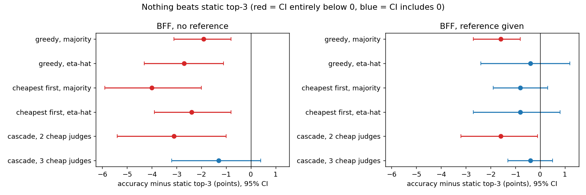
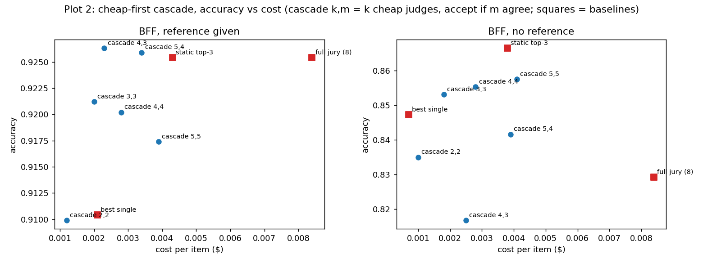
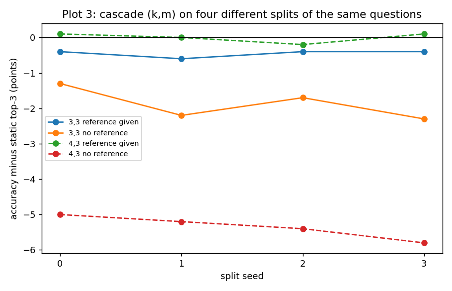

# role_conditioned_panels

Role-conditioned judge-panel construction on the 8-judge Tinker pool (BFF-Bench, RewardBench-2 Safety), plus the control experiments. Results and discussion: `docs/findings_role_conditioned_panels.md`.

## Summary

- No panel-building method beats a static top-3 majority vote on BFF-Bench (with or without the reference answer); the panel ends up at about the best single judge. Starting from the cheapest judge, or removing the strongest judge, does not change this.
- The cheap-first cascade (3 cheap judges answer, escalate to the best judge if they disagree) is the only thing that comes close to top-3 at lower cost, and only when judges are given the reference answer.

| File | What it does |
|---|---|
| `data.py` | loads judgments into verdicts `Z`, gold `Y`, question groups; joins prompt/response text from Hugging Face |
| `audit.py` | the only place the match matrix (`Z == Y`) is built; descriptive stats and the baselines |
| `splits.py`, `slices.py` | question-grouped fit/val/test splits; hand-crafted slices with fit-only thresholds |
| `oracle_risk.py`, `construct.py`, `evaluate.py` | eta-hat table, panel construction, serving, repeats, bootstrap, copy stress test |
| `majority.py` | the same construction and serving using majority vote only (no eta-hat table) |
| `run.py` | main CLI (`--rule eta|majority`, `--condition none|human`, `--sanity`, `--lambda-sweep`) |
| `explore_12.py` | brute-force search over all panels and logistic regression over the verdicts |
| `explore_3.py`, `explore_pools.py`, `embed.py` | embedding (PC5) slice and reduced-pool specialization tests |
| `cost_ci.py`, `subsample.py`, `calibration.py` | cost/accuracy intervals, subsampling test, verdict-rate vs gold-rate check |
| `cheapest_first.py` | forces the cheapest judge in as the first panel member, then greedy growth (`--exclude` drops judges from the pool) |
| `cascade.py` | cheap-first cascade simulated from saved verdicts |
| `cascade_sweep.py` | cascade variants + fresh-seed robustness check |
| `make_chart.py`, `plot_chart.py` | accuracy comparison figure |
| `make_readme_plots.py` | regenerates the figures in `figures/` from the numbers in the tables below |

`data_cache/` and `results/` are git-ignored; no raw judgment files are committed. `figures/` holds the plots shown below.

## Cheapest judge first

Suggested in discussion: force the cheapest judge (nemotron3-nano-30b, $0.00029/call) to be the first panel member, then grow greedily (`first_judge` in `run_all_repeats` / `run_all_repeats_mv`; `python cheapest_first.py --bff <bff_judgments.jsonl> --rb2 <rb2_judgments.jsonl>`). It does not help. Accuracy difference vs static top-3 majority, same 20 splits (95% CI):

| Setting | Rule | Default greedy | Cheapest first | Panel size (default -> cheapest first) |
|---|---|---|---|---|
| BFF, no reference | eta-hat | -2.7 [-4.3, -1.1] | -2.4 [-3.9, -0.8] | 2.1 -> 2.9 |
| BFF, no reference | majority | -1.9 [-3.1, -0.8] | -4.0 [-5.9, -2.0] | 2.6 -> 4.4 |
| BFF, reference given | eta-hat | -0.4 [-2.4, +1.2] | -0.8 [-2.7, +0.8] | 1.8 -> 2.7 |
| BFF, reference given | majority | -1.6 [-2.7, -0.8] | -0.8 [-1.9, +0.3] | 2.4 -> 3.8 |
| RewardBench-2 | eta-hat | +5.2 | +5.1 | 3.4 -> 3.5 |
| RewardBench-2 | majority | +0.4 [-0.7, +1.5] | -0.3 [-0.9, +0.2] | 1.6 -> 3.0 |

Panels get larger and cost more (BFF, no reference, majority: $0.0048 vs $0.0032 per item). The RewardBench-2 eta-hat gain is the calibration effect described in the findings doc, not panel construction. Excluding the strongest judge and trying other benchmarks were done earlier (see the findings doc).

**Plot 1: the table above plus the cascade, as accuracy difference vs static top-3 (dot = estimate, bar = 95% CI; left of the black line = worse than top-3).** Look at the "cheapest first" rows.

### Cheapest first without gpt-oss-120b

Same run on the 7-judge pool (`python cheapest_first.py ... --exclude gpt-oss-120b`). Accuracy difference vs top-3 of the reduced pool, default greedy -> cheapest first:

| Setting | eta-hat | majority |
|---|---|---|
| BFF, no reference | -1.4 -> +0.0 [-2.0, +2.2] | -0.4 -> -1.6 |
| BFF, reference given | -0.6 -> -0.8 | -1.2 -> -0.7 |
| RewardBench-2 | +4.7 -> +4.7 (calibration) | -0.1 -> -0.9 [-1.4, -0.4] |

One of six cells reaches parity with top-3, within noise; panels grow from about 2.3 to 3 judges. This reproduces the null result.

## Cheap-first cascade

`python cascade.py --bff <bff_judgments.jsonl> --rb2 <rb2_judgments.jsonl>` simulates a cascade from the saved verdicts (no new API calls). On each split the escalation judge is the best single judge on fit+validation. The k cheapest other judges answer first; if they all agree their verdict is accepted, otherwise the escalation judge's verdict is used. Cost counts the escalation judge only on escalated items. Accuracy difference vs static top-3 (95% question-bootstrap CI):

| Setting | Strategy | Accuracy | $/item | Escalated | vs top-3 | Cost vs top-3 |
|---|---|---|---|---|---|---|
| BFF, no reference | static top-3 | 0.866 | 0.0038 | - | - | 100% |
| | best single | 0.847 | 0.0007 | - | -1.9 [-4.2, +0.4] | 19% |
| | cascade, 2 cheap judges | 0.835 | 0.0010 | 34% | -3.1 [-5.4, -1.0] | 26% |
| | cascade, 3 cheap judges | 0.853 | 0.0018 | 45% | -1.3 [-3.2, +0.4] | 47% |
| BFF, reference given | static top-3 | 0.925 | 0.0043 | - | - | 100% |
| | best single | 0.910 | 0.0021 | - | -1.5 [-3.0, -0.1] | 49% |
| | cascade, 3 cheap judges | 0.921 | 0.0020 | 27% | -0.4 [-1.3, +0.5] | 47% |
| RewardBench-2 | cascade, 3 cheap judges | 0.843 | 0.0019 | 34% | +0.6 [-0.5, +1.6] | 87% |

With the reference answer, the 3-judge cascade is within noise of top-3 at 47% of its cost, and about the same cost as the best single judge with +1.1 points higher accuracy [-0.3, +2.6]. Without a reference it is within noise of the best single judge (+0.6 [-1.3, +2.4]) but costs 2.6x as much ($0.0018 vs $0.0007), because gpt-oss-120b is already one of the cheapest judges. Two cheap judges are too few.

**Plot 2: cascade accuracy vs cost per item (squares = baselines, dots = cascade variants; up and left is better).**

### Cascade variants and fresh-seed check

`python cascade_sweep.py --bff <bff_judgments.jsonl> --rb2 <rb2_judgments.jsonl>`. Variant = (k cheap judges, m votes needed to accept); otherwise escalate to the best judge. Accuracy difference vs static top-3 majority in points: seed 0 with 95% CI, then three fresh random split seeds, then the 4-seed mean. Picking the cheap judges by accuracy per dollar instead of by price gives identical results.

BFF, reference given:

| Variant (k, m) | Cost vs top-3 | Escalated | Seed 0 | Seeds 1-3 | Mean |
|---|---|---|---|---|---|
| 2, 2 | 29% | 24% | -1.6 [-3.2, -0.1] | -1.2, -1.1, -1.3 | -1.3 |
| 3, 3 | 47% | 27% | -0.4 [-1.3, +0.5] | -0.6, -0.4, -0.4 | -0.5 |
| 4, 4 | 65% | 29% | -0.5 [-1.5, +0.5] | -1.0, -0.4, -0.3 | -0.6 |
| 4, 3 | 55% | 6% | +0.1 [-0.9, +1.2] | -0.0, -0.2, +0.1 | 0.0 |
| 5, 5 | 91% | 31% | -0.8 [-1.5, -0.1] | -1.4, -0.6, -0.8 | -0.9 |
| 5, 4 | 79% | 8% | +0.1 [-0.8, +1.1] | -0.3, +0.2, +0.2 | 0.0 |

BFF, no reference:

| Variant (k, m) | Cost vs top-3 | Escalated | Seed 0 | Seeds 1-3 | Mean |
|---|---|---|---|---|---|
| 2, 2 | 26% | 34% | -3.1 [-5.4, -1.0] | -3.6, -2.5, -3.7 | -3.2 |
| 3, 3 | 47% | 45% | -1.3 [-3.2, +0.4] | -2.2, -1.7, -2.3 | -1.9 |
| 4, 4 | 74% | 51% | -1.1 [-3.0, +0.7] | -1.7, -1.3, -1.7 | -1.4 |
| 4, 3 | 67% | 16% | -5.0 [-8.0, -2.0] | -5.2, -5.4, -5.8 | -5.3 |
| 5, 5 | 108% | 56% | -0.9 [-2.9, +1.1] | -1.5, -1.0, -1.4 | -1.2 |
| 5, 4 | 102% | 27% | -2.5 [-4.4, -0.9] | -2.9, -3.0, -3.4 | -3.0 |

- With the reference answer the 3-judge cascade is stable: -0.4 to -0.6 points vs top-3 on every seed (within noise) at 47% of the cost.
- Without the reference it is consistently about 2 points below top-3. Seed 0 looked closest; the 4-seed mean is -1.9. Not parity.
- Accepting on 3 of 4 votes matches top-3 with the reference (4-seed mean 0.0, 55% of the cost, 6% escalated) but is -5.3 without a reference and -2.4 on RewardBench-2. It was the best of about six variants tried, so treat it as unreliable.
- RewardBench-2: the best single judge is already the most accurate and the cheapest; no cascade variant beats it.

**Plot 3: the cascade on four different splits of the same questions (accuracy minus static top-3).**

## Status against the suggestions

- Exclude the strongest judge: done (7- and 6-judge pools, and cheapest first on the 7-judge pool). Same null result.
- Force the weakest/cheapest judge first, then greedy: done (nemotron3-nano-30b, all three settings, both rules). Does not help. On RewardBench-2 nemotron3-nano-30b is the cheapest judge but not the weakest by accuracy; weakest-by-accuracy first was not run.
- Other benchmarks: RewardBench-2 Safety done. JudgeBench and BBEH need new judge runs.
- Check the implementation against the paper (joint verdict patterns): not done. The code follows the project spec, not the paper's text.
