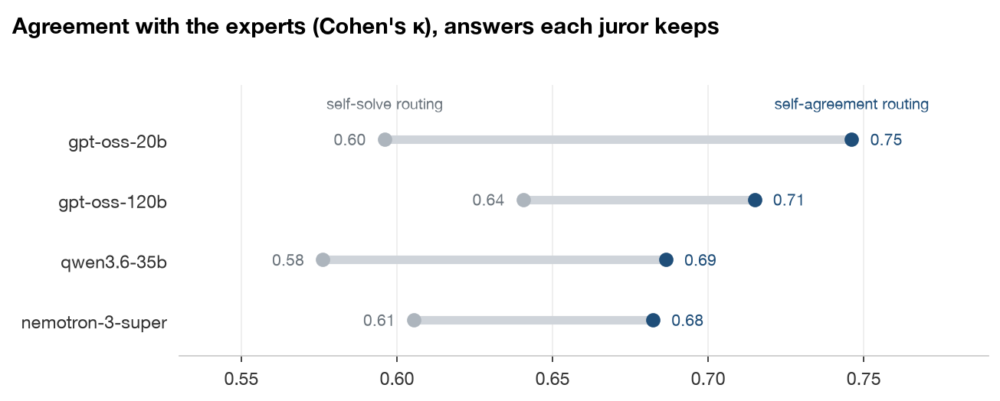
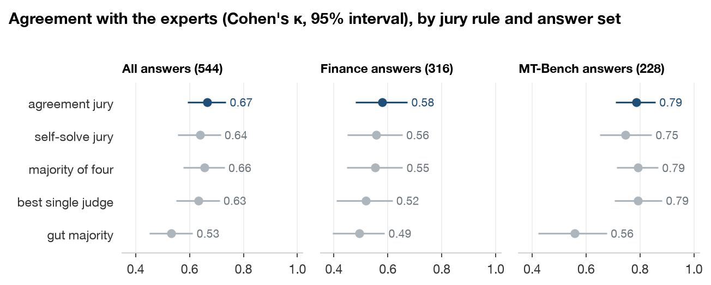
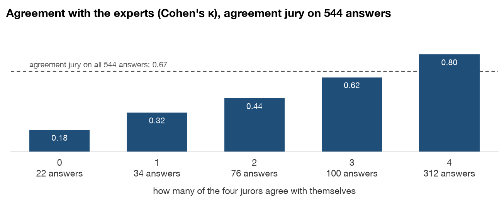
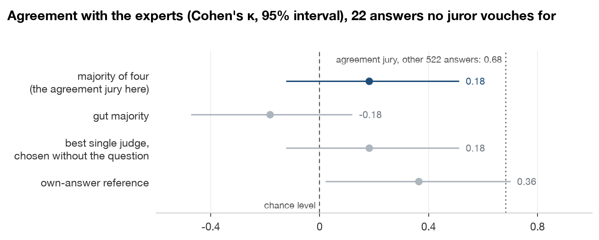

# Self-Agreement: results

Agreement is Cohen's κ against the majority expert label on 544 answers, 316 finance and 228 MT-Bench, with 95% intervals from resampling the 99 questions. Differences compare two rules on the same answers, and a missing verdict counts as a reject. Juries have the four kept jurors unless a section says otherwise. [Terms](#terms) at the end defines each name. In `results/`, shares are fractions.

## Does self-agreement beat self-solve as the trust signal?

For routing, choosing which of a juror's answers to trust, yes. Self-agreement scores higher than self-solve for all four jurors, by +0.074 to +0.150, with the interval above 0 for three ([self_agreement.py](lib/self_agreement.py)).

| Jurors | Answers kept | κ, self-solve routing | κ, self-agreement routing | κ, random 95th percentile | Self-agreement minus self-solve |
|---|---:|---:|---:|---:|---:|
| gpt-oss-20b | 365 (67.1%) | 0.596 | 0.746 | 0.627 | +0.150 (+0.063 to +0.254) |
| gpt-oss-120b | 439 (80.7%) | 0.641 | 0.715 | 0.660 | +0.074 (-0.005 to +0.159) |
| qwen3.6-35b | 406 (74.6%) | 0.576 | 0.686 | 0.648 | +0.110 (+0.037 to +0.232) |
| nemotron-3-super | 436 (80.1%) | 0.605 | 0.682 | 0.633 | +0.077 (+0.008 to +0.147) |

Each routing keeps as many answers as fall on the question turns the juror solved, and self-agreement keeps those with the least conflict. This comparison was planned, but without a decision rule. Pilot context: on Oct 23, 2026, a pilot with gpt-oss-20b alone on finance answers scored self-agreement routing κ 0.742 against 0.520 for self-solve. Self-solve stays below the random 95th percentile for every juror. Solving still matters: on the answers it did not solve, each juror scores κ 0.27 to 0.51. Inside a jury the two signals tie. The agreement jury leads the self-solve jury by +0.026 (-0.020 to +0.072), short of rule 1, which needs +0.04 with the interval above 0. Three or five jurors give the same tie. Result: [matched_coverage.csv](results/matched_coverage.csv) and [decisions.csv](results/decisions.csv).

## Does the agreement jury beat the best single judge?

No, with three, four or five jurors. With four, it leads gpt-oss-120b's reasoned read by +0.033 (-0.011 to +0.081), short of rule 2, which needs +0.03 with the whole interval above 0 ([notebook](notebook/self_agreement.ipynb), [self_agreement.py](lib/self_agreement.py)).

| Rules | 316 finance answers | 228 MT-Bench answers | All 544 answers |
|---|---:|---:|---:|
| Agreement jury | 0.579 | 0.786 | 0.666 (0.592 to 0.734) |
| Self-solve jury | 0.557 | 0.747 | 0.640 (0.557 to 0.715) |
| Majority of four | 0.554 | 0.793 | 0.655 (0.576 to 0.729) |
| Best single judge, gpt-oss-120b's reasoned read | 0.519 | 0.793 | 0.633 (0.550 to 0.711) |
| Gut majority | 0.494 | 0.557 | 0.532 (0.451 to 0.611) |
| Agreement jury minus best single judge | +0.059 (-0.005 to +0.127) | -0.007 (-0.057 to +0.046) | +0.033 (-0.011 to +0.081) |

Rule 2 also needs the jury to be no worse than the majority of four, which it is, by +0.011 (-0.033 to +0.052). On MT-Bench, every juror's reasoned read already reaches 0.74 to 0.79. The best single judge was chosen with the expert labels. Chosen again in each resample, the gain is +0.033 (-0.021 to +0.071). Result: [results_by_rule.csv](results/results_by_rule.csv) and [contrasts.csv](results/contrasts.csv).

## Does the count of jurors that agree track the experts?

Yes, in this run. The agreement jury's κ climbs from 0.182 on the answers where no juror agrees with itself to 0.804 where all four do ([self_agreement.py](lib/self_agreement.py)).

| Jurors that agree with themselves | 0 | 1 | 2 | 3 | 4 |
|---|---:|---:|---:|---:|---:|
| Answers | 22 | 34 | 76 | 100 | 312 |
| Agreement jury κ | 0.182 | 0.325 | 0.443 | 0.615 | 0.804 |
| Labelled correct | 50% | 38% | 54% | 66% | 70% |

This grouping is descriptive, has no interval and was not one of the tests set before the run. Grouped by how many jurors solved the question, the self-solve jury's κ is 0.073, 0.177, 0.636, 0.733 and 0.593 for 0 to 4, which does not climb the same way. Result: [kappa_by_juror_count.csv](results/kappa_by_juror_count.csv).

## What happens when no juror vouches for an answer?

On 22 of the 544 answers, 4.0%, no juror agrees with itself, and every fallback is weak there. A person's review is the safe default, though the run did not test one ([self_agreement.py](lib/self_agreement.py)).

| Fallbacks on the 22 answers | κ | False rejects | False accepts |
|---|---:|---:|---:|
| Majority of four, what the agreement jury uses here | 0.182 (-0.123 to 0.512) | 0.73 | 0.09 |
| Gut majority | -0.182 (-0.472 to 0.119) | 0.27 | 0.91 |
| Best single judge, chosen without the question | 0.182 (-0.123 to 0.512) | 0.73 | 0.09 |
| Own-answer reference, gpt-oss-120b's gut read | 0.364 (0.021 to 0.700) | 0.45 | 0.18 |

The 22 answers, 11 finance and 11 MT-Bench, come from 20 questions, and 50% are labelled correct, against 65% of the rest. The own-answer reference scores twice the majority's κ, but on 22 answers the two intervals overlap widely. Sending the 22 to a person keeps 96% of answers automatic, where the agreement jury scores 0.684 (0.607 to 0.755). Result: [uncovered_fallbacks.csv](results/uncovered_fallbacks.csv) and [coverage.csv](results/coverage.csv).

## Does self-agreement flag errors on questions a juror could not solve?

Partly, between the two outcomes set before the run. The conflict between a juror's two reads ranks its errors at an AUROC of 0.730 where it solved the question and 0.640 where it did not ([self_agreement.py](lib/self_agreement.py)).

| Self-solve status | Units | Questions | Error rate | AUROC |
|---|---:|---:|---:|---:|
| Solved | 1,646 | 97 | 17% | 0.730 (0.676 to 0.783) |
| Unsolved | 439 | 59 | 26% | 0.640 (0.555 to 0.721) |
| Unsolved, with an own answer | 246 | 44 | 30% | 0.669 (0.572 to 0.759) |
| Contested | 91 | 11 | 11% | 0.812 (0.625 to 0.944) |

A unit is one juror on one answer. To hold, the signal needed an AUROC of 0.65 or more on unsolved units, with a lower bound of 0.55 or more. To vanish, it needed 0.60 or less and a gap of +0.10 or more. The gap, solved minus unsolved, is +0.089 (-0.007 to +0.177), on 59 questions, and could be chance. On unsolved units, reasoned verdicts match the juror's own-answer reference about as often as the label, 0.687 against 0.703. So jurors show no sign of grading against their own answer. Result: [latent_solver.csv](results/latent_solver.csv) and [own_answer_index.csv](results/own_answer_index.csv).

## What limits the comparison?

The labels are expert majority votes, less certain where an expert dissented or was unsure. Self-solve rests on a strict, imperfect grader. On 150 finance answers, qwen3.5-397b reached κ 0.696 and kimi-k2.6 0.582, both short of the 0.80 bar. The chosen grader rejected 19 of the 81 correct answers. The hand check of 20 of its grades is still blank ([hand_check_sample.md](results/checks/hand_check_sample.md)). Two of six jurors, qwen3.5-4b and qwen3.5-9b, looped until the 6,144-token limit and were dropped, so the jury is less varied than planned ([juror_check.csv](results/checks/juror_check.csv)). κ depends on the share of kept answers labelled correct, 69% to 75% for self-solve against 64% overall. Checked after the run with no interval, the reasoned read is right on 0.858 to 0.888 of the answers self-agreement keeps, against 0.819 to 0.841 for self-solve. Each read ran once at temperature 0, and reading the first 40 answers again changed 0 to 3 reasoned verdicts per juror and 1 of the agreement jury ([duplicates.csv](results/checks/duplicates.csv)). All answers are finance or MT-Bench math and reasoning questions, so the result may not hold for other kinds.

## Terms

- **Reads.** A gut read is a one-token verdict right after "VERDICT:". Its gut margin is log P(INCORRECT) minus log P(CORRECT), so a margin below 0 accepts. A reasoned read reasons first, then gives a verdict.
- **Trust signals.** A juror agrees with itself when its two reads give the same verdict. Its conflict is its gut margin when the reasoned read accepts, and minus that margin when it rejects. A juror solved a question turn when the grader called its own answer correct and any MT-Bench answer key agreed. If the two disagree, the turn is contested. Self-solve, from No Free Labels, trusts a juror only where it solved the question.
- **Juries.** The agreement jury counts the reasoned verdicts of the jurors that agree with themselves, and the self-solve jury those of the jurors that solved the question. A tie goes to the most confident gut read. With no such juror, the majority of four decides, where a tie is a reject. AUROC is the chance a score ranks an error above a correct verdict.
- **Rules and changes.** A plan written before the run set rules 1 and 2 and the gap test, and [decisions.csv](results/decisions.csv) quotes each. The run screened two graders and six jurors, and set the juror bar at a gut AUROC of 0.60, not 0.65, which decided nothing. A juror with no reasoned verdict never agrees with itself, a choice made in the run. The plan's literal rule gives κ 0.655 instead of 0.666. [error_rankers.csv](results/error_rankers.csv) is post hoc.
