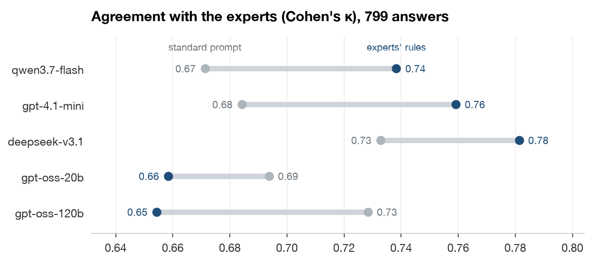
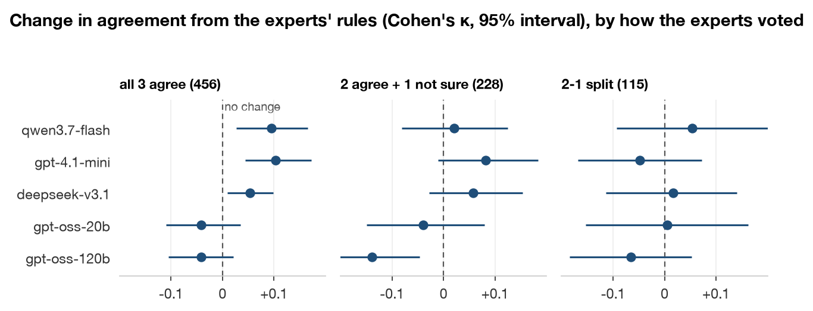
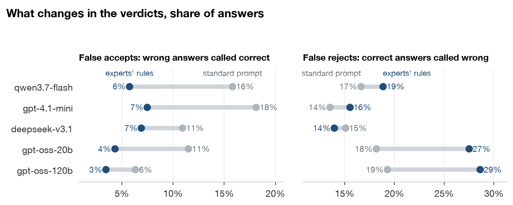
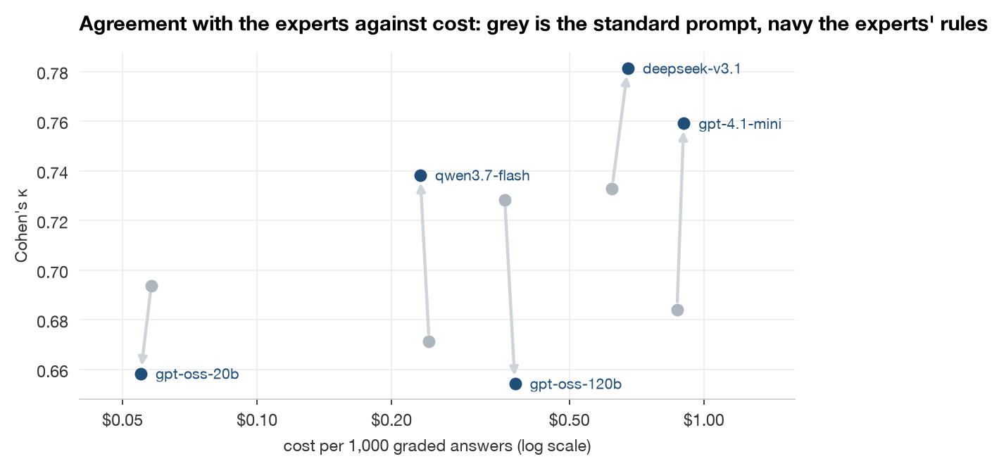

# Grading Like the Experts: results

Agreement is Cohen's κ against the majority expert label on 799 BFF-Bench answers, with 95% intervals from resampling the 79 conversations. Judges run from most to least lenient on the standard prompt. Costs are per 1,000 graded answers. In `results/`, shares are fractions.

## Do the experts' rules raise agreement?

For three of five judges, yes. qwen3.7-flash, gpt-4.1-mini and deepseek-v3.1 gain 0.049 to 0.075 with the rules, while both gpt-oss judges lose ([notebook](notebook/grading_like_experts.ipynb), [juries.py](lib/juries.py)).

| Judges | Standard prompt | Experts' rules | Change |
|---|---:|---:|---:|
| qwen3.7-flash | 0.671 | 0.738 | +0.067 (+0.01 to +0.12) |
| gpt-4.1-mini | 0.684 | 0.759 | +0.075 (+0.02 to +0.13) |
| deepseek-v3.1 | 0.733 | 0.781 | +0.049 (+0.01 to +0.09) |
| gpt-oss-20b | 0.694 | 0.658 | -0.035 (-0.09 to +0.03) |
| gpt-oss-120b | 0.728 | 0.654 | -0.074 (-0.12 to -0.03) |

Change is the rules minus the standard prompt on the same answers, with its 95% interval. Grading the same answers twice with the same prompt moves κ by 0.01. Result: [prompt_differences.csv](results/prompt_differences.csv).

## Does it hold when the experts disagreed?

The gain is clearest where all three experts agreed. On the 343 answers where one expert was unsure or dissented, no judge gains clearly above zero ([juries.py](lib/juries.py)).

| Judges | All 3 agree (456) | 2 agree + 1 not sure (228) | 2-1 split (115) |
|---|---:|---:|---:|
| qwen3.7-flash | +0.095 | +0.021 | +0.054 |
| gpt-4.1-mini | +0.104 | +0.081 | -0.048 |
| deepseek-v3.1 | +0.053 | +0.058 | +0.016 |
| gpt-oss-20b | -0.041 | -0.040 | +0.005 |
| gpt-oss-120b | -0.042 | -0.139 | -0.066 |

Change in κ, the rules minus the standard prompt. The chart draws each 95% interval. Result: [prompt_differences.csv](results/prompt_differences.csv).

## What changes in the verdicts?

The rules mostly cut false accepts. They fall to 3% to 7% for every judge, from 11% to 18% for the three lenient judges, while false rejects rise most for gpt-oss, from about 19% to 28% ([juries.py](lib/juries.py)).

| Judges | False accepts, standard | With the rules | False rejects, standard | With the rules |
|---|---:|---:|---:|---:|
| qwen3.7-flash | 15.8% | 5.7% | 16.6% | 18.8% |
| gpt-4.1-mini | 18.1% | 7.5% | 13.5% | 15.5% |
| deepseek-v3.1 | 10.9% | 6.9% | 15.1% | 14.0% |
| gpt-oss-20b | 11.5% | 4.3% | 18.2% | 27.5% |
| gpt-oss-120b | 6.3% | 3.4% | 19.3% | 28.6% |

False accepts are wrong answers called correct, and false rejects are correct answers called wrong. Result: [results_by_judge_prompt.csv](results/results_by_judge_prompt.csv).

## Can a cheap judge match the best one?

Yes, with the rules. qwen3.7-flash reaches 0.74, against 0.73 for deepseek-v3.1, the best judge on the standard prompt, at $0.23 against $0.62 per 1,000 answers ([notebook](notebook/grading_like_experts.ipynb)).

| Judges | Standard prompt | Experts' rules | κ with the rules |
|---|---:|---:|---:|
| qwen3.7-flash | $0.24 | $0.23 | 0.738 |
| gpt-4.1-mini | $0.87 | $0.90 | 0.759 |
| deepseek-v3.1 | $0.62 | $0.68 | 0.781 |
| gpt-oss-20b | $0.06 | $0.05 | 0.658 |
| gpt-oss-120b | $0.36 | $0.38 | 0.654 |

Cost per 1,000 graded answers. qwen3.7-flash and deepseek-v3.1 are what OpenRouter charged, and gpt-4.1-mini is estimated from its tokens at list price. The gpt-oss judges ran on our own GPUs, so their cost is their tokens at OpenRouter's list price on Oct 15, 2026. Result: [results_by_judge_prompt.csv](results/results_by_judge_prompt.csv).

## Why does gpt-oss lose?

It rejects correct answers over one detail that differs from the reference. On the 456 answers all three experts agreed on, gpt-oss-120b rejected 23 correct answers with the rules that it had accepted on the standard prompt. We read its reasoning for each ([gpt_oss_120b_rejections_read.csv](data/gpt_oss_120b_rejections_read.csv)).

| Why it rejected the answer | Answers | Example |
|---|---:|---|
| One point differs from the reference | 12 | Recommends the right bond, but cites a different risk than the reference |
| A number or step differs | 8 | Picks the same three bonds, but prices one at $1,038 instead of $1,028 |
| The conclusion is hedged | 2 | Recommends FRS 102, but notes when FRS 105 could also work |
| Missing information judged crucial | 1 | Explains beta correctly, but leaves out the formula |

The examples are written for readability, not quoted from the runs. Rule 2 is the one rule that tells a judge to reject an answer with the right conclusion because a step differs. Without it, both gpt-oss judges only return to about their standard-prompt agreement.

| Judges | Standard prompt | All 5 rules | Rules without rule 2 | Without rule 2 minus all 5 rules |
|---|---:|---:|---:|---:|
| gpt-oss-20b | 0.694 | 0.658 | 0.692 | +0.034 (+0.00 to +0.06) |
| gpt-oss-120b | 0.728 | 0.654 | 0.710 | +0.056 (+0.03 to +0.08) |

Result: [prompt_differences.csv](results/prompt_differences.csv).

## What limits the comparison?

The labels are the majority vote of three experts, so on the 343 answers without a unanimous vote the label itself is less certain. Each judge graded each answer once per prompt at temperature 0, and a regrade changes 7.0% of qwen3.7-flash's verdicts. All 799 answers are finance questions, and the standard prompt is one wording, so it is still open whether any careful rubric works as well and whether the result holds outside finance.
